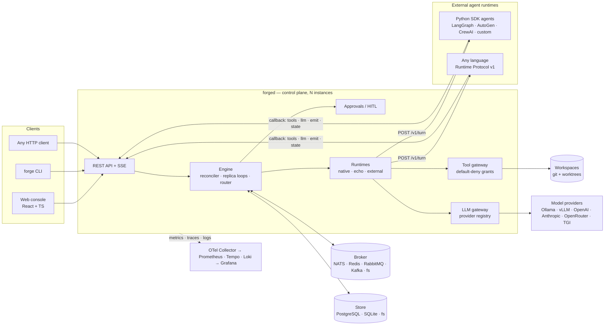

# LeForge

**An open-source, vendor-neutral Agent Factory.** Autonomous AI agents run as a
graph of continuously running loops, exchange work through durable queues, and
operate under enforced tool permissions — on a laptop, in a datacenter, or on
any cloud, with no dependency on a specific cloud provider, model vendor or
agent framework.

LeForge provides a production-grade agent orchestration platform with
pluggable brokers, storage and model providers; a framework-agnostic runtime
protocol; at-least-once delivery with deduplication; multi-instance high
availability; OpenTelemetry tracing across agents; and human-in-the-loop gates.

```bash
docker compose up        # the whole platform, offline, on one machine
```

---

## Features

| Capability | How LeForge provides it |
|---|---|
| **Graph of agents** | Nodes are agents, edges are durable channels. Cycles (review → rework loops), parallel branches and **dynamic branching** (`when:` expressions, type filters, per-message `target`) are first-class. Graph documents are versioned YAML/JSON and can be edited while running. |
| **Visual graph editor** | Add and remove agents, connect channels, edit channel routing, arrange nodes, validate, save and discard changes from the canvas. YAML remains available for advanced graph settings. |
| **Agent loops** | Every node runs `once`, `continuous`, `scheduled` (cron / `@every`) or `event`-triggered (wait for work). Stop policies: `never`, `auto` (two-turn "no further work" handshake), `iterations`, `duration`, `idle`. |
| **Message passing** | One envelope `{id, type, source, target, payload, metadata}` with correlation/causation ids, hop counter and W3C trace context in metadata. |
| **Queue semantics** | `queue` (point-to-point, competing consumers), `topic` (pub-sub by name, wildcard subscriptions), `fanout` (copy per target node), `broadcast` (copy per replica). |
| **Clusters** | N replicas per node, fixed or **autoscaled** on backlog, isolated or **ring** communications. Replicas compete over the same queue. |
| **Tool permissions** | Default-deny capability grants (`filesystem.read`, `shell.exec`, `git.write`, `http.fetch`, …) narrowed by paths, commands, hosts and rate limits; optional per-tool human approval. Enforced in a gateway the agent cannot bypass. |
| **Isolation** | Process sandbox, Docker sandbox per replica (no network by default), Kubernetes deployment; per-replica git worktrees. External agents hold no credentials. |
| **Persistence & recovery** | Graphs, versions, executions, messages, approvals, state, events and leases are stored in SQLite / PostgreSQL / filesystem. Unacked messages are redelivered; a crashed instance's replicas are taken over when its leases expire. |
| **Pluggable everything** | Brokers: NATS JetStream (default), Redis Streams, RabbitMQ, Kafka, filesystem, memory. Storage: SQLite, PostgreSQL, filesystem. Models: Ollama, vLLM, OpenAI-compatible, Anthropic-compatible, OpenRouter, HuggingFace TGI, offline mock. Runtimes: native Go agent, echo, external (LangGraph, AutoGen, CrewAI, custom — any language). |
| **Observability** | Prometheus metrics, OpenTelemetry traces that follow a message across agents and brokers, OTLP logs, Grafana dashboard and alerts, full message history with causal chains, live event stream, graph visualisation. |
| **Human in the loop** | Approval gates on channels, turns, outputs and tools; agents can ask a human a question; pause/resume of graphs and nodes; operator chat with running agents; message injection. |
| **Workspace inspection** | Browse graph workspaces and read agent-produced files in the console; user-side workspace editing and uploads are not exposed. |

## macOS setup with Colima

If you already have Docker with Compose working, skip to the
[Quickstart](#quickstart-60-seconds). Otherwise, Colima can run the Docker
engine in a Linux VM on your Mac, without Docker Desktop.

With [Homebrew](https://brew.sh/) installed, install Colima and the Docker
client and plugins:

```bash
brew install colima docker docker-compose docker-buildx

mkdir -p ~/.docker/cli-plugins
ln -s "$(brew --prefix)/opt/docker-compose/bin/docker-compose" \
  ~/.docker/cli-plugins/docker-compose
ln -s "$(brew --prefix)/opt/docker-buildx/bin/docker-buildx" \
  ~/.docker/cli-plugins/docker-buildx
```

If a plugin link already exists, check it before replacing it.

On Apple Silicon with macOS 13 or newer, start the VM with Apple's
virtualization framework and VirtioFS file sharing:

```bash
colima start --runtime docker --vm-type vz --mount-type virtiofs \
  --cpus 4 --memory 8 --disk 100
```

The 4 CPUs, 8 GiB of RAM and 100 GiB virtual disk are suggested starting
settings for LeForge, not minimum requirements. Adjust them to your machine;
local models need additional resources. On other supported Macs, use
`colima start --runtime docker --cpus 4 --memory 8 --disk 100`.

Verify the engine, plugins and a test container:

```bash
colima status
docker info
docker compose version
docker buildx version
docker run --rm hello-world
```

Initial setup and image downloads need internet access. Use `colima stop`
to stop the VM and `colima start` to restart it with its saved settings.
Then continue below to create LeForge's `.env` and start the platform.
See the official [installation](https://colima.run/docs/installation/) and
[configuration](https://colima.run/docs/configuration/) guides for details.

## Quickstart (60 seconds)

Requirements: Docker with Compose v2.

```bash
git clone <this repository> leforge && cd leforge
for name in LEFORGE_ADMIN_TOKEN LEFORGE_RUNTIME_SECRET POSTGRES_PASSWORD GRAFANA_ADMIN_PASSWORD; do
  printf '%s=%s\n' "$name" "$(openssl rand -hex 32)"
done > .env
chmod 600 .env
docker compose up -d --build
```

1. Open the console at <http://localhost:8080> and sign in with the token
   generated for `LEFORGE_ADMIN_TOKEN` in `.env`. Grafana is at
   <http://localhost:3000>; its admin password is generated into the same file.
2. Two example graphs start automatically: `hello-echo` (zero-cost echo agents)
   and `software-factory` (planner → researcher → developer cluster → reviewer →
   QA → human release gate → integrator).
3. Inject a feature request:

   ```bash
   set -a; . ./.env; set +a
   curl -s -X POST localhost:8080/api/v1/graphs/software-factory/channels/requests/messages \
     -H "Authorization: Bearer $LEFORGE_ADMIN_TOKEN" -H 'Content-Type: application/json' \
     -d '{"type":"feature.request","payload":{"title":"slugify","description":"Add a slugify(text) helper. It lowercases text and joins words with dashes."}}'
   ```

   or with the CLI shipped in the image:

   ```bash
   set -a; . ./.env; set +a
   docker compose exec -e LEFORGE_TOKEN="$LEFORGE_ADMIN_TOKEN" forged \
     forge inject software-factory requests feature.request '{"title":"slugify","description":"Add slugify(text)."}'
   ```

4. Watch the work move on the canvas, then approve the release in the
   **Approvals** view (or `forge approvals` / `forge approve <id>`).

Out of the box the platform uses the deterministic **mock** model provider, so
everything works with no model and no Internet. Switch to a real model with
`docker compose --profile ollama up -d` and `LEFORGE_DEFAULT_PROVIDER=ollama`,
or reuse an Ollama installed on your machine with
`OLLAMA_BASE_URL=http://host.docker.internal:11434` — see
[Getting started](docs/getting-started.md#ollama-installed-on-the-host).

## Architecture



The engine is a **reconciler**: desired state lives in storage, every instance
takes leases on the replicas it runs, and agents never touch the broker, the
model keys or the host directly — they reach the world only through the tool
and LLM gateways, under their node's grants.

## Repository layout

| Path | Contents |
|---|---|
| `server/` | Go module: `cmd/forged` (control plane), `cmd/forge` (CLI), `internal/*` (domain, engine, graph, queue, storage, llm, tools, runtime, api, hitl, events, observability) |
| `web/` | React + TypeScript console |
| `sdk/python/` | Python Agent SDK (`leforge`), framework adapters |
| `agents/` | Example agents: planner, researcher, developer, reviewer, QA |
| `examples/graphs/` | Example graphs |
| `deploy/` | Container config, observability stack, Kubernetes manifests |
| `docs/` | Architecture, operations and reference documentation |

Full tree: [docs/folder-structure.md](docs/folder-structure.md).

## Documentation

- [Getting started](docs/getting-started.md) — install, model providers, first graph, running without Docker
- [Architecture](docs/architecture.md) — C4 views, domain model, state machines, sequences, queue and execution model
- [Security model](docs/security.md) — threat model, tool permission model, isolation
- [Sandbox runtime](docs/sandbox-runtime.md) — agent commands in containers on a Docker daemon dedicated to LeForge
- [Project environments](docs/environments.md) — the toolchain image agents run in, built from the console
- [Configuration reference](docs/configuration.md)
- [Deployment](docs/deployment.md) — single node, HA, Kubernetes, backup, upgrades, air-gapped
- [Production hardening](docs/production-hardening.md)
- [Extensibility](docs/extensibility.md) — providers, brokers, stores, runtimes, tools, sandboxes, agents in any language
- [API and protocol contracts](docs/dev/contracts.md), OpenAPI in `api/`
- [Architecture decision records](docs/adr/)
- [Python SDK](sdk/python/README.md), [example agents](agents/README.md), [web console](web/README.md)

## Status and limitations

LeForge is young. What works is tested (adapter conformance suites against real
NATS, Redis, RabbitMQ, Kafka and PostgreSQL; engine end-to-end tests including
failover; an end-to-end compose run). Known gaps:

- **No MCP bridge yet.** MCP tools can be integrated through the tool registry.
- **Kubernetes tool sandbox is an extension point.** On Kubernetes, tools run in
  the (restricted) control-plane container; per-replica tool pods would be a
  `SandboxFactory` implementation. Docker isolation needs the Docker socket.
- **No streaming LLM output.** Agent narration appears per model round, not per token.
- **Process sandbox is not a security boundary** against a granted, unrestricted
  shell; use Docker isolation or a sandboxed container runtime for untrusted work.
- Lease expiry uses instance clocks: keep instances NTP-synchronised.
- The filesystem broker and store are meant for development and small single-node installs.

## License

Apache License 2.0 — see [LICENSE](LICENSE) and [NOTICE](NOTICE). LeForge is an
an independent open-source project.
