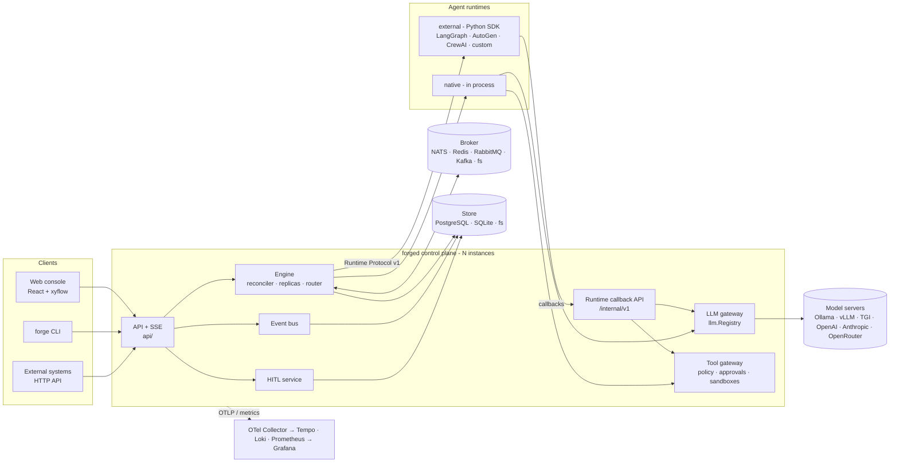

# LeForge Architecture

LeForge is a self-hosted, vendor-neutral **agent factory**. Autonomous AI agents run as a graph of continuously running loops that exchange work through durable, observable channels. This document is the master reference. The detail lives in:

| Document | Contents |
|---|---|
| [diagrams/c4.md](diagrams/c4.md) | C4 context, container, component and deployment views |
| [diagrams/sequences.md](diagrams/sequences.md) | Sequence diagrams for the main runtime interactions |
| [domain-model.md](domain-model.md) | Entities, fields, invariants, the message envelope |
| [state-machines.md](state-machines.md) | Graph, replica, execution, message and approval state machines |
| [execution-model.md](execution-model.md) | Loop modes, turns, delivery guarantees, clusters, routing, isolation |
| [dev/contracts.md](dev/contracts.md) | HTTP API and Runtime Protocol v1 (wire contracts) |
| [product-contracts.md](product-contracts.md) | Current-state inventory and design contracts for planned Release 1 capabilities |

---

## 1. Purpose and scope

**In scope.** LeForge provides:

- a declarative graph model: nodes are agents, edges are channels;
- an engine that runs each node as one or more long-lived loops (replicas);
- durable message passing with queue, topic, fan-out and broadcast semantics;
- tool execution under an enforced permission model;
- human-in-the-loop gates;
- persistence of everything needed to recover after a restart;
- full observability (metrics, traces, logs, message lineage);
- a web console and a CLI.

**Out of scope.** LeForge does not provide:

- an agent framework. It runs any framework through a runtime protocol;
- model hosting. It calls model servers through a provider abstraction;
- a general-purpose workflow engine with deterministic replay (Temporal-style). Agent turns are non-deterministic by nature, and LeForge recovers by *redelivery*, not *replay*.

**Hard constraints.**

- No cloud services, no proprietary runtimes, no vendor APIs on the critical path.
- The whole platform runs with `docker compose up` on Linux, macOS or Windows.
- After images are pulled, it runs without Internet access: the `mock` provider stands in for a model, and Ollama or TGI serve local weights.

## 2. Core concepts

LeForge defines workflows as versioned graph documents. Nodes describe agents,
their model and runtime configuration, tool grants, and execution policies.
Channels connect nodes and provide durable queue, topic, fan-out, and broadcast
semantics. The engine claims messages, invokes the configured runtime, routes
outputs, and acknowledges inputs only after publication.

Each turn is bounded by configured time, token, and tool-call limits. Tool
access is enforced by a default-deny gateway; model credentials and broker
access remain in the control plane. Human approvals can gate turns, tool calls,
and message publication.

| Workflow concept | LeForge implementation |
| `queue`, `topic`, `fanout`, `broadcast` channel types | Consumer groups | `graph.ConsumerGroups` |
| Fixed and autoscaled clusters | `cluster.mode: fixed / autoscale` | `engine/graphrun.go` |
| Ring communication | Durable broadcast lines in the store | `engine/turn.go` (`putBroadcast`, `neighbours`) |
| Run modes and stop policies | `loop.mode` × `stop.policy` | `engine/replica.go` |
| `NO FURTHER WORK:` / `CONFIRM STOP:` handshake | Same two-turn handshake, signalled through a `finish` tool or text sentinels | `engine/turn.go`, `runtime/native` |
| Tool grants | Capability grants with path/command/host constraints, default deny, gateway-enforced | `tools/policy.go`, `tools/gateway.go` |
| `@input`, `@output`, `@project`, `@loop`, parameters | Same tokens; `@workspace` aliases `@project`; parameters are substituted per turn | `graph.Substitute`, `engine/prompt.go` |
| Own checkout (worktree per session) | `workspace.mode: worktree`, one git worktree and branch per replica | `workspace/workspace.go` |
| Operator chat to a loop | Operator messages that wake a replica | `engine/control.go` |
| Human approvals | Approval gates on tools, turns, channels and node emits; `human.ask` | `hitl/`, `engine/publish.go` |
| `LOOP_DRIVER=echo` | `runtime.kind: echo` | `runtime/echo` |
| Loopback-only server with a per-start token | Bearer tokens with roles, optional OIDC | `api/auth.go` |
| Output log per loop | Event log (durable, SSE), OTel traces, Prometheus metrics, message history | `events/`, `observability/` |

The engine claims work rather than delegating broker operations to agents.
Deliveries are leased and redelivered when a turn fails before acknowledgement.

### Planned Release 1 boundaries

The current architecture does not yet implement managed MCP connections,
application-managed skills/project steering, first-class user tasks, or
dynamic child executions. Their proposed API, persistence, authorization,
audit, and failure contracts are documented in
[product-contracts.md](product-contracts.md). The target component view there
is explicitly planned and must not be read as a description of deployed
components.

## 3. Architectural principles and how they are enforced

| Principle | Enforcement |
|---|---|
| **Vendor neutral** | Each external dependency is reached through one interface: `queue.Broker`, `storage.Store`, `llm.Provider`, `runtime.Runtime`, `tools.Sandbox`. Concrete adapters are wired only in the composition root `internal/app`. No package outside an adapter imports a vendor SDK. |
| **Local first** | `config.Default()` uses SQLite, filesystem queues and the `mock` provider: no services at all. The compose stack adds NATS, PostgreSQL and the observability stack, all as open-source images. Telemetry failures never stop startup (`app.New` falls back to stdout logging). |
| **LLM provider agnostic** | `llm.Provider` has three methods (`Name`, `Chat`, `Models`). A new backend is one `RegisterType` call. Agents never hold model credentials; external agents call the platform's `/llm/chat` callback. |
| **Storage independent** | One `storage.Store` interface with filesystem, SQLite and PostgreSQL adapters. All three pass the same conformance suite (`storage/conformance`). |
| **Queue independent** | One `queue.Broker` interface with memory, filesystem, NATS JetStream (default), Redis Streams, RabbitMQ and Kafka adapters. All pass `queue/conformance`, and the four networked adapters were run live against real servers. |
| **Runtime independent** | The engine owns the loop. A `Runtime` only turns `TurnInput` into `TurnResult`. LangGraph, AutoGen, CrewAI and custom code plug in through Runtime Protocol v1 (`sdk/python/leforge/adapters`). |
| **Declarative and recoverable** | Desired state (graph, node overrides, replica counts) lives in the store, and a reconciler converges reality onto it. Every instance is stateless apart from the replicas it is currently running. |

## 4. System overview



There is one binary, `forged` (`cmd/forged`), which contains the API, the engine and both gateways. You scale it horizontally by running several instances against the same store and broker. Python agents run in a separate process or container (`agents/`) and hold no credentials.

## 5. Subsystems

### 5.1 Graph model, validation and routing (`internal/graph`)

**Responsibilities**

- Normalise defaults (`Normalize`). For example, a node with inputs defaults to `event` mode.
- Validate documents (`Validate` returns a `Report` of errors and warnings with JSON paths).
- Derive the broker topology: `ConsumerGroups` and `SubjectGroups`.
- Compile and evaluate routing conditions (`CompileCondition`, `Router.Route`).
- Parse schedules (`ParseSchedule`, cron and `@every`).
- Substitute parameters into prompts (`Substitute`).

```go
func Validate(g *domain.Graph, knownRuntimes map[domain.RuntimeKind]bool) *Report
func ConsumerGroups(g *domain.Graph, nodeID string, replica int) []Group
func SubjectGroups(g *domain.Graph, c *domain.Channel, replicas func(node string) int) []string
func NewRouter(g *domain.Graph) (*Router, error)
func (r *Router) Route(node string, m *domain.Message, channel string) RouteResult
```

**Trade-offs and decisions**

| Decision | Alternatives | Why | Consequences |
|---|---|---|---|
| Channel semantics are expressed through **consumer groups on one subject** (queue = 1 group; topic and fan-out = 1 group per node; broadcast = 1 group per replica). | A separate broker queue per edge; push fan-out done by the engine. | A single primitive that every broker supports natively (JetStream consumers, Redis consumer groups, Kafka groups, RabbitMQ queues bound to one key). Competing consumers inside a group come for free. | Groups must be **declared before publish**, so the engine declares the topology on every save, start, scale and injection. Broadcast with autoscale declares `maxReplicas` groups. |
| Conditions use **expr-lang** over `{type, source, target, payload, metadata}`. | CEL, JavaScript, Go templates. | Pure Go, type-checked at validation time, no I/O, bounded execution. | An evaluation error makes the branch false and is visible as `dropped` with a reason. Expressions cannot call out. |
| **Cycles are legal** and bounded by `spec.maxHops` (default 64). | Reject cycles (DAG only). | Review/rework loops *are* cycles. | Runaway loops become visible drops (`reason=hop_limit`) instead of infinite traffic. |
| Unset parameters keep their `@token`. | Substitute an empty string. | Avoid silently dropping a required value. | The preamble tells the agent which parameters are unset. |

### 5.2 Engine, reconciler and leases (`internal/engine`)

**Responsibilities**

- Turn stored graphs into running replicas.
- Keep the actual state converging on the desired state.
- Coordinate several instances.

Every `ReconcileInterval` (default `LeaseTTL/4`) each instance performs these steps:

1. List graph records; load the referenced graph version.
2. For each node, compute the desired replica count (`desiredReplicas`): fixed count, the operator's scale override, or the autoscale backlog clamped to `[min,max]`.
3. For each wanted replica, renew the lease if this instance runs it. Otherwise try `AcquireLease`; on success, mark the previous owner's in-flight executions `interrupted` and start the replica.
4. Stop surplus replicas. Autoscaled replicas are stopped only after being idle for `scaleDownAfter`.
5. Sweep expired approvals.

```go
type Options struct {
    Instance string; Store storage.Store; Broker queue.Broker; Bus *events.Bus
    Approvals *hitl.Service; Models Models; Tools ToolGateway
    Runtimes map[domain.RuntimeKind]runtime.Runtime; Workspaces *workspace.Manager
    Sandboxes SandboxFactory; CallbackURL string
    LeaseTTL, ReconcileInterval, RetryBackoff time.Duration; MaxConcurrentTurns int
}
func (e *Engine) SaveGraph(ctx, g *domain.Graph, expectedVersion int, actor string) (*domain.Graph, *domain.GraphRecord, error)
func (e *Engine) GraphAction(ctx, id, action, actor string) error // start|stop|pause|resume|kill
func (e *Engine) NodeAction(ctx, id, node, action, actor string) error
func (e *Engine) Scale(ctx, id, node string, replicas int, actor string) error
func (e *Engine) Inject(ctx, graphID, channel, typ string, payload json.RawMessage, target string, meta map[string]any, actor string) (*domain.Message, error)
func (e *Engine) SendOperatorMessage(ctx, id, node string, replica int, text, actor string) (*domain.OperatorMessage, error)
func (e *Engine) Status(ctx, id string) (*GraphStatus, error)
```

Per-node operator overrides (stopped, paused, replica count) and per-run completion markers are stored in KV namespace `_control/<graph>`, so they survive restarts and are shared by all instances.

**Trade-offs and decisions**

| Decision | Alternatives | Why | Consequences |
|---|---|---|---|
| A **level-triggered reconciler** over a desired state held in the store. | Imperative start/stop RPCs; an external orchestrator (Kubernetes controller, Temporal). | Restart recovery and multi-instance operation are the same code path. Nothing to replay. | Actions take effect within one reconcile interval (`Nudge()` makes it immediate locally). |
| **Per-replica leases in the store** (`AcquireLease` compare-and-set with a TTL). | Consensus (Raft/etcd); broker-native locks; a single leader that assigns work. | No extra infrastructure. Works on PostgreSQL, SQLite and the filesystem. Failover is automatic. | Failover latency is at most `LeaseTTL` (default 20s). Clock skew between instances must be well below the TTL (use NTP). A paused instance that loses its lease stops the replica on its next renewal attempt; a turn may overlap the new owner's turn for up to one reconcile interval. Duplicate effects are then contained by message deduplication. |
| **Live adoption of a new graph version.** Behavioural changes (prompt, model, tools, loop, approvals) apply on the next turn. Structural changes (runtime, isolation, workspace, comms) restart the replica gracefully. | Always restart; never apply to a running graph. | Separates structural settings from per-turn behavior. | Editing a prompt never interrupts a turn in flight. |
| **A start is a new run** (`RunID`): node stops and completion markers are reset. | Persist completion forever. | "Run all" means all; a completed auto-stop loop can run again. | Completion is evaluated per run id. |

### 5.3 Replica loop and turns (`engine/replica.go`, `engine/turn.go`)

One goroutine per replica:

- **Setup:** workspace (shared or worktree), sandbox, `Runtime.Prepare`, one subscription per consumer group.
- **Loop:** check the stop policy → wait while paused → consume operator messages → claim inputs according to loop mode → run a turn → back off on failure → pace (`interval`).

A **turn** consists of:

1. Acquire the global turn semaphore.
2. Open an `agent.turn` span. Its parent is the first input's `traceparent`; any other inputs are attached as span links.
3. Create the `Execution` record and record the deliveries.
4. Extend the input leases periodically.
5. If `approval.beforeTurn` is set, wait for a human.
6. Build `TurnInput`, including the platform preamble from `prompt.go`.
7. Call the runtime.
8. On success, route and publish the emits, then ack the inputs, then `MarkProcessed`. On failure, nack the inputs with exponential backoff, or `Term` (dead-letter) them at `maxDeliver`.
9. Apply the auto-stop handshake and the ring broadcast.

See [execution-model.md](execution-model.md).

**Trade-offs and decisions**

| Decision | Alternatives | Why | Consequences |
|---|---|---|---|
| **Pull-based claiming** (`Subscription.Fetch`). | Push subscriptions with buffers. | Natural back-pressure; a busy replica never hoards messages. | Event-mode replicas poll with a 2s wait; latency is sub-second on JetStream and Redis, up to about 500ms on the filesystem broker. |
| **Ack after publish.** | Ack before the turn (at-most-once); transactional outbox. | Never lose work. Brokers do not share a transaction with the store. | At-least-once delivery. Consumers deduplicate with history plus `MarkProcessed` (see §5.9). |
| **Graceful stop** lets the turn finish; **kill** cancels it. | Only kill. | A turn in flight has claimed inputs and side effects. | Stopping can take up to `limits.turnTimeout` (default 30m). The kill path exists for this. |
| A **fresh session per turn**; memory lives in the workspace, the scratch dir and the KV state. | A long-running chat context. | Bounded context and crash-safe recovery. | Agents must write down what they want to remember (`state_set`, files). |

### 5.4 Runtimes (`internal/runtime`)

```go
type Runtime interface {
    Kind() domain.RuntimeKind
    Turn(ctx context.Context, in *TurnInput, env TurnEnv) (*TurnResult, error)
    Prepare(ctx context.Context, rc ReplicaContext) error
    Release(ctx context.Context, rc ReplicaContext) error
}
type TurnEnv interface { // the only doors out of an agent
    InvokeTool(ctx, name string, args json.RawMessage) (*tools.Result, error)
    Chat(ctx, req *llm.ChatRequest) (*llm.ChatResponse, error)
    Emit(ctx, e Emit) error
    StateGet(ctx, key string) ([]byte, error); StatePut(ctx, key string, value []byte) error
    Output(ctx, text string)
    AskHuman(ctx, question string) (string, error)
}
```

| Kind | Implementation | Notes |
|---|---|---|
| `native` | `runtime/native`: tool-calling loop (≤40 model rounds). Adds the platform tools `emit`, `state_get`, `state_set` and `finish` to the granted tools. Parses text sentinels for models without tool calling. | No framework and no extra process. |
| `external` | `runtime/external`: `POST {endpoint}/v1/turn` (Runtime Protocol v1). The endpoint is either preconfigured (compose service, Kubernetes Service), a child process (`command`, process isolation), or a container (`image`, docker isolation). Launched runtimes are shared per node and reference-counted. | The agent reaches the platform only through `callback.url` with a token scoped to one execution. |
| `echo` | `runtime/echo`: forwards inputs to outputs; a source node emits `tick`. | Zero-cost topology testing. Config keys: `type`, `fail`, `stopAfter`. |

The Python SDK (`sdk/python/leforge`) implements the server side of the protocol using only the standard library. Its adapters are `LangGraphAgent`, `AutoGenAgent` and `CrewAIAgent`, imported lazily. Example agents live in `agents/leforge_agents`.

**Trade-offs and decisions**

| Decision | Alternatives | Why | Consequences |
|---|---|---|---|
| A **stateless request/response protocol per turn**, with callbacks for tools and models. | gRPC streaming; agents consuming the broker directly; an embedded Python interpreter. | Language-neutral; agents hold no credentials; delivery guarantees stay in the engine; one agent process can serve any number of replicas. | A per-turn HTTP round trip, and agents need network reachability to `InternalURL`. With several instances, each must advertise its *own* internal URL, because the execution token registry is in memory. |
| **Kubernetes isolation requires an explicit `endpoint`.** `forge k8s render` emits a Deployment and Service for nodes with an image. | The engine creating pods. | Avoids giving the control plane cluster-admin-like RBAC. | Per-node runtime pods are deployed by GitOps or Helm, not by the engine. Engine-managed pods are an extension point. |

### 5.5 LLM gateway (`internal/llm`)

```go
type Provider interface {
    Name() string
    Chat(ctx context.Context, req *ChatRequest) (*ChatResponse, error)
    Models(ctx context.Context) ([]ModelInfo, error)
}
func RegisterType(typ string, f Factory)
func NewRegistry(cfgs []ProviderConfig, defaultName string) (*Registry, error)
func (r *Registry) Resolve(ref domain.ModelRef) (Provider, string, error)
func (r *Registry) Chat(ctx context.Context, providerName string, req *ChatRequest) (*ChatResponse, error)
```

**Provider types:** `openai`, `vllm`, `lmstudio`, `anthropic`, `ollama`, `openrouter`, `huggingface`/`tgi`, `mock`.

**What `Registry.Chat` adds:** a per-provider concurrency semaphore, Prometheus metrics, and an `llm.chat` span with `gen_ai.*` attributes.

**What the shared HTTP client adds:** retries with jitter on 429, 408, 5xx and network errors, honouring `Retry-After`.

**Key resolution:** API keys come from `apiKeyEnv` or `apiKeyFile`, never from the config body. Well-known variables (`OLLAMA_BASE_URL`, `OPENAI_API_KEY`, `ANTHROPIC_API_KEY`, `OPENROUTER_API_KEY`, `VLLM_BASE_URL`, `HF_BASE_URL`) register a provider automatically (`config.applyEnv`).

Tool names travel to vendors as `filesystem__read` (`WireToolName`), because vendor function names cannot contain dots.

**Trade-offs and decisions**

| Decision | Alternatives | Why | Consequences |
|---|---|---|---|
| A **minimal common denominator** (chat with tools and a JSON-mode flag). | Expose every vendor feature. | Adding a provider is one file. Graphs stay portable. | Vendor features such as prompt caching and vision are not modelled yet. JSON mode on Anthropic and TGI is only a prompt instruction, so callers must still parse defensively. |
| **No streaming.** | Server-sent token streams to the UI. | Simplicity. Agents act on complete responses. | Narration appears per model round, not per token. Streaming is roadmap. |
| A **`mock` provider by default**. | Require a model to start. | `docker compose up` must work offline. | Example agents fall back to deterministic heuristics when the mock returns `{"mock":true,...}`. |

### 5.6 Tool gateway and permission model (`internal/tools`)

There is one enforcement point for native and external agents alike:

```go
func Builtin(cfg BuiltinConfig) *Registry
func NewGateway(reg *Registry, approver Approver, auditor Auditor) *Gateway
func (g *Gateway) Invoke(ctx context.Context, p *Principal, name string, args json.RawMessage) (*Result, error)
func (r *Registry) Schemas(p *Principal) []llm.ToolSchema // only granted tools are shown to the model
```

**How a call is handled:**

1. **Authorise, default deny.** A grant matches a tool by tool name or by capability, using globs (`git.*`, `*`). When several grants match, they are merged permissively: a call is allowed if any one of them would allow it, and approval is required only if every matching grant requires it.
2. **Rate-limit** with a per-node token bucket.
3. **Approval:** if required, block on `hitl`.
4. **Execute** with constraints:
   - `paths`: `**` globs checked against a jail resolved through symlinks;
   - `commands`: argv allowlist; a command string containing shell metacharacters is rejected when the grant is constrained;
   - `hosts`: allowlist, plus an SSRF guard against private, loopback and metadata IPs.
5. **Audit and measure:** `tool.invoked`/`completed`/`denied` events, metrics, and a `tool.<name>` span. Tool failures are returned to the model as `IsError` results; only refusals are Go errors.

| Capability | Tools |
|---|---|
| `filesystem.read` | `filesystem.read`, `.list`, `.search`, `.stat` |
| `filesystem.write` | `filesystem.write` (atomic), `.edit`, `.move`, `.mkdir` |
| `filesystem.delete` | `filesystem.delete` |
| `shell.exec` | `shell.exec` |
| `git.read` | `git.status`, `.diff`, `.log`, `.show`, `.branches` |
| `git.write` | `git.add`, `.commit`, `.branch`, `.checkout`, `.merge` |
| `http.fetch` | `http.fetch` |
| `human.ask` | `human.ask` |

The **sandboxes** are:

- `ProcessSandbox`: working directory confined, scrubbed environment, process-group kill on timeout, capped output;
- `DockerSandbox`: one container per replica, `--network none`, `--cap-drop ALL`, `no-new-privileges`, workspace bind-mounted.

**Trade-offs and decisions**

| Decision | Alternatives | Why | Consequences |
|---|---|---|---|
| **Gateway-side execution.** Agents never touch the host. | Agent-side tools with advisory permissions. | A single audit and enforcement point, independent of the agent framework. | Every tool call is a function call inside `forged` (native) or an HTTP callback (external). |
| **Capability grants** instead of per-tool lists. | Tool lists only. | A grant survives new tools being added within a capability, and is readable by humans. | `filesystem.read` grants list, search and stat as well. |
| **Process sandbox by default.** | Docker by default. | Works everywhere without the Docker socket. | The process sandbox does **not** confine syscalls: an unrestricted `shell.exec` can read outside the workspace. Use docker isolation or constrained `commands` for untrusted work. Docker isolation needs the Docker socket, which is root-equivalent on the host. |
| **MCP** | — | — | MCP tool connections are managed by the user and exposed through the tool registry. |

### 5.7 Human in the loop (`internal/hitl`)

```go
func (s *Service) Create(ctx, a *domain.Approval) (*domain.Approval, error)            // non-blocking (held messages)
func (s *Service) RequestApproval(ctx, a *domain.Approval) (*domain.Approval, error)   // blocking (tools, turns, questions)
func (s *Service) Decide(ctx, id string, approve bool, by, comment, answer string) (*domain.Approval, error)
func (s *Service) OnDecision(h DecisionHook)
```

The gates are:

| Gate | Kind | Blocking |
|---|---|---|
| Tool grants with `requiresApproval` | `tool` | yes |
| `approval.beforeTurn` | `turn` | yes |
| `channel.approval` and `approval.beforeEmit` | `message` | no: the message is held; on approval it is published, optionally with an edited payload from `answer` |
| `human.ask` and `AskHuman` | `question` | yes |

Other operator controls are pause/resume (graph and node), operator messages, and message injection.

**Trade-offs and decisions.**

- **Approvals are durable records.** `DecideApproval` succeeds only while the approval is pending, so two humans clicking at once cannot both win.
- **Waiters use a local channel plus polling the store every 2s,** so a decision taken on another instance is observed.
- **Timeouts follow `onTimeout`** (reject by default).
- **Held messages do not block the producing replica.** The decision hook publishes them on whichever instance receives the decision.

### 5.8 Event bus and persistence (`internal/events`, `internal/storage`)

Every fact is appended to the event log *before* it is fanned out: graph lifecycle, replica state, execution, message movement, tool calls, approvals and agent narration. Live subscribers (SSE) **tail the log by sequence number** and are only *woken* by local publishes. This makes the stream correct across instances and resumable with `Last-Event-ID` or `?after=`. A nil-event heartbeat is sent every 15s.

`storage.Store` persists:

- graph versions with optimistic concurrency;
- graph records (desired/actual state);
- events;
- message history, one row per (message, channel, group);
- processed markers (dedupe);
- executions, approvals and operator messages (consume-once);
- replica status;
- KV (agent state, control overrides, ring lines);
- leases.

| Adapter | Use | Notes |
|---|---|---|
| `sqlstore` (SQLite) | single node (default outside compose) | WAL, one pooled connection, `BEGIN IMMEDIATE` |
| `sqlstore` (PostgreSQL) | multi-instance, compose default | embedded migrations under an advisory lock; event appends serialised so that seq order matches commit order |
| `fsstore` | zero dependencies | JSON files + JSONL segments, crash-safe writes, `LOCK` file |

**Trade-offs and decisions**

| Decision | Alternatives | Why | Consequences |
|---|---|---|---|
| **Store-tailing SSE.** | Broker-based fan-out; in-memory only. | Multi-instance correctness and exact resume with no extra infrastructure. | One store read per wake-up or second per subscriber. Narration-heavy graphs grow the log, so prune old events (`engine.eventRetention` is defined but pruning is roadmap). |
| **Recovery by redelivery, not replay.** | Event sourcing with deterministic replay. | LLM turns are non-deterministic; replaying them is meaningless. | The event log explains what happened; the broker and store hold the state needed to continue. |
| **Best-effort history writes.** | Fail delivery if history fails. | Observability must not stop work. | History can have gaps under store outages, and the duplicate pre-check depends on it (see the limitations). |

### 5.9 API and SSE (`internal/api`)

- `/api/v1`: REST over Go 1.22 pattern routing. Roles are `viewer`, `operator` and `admin`.
- Authentication: static tokens compared by SHA-256 digest in constant time, plus optional OIDC (RS256/ES256 via JWKS).
- Errors are `{error, code, details}`.
- `/api/v1/events/stream` (SSE) also accepts `?access_token=`, for GET requests only.
- `/internal/v1/executions/{id}/...` is the runtime callback API, authenticated with the per-execution token.
- `/healthz` and `/readyz` (checks store and broker), and `/metrics` (unauthenticated by default; set `server.protectMetrics` / `LEFORGE_PROTECT_METRICS=true` to require a viewer token).
- The middleware adds panic recovery, security headers, CORS allowlist, body limit (8 MiB), and a request span with metrics.
- Workspace files are served as `text/plain` with a CSP of `default-src 'none'`, so HTML written by an agent can never execute in the console's origin.

The full endpoint list is in [dev/contracts.md](dev/contracts.md).

### 5.10 Web console (`web/`)

The console uses React 19, TypeScript, `@xyflow/react` and dagre. Its views are:

- graph list (with YAML/JSON create);
- visual graph editor for nodes and channels, including state, replica stacks and channel backlog;
- read-only workspace file browser;
- node panel (prompt edit, replica bar, executions, live output, operator chat, scaling);
- channel panel (history, inject);
- approvals inbox;
- event timeline;
- message explorer with the causal tree;
- YAML editor with validate, save and versions.

It keeps one SSE connection with resume, and polls `/status` every 2s. It is served by `forged` from `LEFORGE_WEB_DIR`.

### 5.11 Observability (`internal/observability`)

- **Metrics:** Prometheus `leforge_*` series (`metrics.go`). The series names are a public contract. A dashboard (`deploy/observability/grafana/dashboards`) and alert rules (`deploy/observability/alerts.yaml`) ship with it.
- **Traces:** OTLP/HTTP. Spans are `agent.turn`, `llm.chat`, `tool.<name>`, `message.inject` and the HTTP routes. W3C trace context is propagated *inside message metadata* (`traceparent`), so one trace follows a request across agents, brokers and instances. External runtimes receive `traceparent` headers.
- **Logs:** JSON to stdout, plus OTLP logs to Loki, correlated by trace id. Export errors are rate-limited to stdout and never loop back into OTLP.
- **Pipeline:** The OTel Collector derives span metrics and exports to Tempo, Loki and Prometheus; Grafana provisions all three data sources.
- **Message lineage:** `correlation_id`, `causation_id` and `hops` metadata, queried through `/messages?correlationId=`.

Telemetry is optional: without `OTEL_EXPORTER_OTLP_ENDPOINT`, only stdout and `/metrics` are active.

### 5.12 Workspaces (`internal/workspace`)

- **Graph workspace:** `<root>/<graph>`, or `spec.workspace.path` (absolute paths only with `allowAbsolute`). It is optionally `git init`-ed or cloned from `repo`.
- **Worktree mode:** each replica gets `<root>/.worktrees/<graph>/<node>-<n>` on branch `leforge/<graph>/<node>-<n>`. Worktrees are outside the repository so they never show as untracked, and the branches are never deleted.
- **Scratch:** each replica has a scratch folder `.leforge/<node>/r<n>` (`@loop`), which is git-ignored.
- `HostPath` maps platform paths to the Docker daemon's view for sandbox bind mounts.

## 6. Quality attributes

| Attribute | Mechanism | Limits |
|---|---|---|
| **Availability** | N stateless `forged` instances; per-replica leases; automatic failover after `LeaseTTL`; graceful shutdown releases leases immediately. | The store and broker are the availability floor: use PostgreSQL with HA and a clustered NATS (JetStream replicas, `Options.replicas`). |
| **Durability** | Graph versions, desired state, approvals, executions, history and events live in the store. Messages are durable in the broker (JetStream file storage, Redis AOF, quorum queues, Kafka). Leases on deliveries cause redelivery after a crash. | `memory` broker and `fsstore` are dev/single-node. Redis retention trimming can drop the unprocessed backlog of a slow group. |
| **Delivery semantics** | At-least-once delivery; effectively-once processing through id-based dedupe; dead-lettering after `maxDeliver`. | Side effects inside a turn (tool calls) are not transactional with the ack. A redelivered turn can repeat them, so agents should write idempotently. |
| **Scalability** | Horizontal instances; competing consumers; autoscaled clusters; `maxConcurrentTurns` per instance; provider concurrency limits. | Kafka concurrency per group ≤ partitions (default 12). SQLite is single-writer. The event log is the main write hotspot. |
| **Security** | Default-deny tools; per-execution callback tokens; credential-free agents; sandboxes; RBAC tokens and OIDC; SSRF guard; untrusted-data framing in the preamble. | See §7 and the production hardening guidance. The process sandbox is not a security boundary for `shell.exec`. |
| **Operability** | Declarative YAML (GitOps bootstrap via `LEFORGE_BOOTSTRAP_GRAPHS`); `/readyz`; dashboards; alerts; the CLI. | — |
| **Portability** | Pure-Go binary (CGO disabled, `modernc` SQLite); Alpine image; compose on any Docker host; Windows-specific sandbox code. | On Windows the process sandbox kills only the direct child on timeout. |

## 7. Known limitations and roadmap

| Item | Status |
|---|---|
| MCP tool provider (`mcp.<server>.*` grants) | Extension point. Grants parse, but no provider is registered. |
| Kubernetes: engine-managed per-replica runtime/tool pods | Extension point. Use `forge k8s render` plus an explicit `endpoint`. Tools for `kubernetes` isolation currently run in the process sandbox of the `forged` pod. |
| Streaming LLM responses and per-token UI narration | Not implemented. |
| Event-log pruning | Not implemented: the event log, message history and executions are kept until pruned externally (see [database-schema.md](database-schema.md#retention)). |
| Callback routing across instances | The execution token registry is in memory. `server.internalUrl` must address the specific instance, not a load balancer. |
| Duplicate window | Before a turn the engine consults the authoritative processed set (`IsProcessed`) and acks redelivered duplicates. A duplicate can still run if the process dies after publishing outputs but before `MarkProcessed` commits. |
| Lease overlap | An instance stalled past `LeaseTTL` can briefly run a turn concurrently with the new owner. |
| Autoscale signal | Backlog = pending + in-flight per group. For RabbitMQ and Kafka, in-flight is counted per process only. |
| Approval gauge | `leforge_approvals_pending` is recomputed from the store by every instance's periodic sweep (every reconcile interval), so it lags decisions by up to one interval. |
