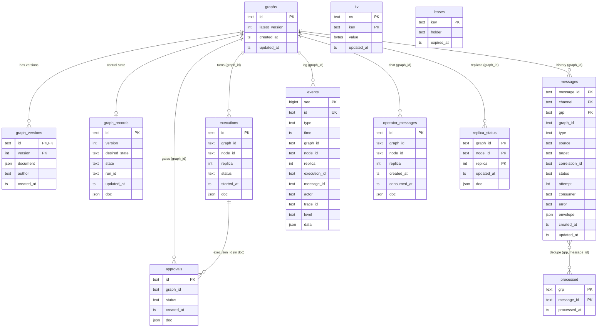

# Database schema and storage adapters

Everything that must survive a restart goes through `storage.Store`
(`server/internal/storage/storage.go`): graph definitions and their versions, desired/actual control
state, the event log, message history, executions, approvals, operator messages, replica status,
agent memory (KV), the dedupe log and replica leases. Three adapters implement it and pass one
conformance suite (`server/internal/storage/conformance`, including concurrency races):

| Adapter | `storage.type` | Use |
|---|---|---|
| SQLite (pure Go, `modernc.org/sqlite`, no cgo) | `sqlite` (default) | Single instance, zero ops, transactional |
| PostgreSQL (`pgx`) | `postgres` | Multi-instance / production (compose default) |
| Filesystem | `fs` | Zero dependencies, inspectable with `cat`/`jq`; dev and small single-node installs |

SQL migrations: `server/internal/storage/sqlstore/migrations/{sqlite,postgres}/0001_init.sql`.

## Entity-relationship diagram



Only `graph_versions → graphs` is a declared foreign key (`ON DELETE CASCADE`). Other relations are
logical: history must outlive what it describes. `DeleteGraph` removes `graphs`, `graph_versions` and
`graph_records`; events, message history, executions, approvals and KV entries of a deleted graph
are **kept** (audit trail) — prune them with SQL if required.

## Tables

| Table | Key | Indexes | Contents and access pattern |
|---|---|---|---|
| `graphs` | `id` | — | One row per graph; `latest_version` is the optimistic-concurrency counter |
| `graph_versions` | `(id, version)` | PK | Immutable documents; every save appends one. Author from label `leforge.io/author` |
| `graph_records` | `id` | — | Desired/actual state, active version and run id (`domain.GraphRecord`); read by every reconcile |
| `events` | `seq` (auto) | `(graph_id, seq)`, `(type)`, unique `id` | Append-only log; tailed by SSE (`seq > after`) |
| `messages` | `(message_id, channel, grp)` | `(graph_id, channel, created_at)`, `(graph_id, created_at)`, `(correlation_id)` | Message history, upserted per status change; `created_at` keeps the original value |
| `processed` | `(grp, message_id)` | PK | Dedupe log: `MarkProcessed` is insert-if-absent |
| `executions` | `id` | `(graph_id, started_at)`, `(graph_id, node_id, started_at)`, `(status)`, `(parent_execution_id, started_at)` | Turns; recovery scans `status = running` |
| `approvals` | `id` | `(status, created_at)`, `(graph_id, created_at)` | HITL; `DecideApproval` updates only while `status = pending` (first decision wins) |
| `operator_messages` | `id` | `(graph_id, node_id, consumed_at, created_at)` | Inbox; `ConsumeOperatorMessages` marks and returns atomically; `replica = -1` = any replica |
| `replica_status` | `(graph_id, node_id, replica)` | PK | Live status written by whichever instance runs the replica |
| `kv` | `(ns, key)` | PK | Agent memory (`<graph>/<node>`), ring broadcasts (`<graph>/<node>/_ring`), control overrides (`_control/<graph>`: node stop/pause/scale, completion markers) |
| `leases` | `key` | PK | Replica ownership `<graph>/<node>#<n>` → instance; compare-and-set acquire |
| `schema_migrations` | `version` | PK | Applied migrations |

### The doc-column strategy

Columns that are **filtered or sorted on** are real, indexed columns; the full record is stored in
a JSON column (`doc`, `document`, `envelope`; `TEXT` in SQLite, `JSONB` in PostgreSQL). Go structs
can gain fields without a migration, while every query still uses an index. Events and message
history are fully column-mapped as well, so they can be queried as an audit trail with plain SQL:

```sql
-- every message of one workflow, in order
SELECT created_at, type, channel, grp, status, attempt, error
FROM messages WHERE correlation_id = 'msg_…' ORDER BY created_at;

-- tool denials in the last day (PostgreSQL)
SELECT time, node_id, data->>'tool' AS tool, data->>'error' AS why
FROM events WHERE type = 'tool.denied' AND time > now() - interval '1 day';
```

### Dialect differences

| Aspect | SQLite | PostgreSQL |
|---|---|---|
| Timestamps | `INTEGER` Unix nanoseconds (UTC) | `TIMESTAMPTZ` (µs; graph timestamps truncated to µs on both) |
| JSON | `TEXT` | `JSONB` (key order/whitespace normalised) |
| Binary | `BLOB` | `BYTEA` |
| Event `seq` | `INTEGER PRIMARY KEY AUTOINCREMENT` | `BIGSERIAL`; appends serialised by `pg_advisory_xact_lock` so seq order equals commit order (SSE resumers never skip an event) |
| Concurrency | WAL, `busy_timeout=10000`, foreign keys, `BEGIN IMMEDIATE`, one pooled connection (serialised writers, no `SQLITE_BUSY`) | Pool; CAS operations in transactions |
| Migrations | in-process | `pg_advisory_lock` so concurrent instances migrate one at a time |

## Filesystem store layout

```
<dir>/LOCK                               exclusive lock (one process per directory)
<dir>/graphs/<id>/<version>.json         immutable graph versions
<dir>/records/<id>.json                  graph control state
<dir>/events/events-<n>.jsonl            append-only event log, 64 MiB segments
<dir>/messages/<message-id>.json         all history rows of one message
<dir>/processed.jsonl                    append-only dedupe log
<dir>/executions/<id>.json
<dir>/approvals/<id>.json
<dir>/operator/<id>.json
<dir>/replicas/<graph/node#n>.json
<dir>/kv/<namespace>/<key>
<dir>/leases/<key>.json
```

All data is loaded into memory at open and every mutation is written through before returning.
Entity files are replaced atomically (temp + fsync + rename + directory fsync); logs fsync per
append and a torn last line is truncated on open (corruption elsewhere is an error, never skipped).
Names are encoded to be case-safe and valid on Windows.

## Retention

| Data | Current behaviour | Recommendation |
|---|---|---|
| Event log | Kept forever; **pruning is not implemented yet** | Partition `events` by time (PostgreSQL) or prune by `time` in a maintenance job |
| Message history, executions, approvals | Kept forever | Same; correlate retention with audit requirements |
| Graph versions | Kept forever (small) | — |
| Broker data | Per channel `retention` (default 7 d) where the broker supports it | — |

## Migration policy

* Migrations are numbered SQL files per dialect, embedded in the binary and applied at startup inside
  transactions; applied versions are recorded in `schema_migrations`.
* Only forward migrations; schema changes are **additive** within a major version (new tables,
  columns, indexes). Because records live in doc columns, most model changes need no migration.
* Destructive changes ship as expand → migrate → contract across two releases so that mixed-version
  instances can run side by side during rolling upgrades.

## Choosing a backend

| | SQLite | PostgreSQL | Filesystem |
|---|---|---|---|
| Control-plane instances | 1 | many (leases, advisory locks) | 1 (LOCK file) |
| Operations | a file | managed or self-hosted PG, backups, HA | a directory |
| Durability | WAL + fsync | WAL, replication, PITR | fsync per write |
| Query history with SQL | yes | yes (JSONB operators) | `jq`/`grep` |
| Memory | low | low | grows with history |
| Choose for | laptops, edge, single server | production, HA, large history | demos, air-gapped debugging |

Known limitations: lease expiry uses each instance's clock (keep NTP in sync well within
`engine.leaseTTL`); on Windows a crashed fs-store process leaves a stale `LOCK` to delete by hand.

## Instruction records

Existing settings CAS stores `instructions/skills/{id}` with current revision plus immutable history and actor/time, and `instructions/executions/{executionId}` as a create-only manifest. No SQL migration. See [limits and deletion semantics](instructions.md).


Migration `0003_execution_parent.sql` adds the indexed `parent_execution_id`
column and backfills it from existing execution JSON without changing the
saved documents. SQLite and PostgreSQL use equivalent migrations. The execution
tree reads this index instead of guessing relationships from recent history.
Durable cooperative cancellation markers live in settings under
`execution-control/cancel/<execution-id>` with first-request actor/time and scope.
They use revision-zero compare-and-set creation; retries do not overwrite them.

Tree token admission uses CAS settings at `delegation/budget/{rootExecutionId}`.
The bounded per-call ledger survives process restarts, keeps settlement idempotent,
and separates held reservations from known/estimated charges. It needs no schema
migration; see [delegation](delegation.md#cumulative-tree-token-budget).
