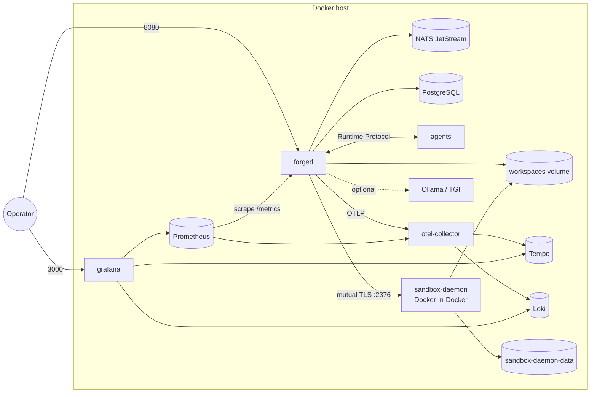
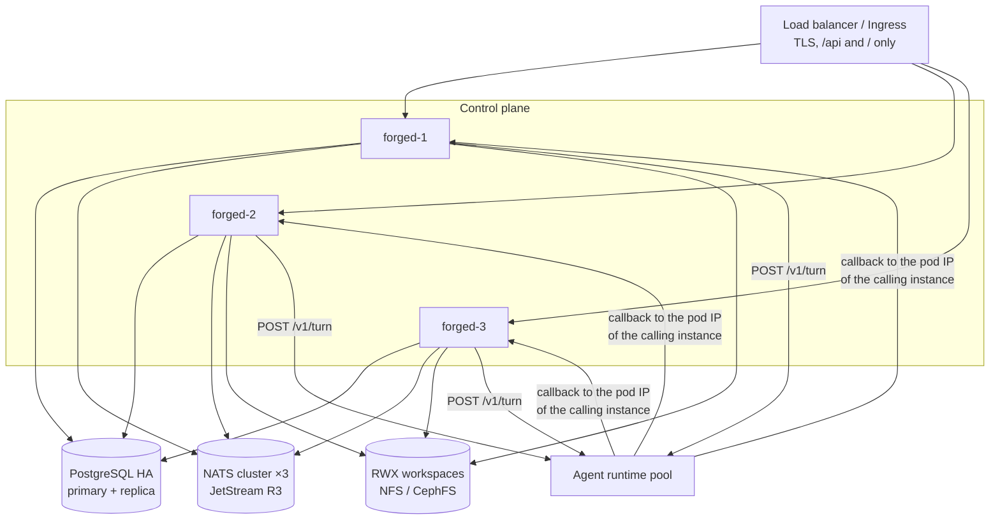
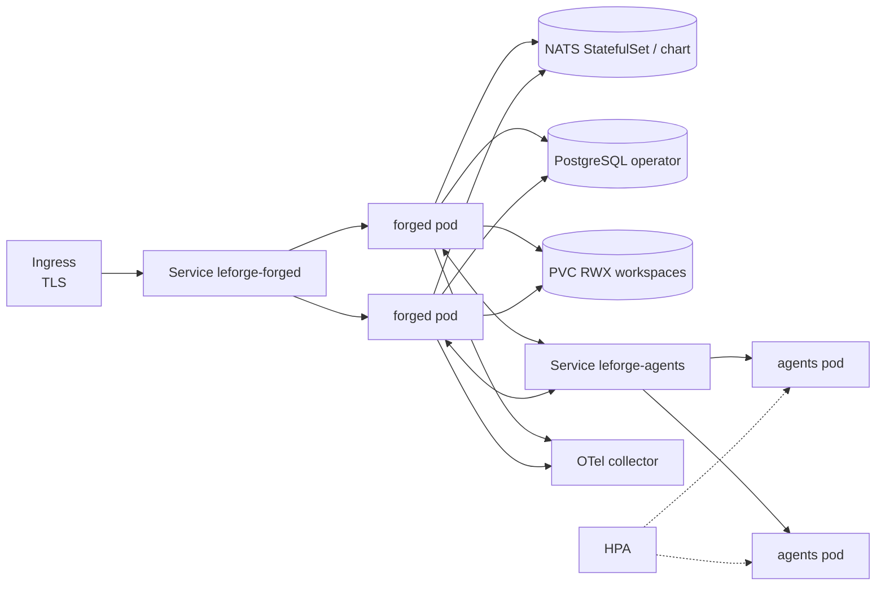

# Deployment

LeForge has one stateless-by-design control plane binary (`forged`) plus three
kinds of state: the **store** (graphs, executions, history, approvals, leases),
the **broker** (messages in flight) and the **workspaces** (files agents
change). Every deployment shape is a choice of where those three live.

## Topologies

### 1. Single node (Docker Compose)

The default `docker-compose.yml`: one `forged`, PostgreSQL, NATS JetStream,
the example agents, `sandbox-daemon` (a Docker daemon dedicated to agent
command sandboxes, see [sandbox-runtime.md](sandbox-runtime.md)), and the
observability stack. Suitable for teams,
evaluation and small production workloads where minutes of downtime during a
host failure are acceptable.



Smallest footprint: `forged` alone with `storage.type: sqlite` and
`queue.type: fs` (the binary's defaults) — no other services.

### 2. High availability (multiple instances)

Run N `forged` instances against a shared PostgreSQL and a NATS cluster.
Instances coordinate only through the store: each replica of each node is a
**lease**; whoever holds it runs it and renews it every reconcile interval.
When an instance dies, its leases expire after `engine.leaseTTL` and the
survivors take the replicas over; unacknowledged messages are redelivered by
the broker; executions the dead instance was running are marked
`interrupted`.



Requirements:

- `instance` unique per instance; `server.internalUrl` = that instance's own
  address (the callback token is valid only on the instance running the turn).
- PostgreSQL storage (SQLite and fs are single-instance).
- A broker with shared durable state (NATS cluster with `options.replicas: "3"`,
  Redis with replication, RabbitMQ quorum queues, Kafka RF≥3).
- A ReadWriteMany workspace volume, or graphs that keep their deliverables in
  git remotes (clone via `spec.workspace.repo`) so any instance can recreate them.
- Clocks synchronised (NTP): lease expiry compares instance clocks.

### 3. Kubernetes

`deploy/kubernetes/` contains kustomize manifests: namespace (restricted Pod
Security), ConfigMap (`forge.yaml`), Secret template, `forged` Deployment
(2 replicas, `LEFORGE_INSTANCE` from the pod name, `LEFORGE_INTERNAL_URL` from
the pod IP, PDB, topology spread), RWX workspace PVC, example agents
Deployment + Service + HPA + PDB, a single-node NATS StatefulSet for
evaluation, NetworkPolicies, and an optional ServiceMonitor/PrometheusRule.

```bash
kubectl apply -k deploy/kubernetes
forge k8s render -f examples/graphs/software-factory.yaml --namespace leforge | kubectl apply -f -
```

`forge k8s render` emits a Deployment + Service per external node that sets
`runtime.image` (non-root, read-only root filesystem, no service-account
token); point the node's `runtime.endpoint` at the printed Service URL.
PostgreSQL is expected from an operator (CloudNativePG, Zalando, Crunchy) or
a managed service; NATS in production from the official Helm chart.



## Sizing guidance

The control plane does little work itself; turns are dominated by model
latency. Starting points:

| Component | Small (≤ 20 replicas) | Medium (≤ 200 replicas) | Notes |
|---|---|---|---|
| forged | 1 × 0.5 CPU / 512 MiB | 3 × 1 CPU / 1–2 GiB | Memory grows with concurrent turns and tool output; cap with `engine.maxConcurrentTurns`. |
| PostgreSQL | 1 CPU / 1 GiB / 20 GiB | 2–4 CPU / 4–8 GiB / 100 GiB SSD | Event log and message history dominate; plan retention. |
| NATS | 0.25 CPU / 256 MiB | 3 × 1 CPU / 1 GiB, fast disk | One stream per channel. |
| Agent runtimes | 0.25 CPU / 256 MiB | HPA on CPU | Stateless per turn. |
| Workspaces | 10 GiB | size of repos × (1 + worktree replicas) | Worktrees are full checkouts. |
| Models | — | GPU servers sized to throughput | Use provider `concurrency` to protect them. |

Measure with the Grafana dashboard: turn duration p95, queue latency p95,
backlog per group and LLM latency tell you where to scale.

## Network and ports

| Port | Service | Exposure |
|---|---|---|
| 8080 | forged: console, `/api/v1`, `/healthz`, `/readyz`, `/metrics`, `/internal/v1` | `/` and `/api` via TLS ingress; `/internal` only to agent runtimes; `/metrics` only to Prometheus |
| 8000 | agent runtimes (Runtime Protocol) | forged only |
| 4222 / 8222 | NATS client / monitoring | forged / monitoring |
| 5432 | PostgreSQL | forged |
| 4317 / 4318 | OTel collector gRPC / HTTP | forged |
| 9090, 3000, 3100, 3200 | Prometheus, Grafana, Loki, Tempo | operators |
| 11434, 80 (tgi) | Ollama, TGI | forged |
| 2376 | sandbox-daemon (Docker API, mutual TLS) | forged only, on the `sandbox` network; never published |

## Backup and restore

| State | Backup | Restore |
|---|---|---|
| PostgreSQL | Continuous WAL archiving + base backups (operator or `pg_basebackup`), plus daily `pg_dump -Fc leforge` | Point-in-time restore; start forged — migrations are idempotent. |
| SQLite | `sqlite3 leforge.db ".backup backup.db"` (online, WAL-safe) | Replace the file with forged stopped. |
| NATS JetStream | `nats stream backup` per stream, or volume snapshots of the JetStream store | `nats stream restore`. Messages in flight are also recoverable from message history (the store keeps every envelope) and can be re-injected. |
| Workspaces | Push work to git remotes (recommended) and/or volume snapshots | Restore the volume or re-clone (`spec.workspace.repo`). Worktree branches survive in the repository. |
| Configuration | Keep graph YAML and `forge.yaml` in git (GitOps via `bootstrap.graphs`) | `forge apply -f` |

Graph documents are versioned in the store (`GET /api/v1/graphs/{id}/versions`);
any version can be exported with `forge get <id>` / `?version=N`.

## Upgrades and schema migrations

- Storage migrations are embedded, versioned SQL (`schema_migrations` table),
  applied automatically at startup; on PostgreSQL an advisory lock ensures one
  instance migrates. Migrations are forward-only and additive within a major
  version, so N and N+1 instances can run side by side during a rolling update.
- Rolling update: `maxUnavailable: 0`. A terminating instance stops its
  replicas gracefully (in-flight turns finish within the grace period —
  set `terminationGracePeriodSeconds` / `stop_grace_period` above your longest
  typical turn) and releases leases so other instances take over immediately.
- Graph documents carry `apiVersion: leforge.io/v1`; a future v2 will ship a
  conversion process for existing graph documents.
- Back up PostgreSQL before upgrading across minor versions.

## Air-gapped installation

1. On a connected machine, build or pull and save all images:
   ```bash
   make images VERSION=1.0.0
   docker compose pull
   docker save leforge/forged:1.0.0 leforge/agents:1.0.0 leforge/sandbox:1.0.0 \
     nats:2.11-alpine postgres:17-alpine otel/opentelemetry-collector-contrib:0.116.1 \
     prom/prometheus:v3.1.0 grafana/tempo:2.6.1 grafana/loki:3.3.2 grafana/grafana:11.4.0 \
     ollama/ollama:0.5.4 | gzip > leforge-images.tar.gz
   ```
   or mirror them into an internal registry (Harbor, Nexus, Artifactory) and
   rewrite image names (kustomize `images:` or compose overrides).
2. Model weights: `ollama pull <model>` into the `ollama-models` volume and
   export it, or download HF weights (`huggingface-cli download`) into the
   `hf-models` volume and run TGI with `HF_HUB_OFFLINE=1`.
3. Python agent dependencies are baked into the agents image (stdlib only by
   default; `EXTRAS=langgraph` at build time when needed).
4. The platform makes no outbound calls by default: the mock provider needs
   no network, Grafana analytics are disabled in compose, and `http.fetch`
   reaches only hosts that graphs explicitly grant.

## Project environment operations

Run builds and execution on the dedicated daemon, with workspace paths visible
to both it and the controller. Budget CPU, memory and active slots for execution,
BuildKit, setup and cache copying, leaving VM headroom for the daemon and control
plane. These budgets do not cap the entire Docker/Colima VM. Idle suspension
preserves container files between turns; it does not checkpoint process memory.

Repository discovery and approved initial proposals follow the
[environment guide](environments.md); unsupported fields fail validation before
build. Installation policy remains authoritative over repository and agent input.
Registry pulls require daemon-level network controls; environment HTTP/HTTPS
allowlists cover supported build/setup/runtime traffic, not registry access.

Use **Integrations → Shared images and caches** to preview and confirm cleanup of unused
registered generations. Referenced or unregistered legacy resources are retained;
never use a global Docker prune to implement per-task Reset. For capacity waits,
failed builds, stale definitions and network denials, inspect the environment
status/logs and agent diagnostics before retrying. See the
[release evidence and limits](sandbox-acceptance.md) and
[tested mise proposal](../examples/projects/mise-node/README.md).
