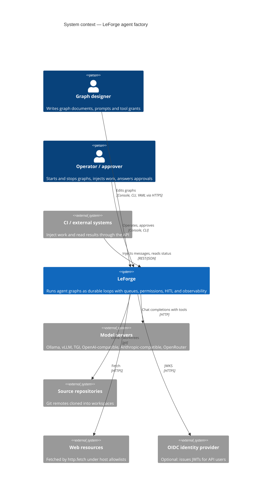
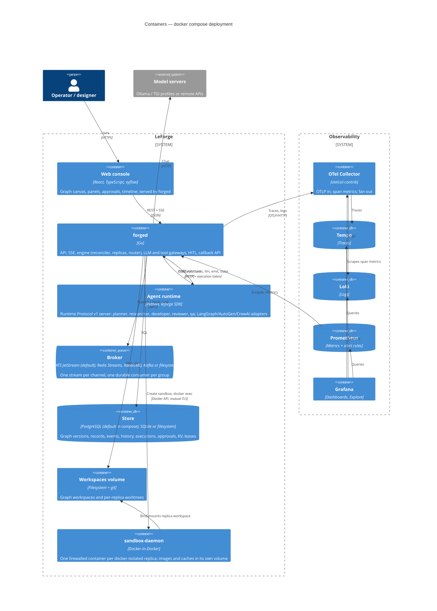
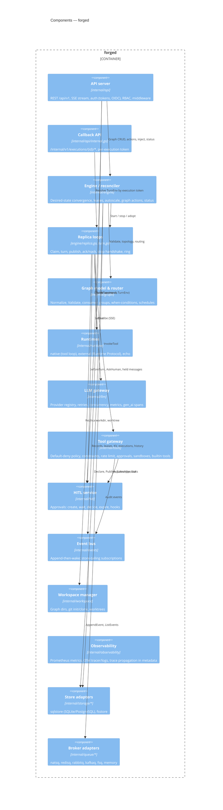
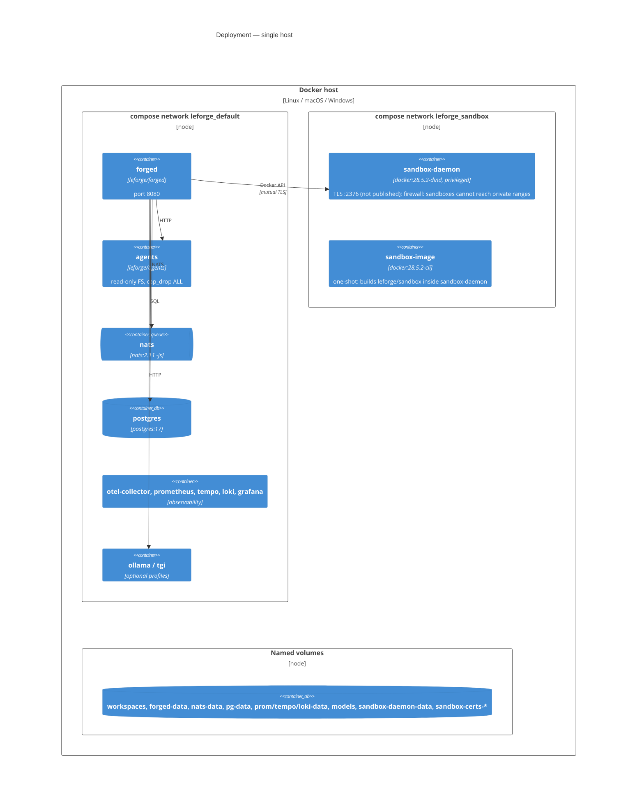
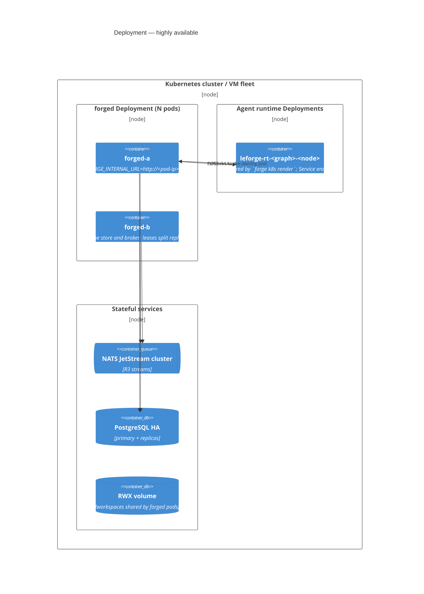

# C4 model

The diagrams use Mermaid's C4 syntax, which renders on GitHub and in most Markdown viewers. The [architecture document](../architecture.md) is the narrative companion.

## Level 1 — System context

LeForge sits between the people who design and supervise agent graphs and the external systems agents act on. Model servers are external systems behind a provider abstraction. "Local" model servers (Ollama, vLLM, TGI) run in the same compose stack but are still separate systems.

## Level 2 — Containers

The compose stack in `docker-compose.yml`. `forged` is the single control-plane binary and can be replicated. `agents` hosts the Python agents and holds no credentials. `sandbox-daemon` is a Docker daemon dedicated to LeForge where docker-isolated agents' commands run ([sandbox runtime](../sandbox-runtime.md)).

## Level 3 — Components of `forged`

## Deployment views

### Single host (docker compose)

### Highly available (Kubernetes or VMs)

In the HA view:

- Workspaces must be on storage that every `forged` pod can mount (ReadWriteMany), because a replica can move to another instance after failover.
- Callbacks must reach the instance that owns the execution. This is why `LEFORGE_INTERNAL_URL` is set per pod and does not point at a Service.
