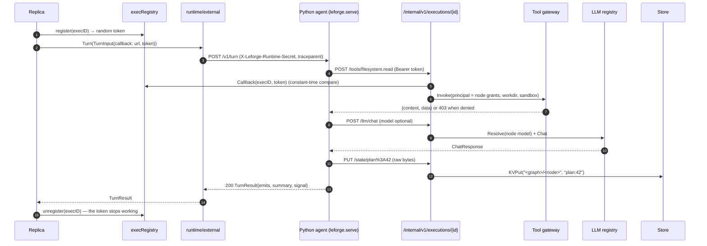
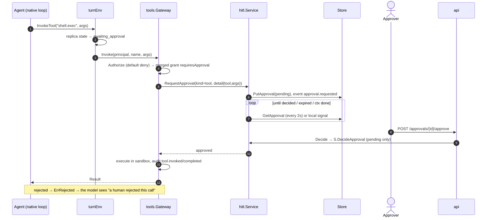
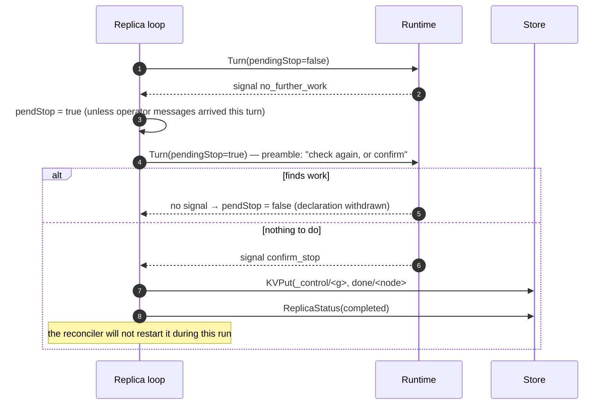
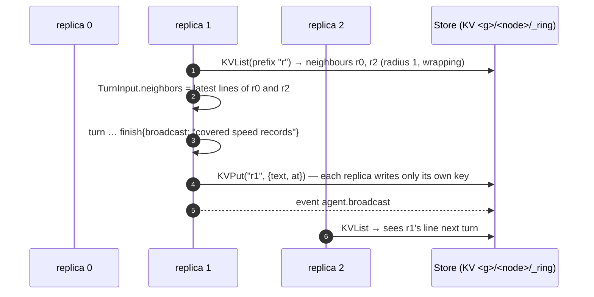
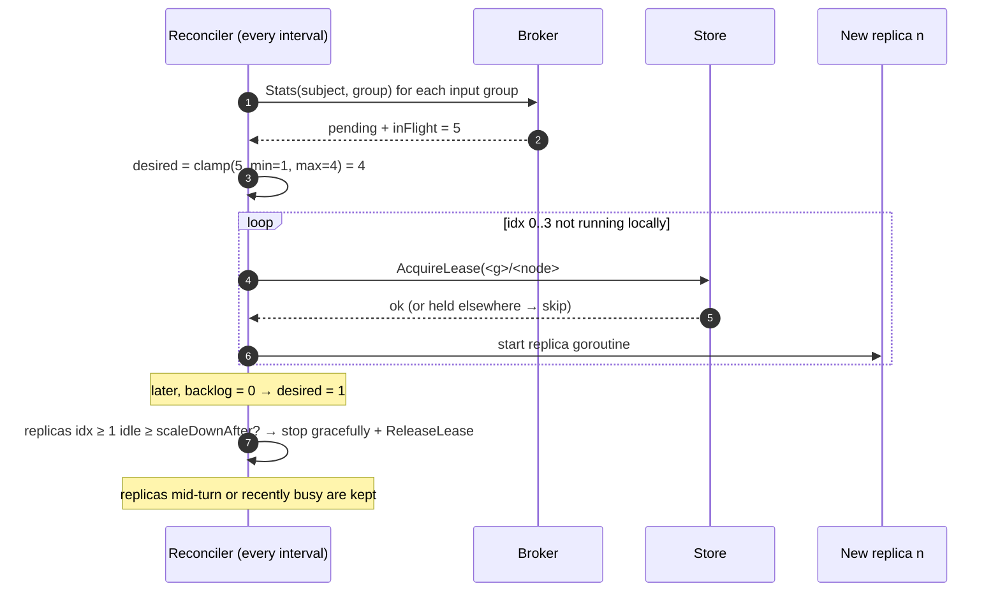
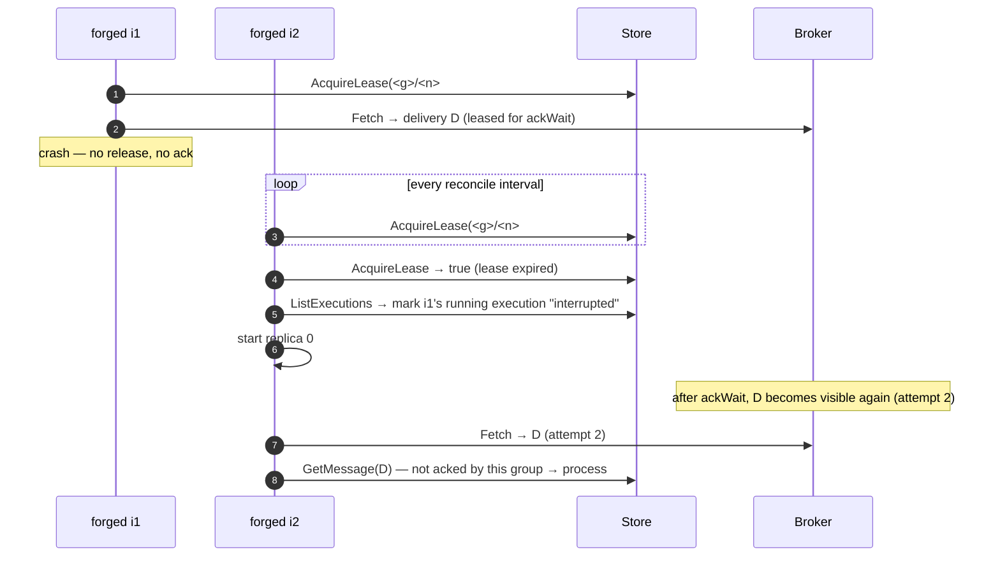
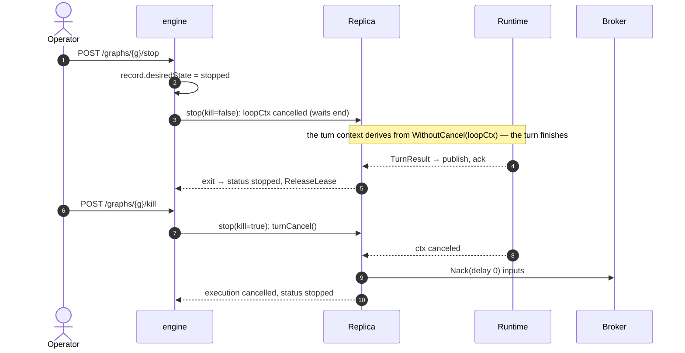

# Sequence diagrams

Participants are named after the packages that implement them. "Replica" is the replica goroutine in `engine/replica.go` and `engine/turn.go`.

## 1. Injection → turn → emit → route → publish → ack

```mermaid
sequenceDiagram
  autonumber
  actor Op as Operator / CI
  participant API as api
  participant E as engine.Inject
  participant B as Broker
  participant S as Store
  participant R as Replica (consumer)
  participant RT as Runtime
  participant RO as graph.Router

  Op->>API: POST /graphs/{g}/channels/{c}/messages
  API->>E: Inject(type, payload)
  E->>E: NewMessage (correlation_id = id, hops 0, traceparent)
  E->>B: Declare(subject, groups) (idempotent)
  E->>B: Publish("<g>.<c>", msg)
  E->>S: RecordMessage(published), AppendEvent(message.published / injected)
  API-->>Op: 201 Message
  R->>B: Fetch(group, max=batchSize, wait=2s)
  B-->>R: Delivery (attempt 1, leased for ackWait)
  R->>S: GetMessage(id) — already acked by this group? (dedupe)
  R->>S: PutExecution(running), RecordMessage(delivered)
  R->>RT: Turn(TurnInput, TurnEnv)
  RT->>R: env.Emit({type, payload, target?})
  RT-->>R: TurnResult
  loop each emit, until the first error
    R->>R: parent.Child() → hops+1, causation_id, inherited correlation & trace
    R->>RO: Route(node, msg, channel)
    RO-->>R: matching channels (types filter, when, target)
    R->>B: Publish(each channel)
    R->>S: RecordMessage(published)
  end
  alt all outputs published or durably held for approval
    R->>B: Ack(delivery)
    R->>S: MarkProcessed(group, id), RecordMessage(acked), PutExecution(succeeded)
  else output construction or publication failed
    R->>B: Nack(back-off), or Term at maxDeliver
    R->>S: RecordMessage(nacked / dead_lettered), PutExecution(failed)
    Note over R,B: No ack or processed marker; partial outputs may repeat on retry
  end
```

## 2. External (Python) agent turn with callbacks



## 3. Tool call that requires approval



## 4. Held message at a channel gate

```mermaid
sequenceDiagram
  autonumber
  participant R as Replica (producer)
  participant E as engine.publish
  participant H as hitl.Service
  participant S as Store
  actor Ap as Approver
  participant B as Broker
  participant C as Replica (consumer)

  R->>E: publish(channel.approval = true)
  E->>H: Create(kind=message, detail{graphId, channel, message, onTimeout})
  E->>S: RecordMessage(held), event message.held
  Note over R: The producer acks its inputs and continues — it does not wait
  Ap->>H: Decide(approve, answer = edited payload JSON?)
  H->>E: onApprovalDecided hook (on the deciding instance)
  E->>E: replace payload if answer is valid JSON (edited_by)
  E->>B: Publish(subject)
  E->>S: RecordMessage(published)
  B-->>C: Delivery
  Note over H,E: reject / expire → RecordMessage(rejected); never published
```

## 5. Auto-stop two-turn handshake



An operator message to the node also clears `pendStop` (`SendOperatorMessage`).

## 6. Ring cluster broadcast



## 7. Autoscale up and down



## 8. Instance failover



A restarting instance also runs `recover()` on boot, which marks its own `running` executions `interrupted`.

## 9. Graceful stop vs kill



## 10. Editing a running graph

```mermaid
sequenceDiagram
  autonumber
  actor D as Designer
  participant API as api
  participant E as engine
  participant S as Store
  participant Old as graphRun v1
  participant New as graphRun v2
  participant R as Replica

  D->>API: PUT /graphs/{g} (If-Match: 1)
  API->>E: SaveGraph(expectedVersion 1)
  E->>S: SaveGraph → v2 (409 if someone saved first)
  E->>S: record.version = 2; Declare topology
  E->>E: reconcile: run.version != record.version
  E->>New: newGraphRun(v2)
  New->>Old: adopt()
  alt same run and structuralKey unchanged (runtime, isolation, workspace, comms)
    Old->>New: move replica; rep.setRun(v2); poke
    Note over R: next turn uses the new prompt/model/tools/loop settings
  else structural change or node removed
    Old->>R: stop(false) — graceful
    E->>R: started again under v2 on the next reconcile
  end
```
