# Domain model

Source of truth: `server/internal/domain` (`graph.go`, `message.go`, `state.go`, `event.go`). JSON field names are the struct tags (camelCase). Graph documents may be YAML.

```mermaid
classDiagram
  direction LR
  class Graph {
    apiVersion = "leforge.io/v1"
    kind = "Graph"
    metadata: GraphMetadata
    spec: GraphSpec
  }
  class GraphSpec {
    parameters: Parameter[]
    workspace: WorkspaceSpec
    defaults: NodeDefaults
    nodes: Node[]
    channels: Channel[]
    maxHops: int
  }
  class Node {
    id, name, description
    runtime: RuntimeRef
    model: ModelRef
    prompt
    tools: ToolGrant[]
    loop: LoopSpec
    cluster: ClusterSpec
    isolation: IsolationSpec
    workspace: NodeWorkspace
    approval: ApprovalSpec
    subscribe: string[]
    limits: NodeLimits
    disabled, config, position
  }
  class Channel {
    id, type, from, to[], topic
    types[], when, approval
    maxDeliver, ackWait, retention, label
  }
  class ToolGrant { name; paths[]; commands[]; hosts[]; requiresApproval; rateLimit }
  class Message { id; type; source; target; payload; metadata }
  class GraphRecord { id; version; desiredState; state; runId; startedAt; updatedAt }
  class Execution { id; graphId; graphVersion; runId; nodeId; replica; iteration; status; inputIds; outputIds; summary; error; signal; usage; toolCalls; traceId; instance }
  class MessageRecord { message; graphId; channel; group; status; attempt; consumer; error }
  class Approval { id; graphId; nodeId; replica; executionId; kind; status; title; detail; answer; decidedBy; comment; expiresAt }
  class OperatorMessage { id; graphId; nodeId; replica; text; author; consumedAt }
  class ReplicaStatus { graphId; nodeId; replica; state; iteration; runIteration; executionId; instance; workdir; branch; deadline }
  class Lease { key; holder; expiresAt }
  class Event { seq; id; type; time; graphId; nodeId; replica; executionId; messageId; actor; traceId; data }

  Graph *-- GraphSpec
  GraphSpec *-- "1..*" Node
  GraphSpec *-- "*" Channel
  Node *-- "*" ToolGrant
  Channel --> Node : from / to
  Graph "1" -- "1" GraphRecord : control state
  Node "1" -- "*" ReplicaStatus : replicas
  ReplicaStatus "1" -- "1" Lease : owned via
  ReplicaStatus "1" -- "*" Execution : turns
  Execution "*" -- "*" Message : inputs / outputs
  Message "1" -- "*" MessageRecord : per channel & group
  Execution "1" -- "*" Approval
  Node "1" -- "*" OperatorMessage
  Graph "1" -- "*" Event
```



## Graph document

| Entity | Key fields | Invariants (checked by `graph.Validate`) |
|---|---|---|
| `Graph` | `metadata.id` (DNS label, derived from `name` if empty), `metadata.version` (assigned by the store) | `apiVersion == leforge.io/v1`, `kind == Graph`, at least one node. |
| `WorkspaceSpec` | `path`, `git`, `repo` | `repo` must be a remote URL (`https://`, `ssh://`, `git://`, `user@host:path`); `http://` is accepted with a warning; local paths, `file://`, `ext::` and option-like values are rejected. It is cloned only while the workspace is empty. |
| `EnvironmentSpec` | `image` or `dockerfile`, `setup`, `network.setup`/`network.run`, `caches`, `timeout`, `cpu`, `memory` | Exactly one of `image`/`dockerfile`; a Dockerfile needs `FROM`; setup commands non-empty; networks `none`/`bridge`; caches absolute, unique, not `/workspace` or system directories; timeout ≤ 2h. Used by docker-isolated nodes without `isolation.image`. See [environments.md](environments.md). |
| `Parameter` | `name`, `value` | Name matches `[A-Za-z_][A-Za-z0-9_-]*`; is not reserved (`input`, `output`, `project`, `workspace`, `loop`, `self`); unique. |
| `Node` | `id`, `runtime.kind` (`native`, `external`, `echo`) | Unique DNS-label id. Native nodes need a prompt. External nodes need `endpoint`, `command` or `image`. The runtime must be registered. |
| `LoopSpec` | `mode` (`once`, `continuous`, `scheduled`, `event`), `schedule`, `interval`, `stop`, `batchSize` | `scheduled` needs a parseable schedule. `event` and stop `auto` are mutually exclusive. Policy-specific limits must be > 0. |
| `ClusterSpec` | `mode` (`fixed`, `autoscale`), `replicas`, `minReplicas`, `maxReplicas`, `comms` (`isolated`, `ring`), `scaleDownAfter` | Fixed: 1–256. Autoscale: min ≤ max ≤ 256. Autoscale is expected with `event` mode (warning otherwise). |
| `IsolationSpec` | `mode` (`process`, `docker`, `kubernetes`), `image`, `cpu`, `memory`, `network`, `env` | Mode must be known. |
| `NodeWorkspace` | `mode` (`shared`, `worktree`), `subdir` | Worktree implies a git workspace (warning if it is not declared). |
| `ToolGrant` | `name` (capability, tool or glob), constraints | Name required. `*` produces a warning. YAML accepts a bare string. |
| `Channel` | `id`, `type` (`queue`, `topic`, `fanout`, `broadcast`), `from` (empty = ingress), `to`, `topic`, `types`, `when`, `approval` | Id matches `[a-z0-9][a-z0-9_-]{0,62}`. Node references must exist. `when` must compile. A channel without consumers produces a warning. |

Documents are stored as written: `graph.Normalize` fills the defaults below
when a graph is validated or run, but the stored document keeps only what the
author set (plus ids derived from names), so `spec.defaults` stays the single
place to change them.

Documents are strict: decoding at the API boundary (and for bootstrap graph
files) rejects keys the schema does not define, with the key's path, instead of
dropping them. Keys starting with `x-` on `Graph`, `metadata`, `Node` and
`Channel` are extensions (`domain.Extensions`): stored and returned unchanged so
editors and tools can annotate a graph without losing data on save.

Defaults applied by `graph.Normalize`:

| Field | Default |
|---|---|
| Runtime | `native` |
| Loop mode | `event` if the node has inputs, else `once` |
| Stop policy | derived from the limits that are set, else `never` |
| `batchSize` | 1 |
| Cluster | fixed, 1 replica |
| Autoscale cluster | `maxReplicas` = max(replicas, 4), `minReplicas` = 1, `scaleDownAfter` = 60s |
| Isolation | `process` |
| Workspace | `shared` |
| `maxToolCalls` | 50 |
| `turnTimeout` | 30m |
| Channel type | `queue` |
| `maxDeliver` | 5 |
| `ackWait` | 10m |
| `maxHops` | 64 |

## Message envelope

The six top-level fields are the stable wire contract:

```json
{
  "id": "msg_mv0uluxa60965e54f886c22d4ec8",
  "type": "feature.request",
  "source": "planner",
  "target": "",
  "payload": {"title": "slugify"},
  "metadata": {"graph": "software-factory", "channel": "requests", "correlation_id": "…", "hops": 0, "traceparent": "00-…-01"}
}
```

Ids are a millisecond base-36 timestamp followed by 80 random bits (`domain.NewID`), so they sort by creation time. `payload` is always valid JSON (`{}` when empty).

Well-known metadata keys:

| Key | Set by | Meaning |
|---|---|---|
| `graph`, `graph_version`, `run_id` | engine | Origin of the message. |
| `channel` | engine at publish | Channel the copy was published on. |
| `correlation_id` | `NewMessage` (= own id), inherited by `Child` | Stable id of the whole workflow. |
| `causation_id` | `Child` | Id of the input message that caused this one. |
| `execution_id`, `replica` | engine at emit | Execution (turn) and replica that emitted it. |
| `hops` | `Child` (+1 per hop) | Cycle guard against `spec.maxHops`. |
| `created_at` | `NewMessage` | RFC 3339 timestamp; used for queue-latency metrics. |
| `traceparent`, `tracestate` | `observability.Inject` | W3C trace context propagated across agents. |
| `injected_by` | `Inject` | Human or system that injected the message. |
| `held_for` | gate | Approval id while the message is held. |
| `edited_by` | approval decision | Set when an approver replaced the payload. |
| `attempt` | reserved | Delivery attempt (the broker exposes it as `Delivery.Attempt()`). |

Agents can add their own metadata through `Emit.metadata`. Reserved keys are silently ignored (`engine/publish.go`).

## Channel types → consumer groups

A channel is a broker subject `"<graph>.<channel>"`. Every declared group receives every message, and within a group each message goes to exactly one consumer (`queue` package doc).

| Type | Group per | Group name | Delivery |
|---|---|---|---|
| `queue` | channel | `<channel>` | Point-to-point. All target nodes and all their replicas compete. |
| `topic` | consuming node | `<channel>.<node>` | Pub-sub. Subscribers are listed in `to` or opt in with `node.subscribe` patterns; replicas of a node compete. |
| `fanout` | target node | `<channel>.<node>` | Static pub-sub to the listed targets; replicas compete. |
| `broadcast` | target replica | `<channel>.<node>.<replica>` | Every replica of every target receives a copy. |
| (no consumer) | — | `<channel>.unconsumed` | Parking group, so work published before a consumer is wired is retained. |

## Persisted records

| Record | Key | Written by | Notes |
|---|---|---|---|
| Graph version | (id, version) | `SaveGraph` | Optimistic concurrency through `expectedVersion` (API `If-Match`). |
| `GraphRecord` | id | engine actions, reconciler | Desired and actual state, run id, current version. |
| `Execution` | id | replica | One per turn; status follows the execution state machine. |
| `MessageRecord` | (message id, channel, group) | engine | Message history; publish records have an empty group. Dropped messages use channel `_unrouted`. |
| processed | (group, message id) | after ack | Dedupe marker. |
| `Approval` | id | hitl | `DecideApproval` succeeds only from `pending`. |
| `OperatorMessage` | id | API | Consumed atomically. `replica = -1` means the first replica to ask. |
| `ReplicaStatus` | (graph, node, replica) | replica | Live view; written on every state change. |
| KV | (namespace, key) | agents, engine | Agent state `<graph>/<node>` (shared by replicas); `_control/<graph>` holds node overrides and `done/<node>#<n>` = run id; `<graph>/<node>/_ring` holds ring lines. |
| `Lease` | `<graph>/<node>#<n>` | reconciler | TTL-based ownership of a replica by an instance. |
| `Event` | seq | event bus | Append-only, strictly increasing sequence number. |
