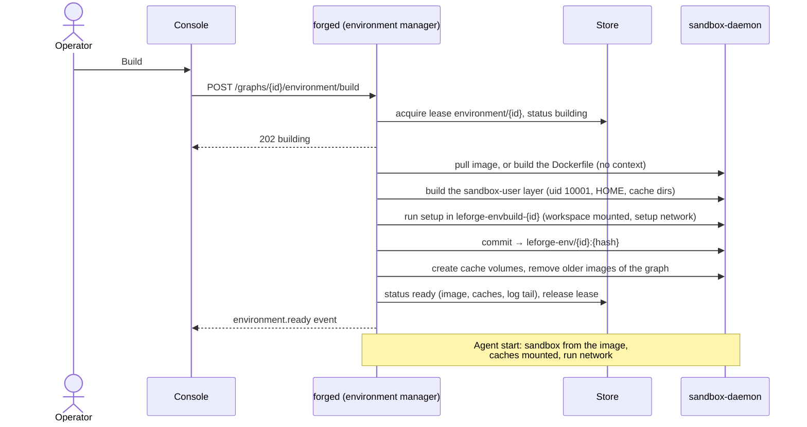

# Project environments

A project environment is the container image an agent's commands run in:
the toolchain your repository needs (Go, Node, pnpm, Python, ...), installed
once and reused by every agent of the graph. You define it on the graph,
LeForge builds it on its own [sandbox daemon](sandbox-runtime.md), and agents
with docker isolation run their commands in containers made from it. Nothing
is installed on your machine, and agents never get access to Docker.

| You want to | Go to |
|---|---|
| Set one up from the browser | [Usage](#usage-from-the-browser) |
| Pick a definition for your stack | [Recipes](#recipes) |
| Understand what happens on Build | [How a build works](#how-a-build-works) |
| Fix a failed build | [Troubleshooting](#troubleshooting) |

**Available through the API:** `GET /api/v1/graphs/{id}/environment/discovery`
(viewer) inspects an existing checkout, preserving explicit graph configuration.
It finds `.leforge/environment.yaml`, then `.devcontainer/devcontainer.json`,
then Dockerfiles, then standard Compose filenames. It returns candidate paths,
content hashes, Compose service names and structural errors, without file
contents, saving, cloning, building or executing anything. Multiple candidates
remain available for review; malformed higher-priority files block fallback.
A missing checkout is an error, not an empty repository. Scans exclude `.git`,
`node_modules`, `vendor` and `.venv`, reject definition symlinks, and are limited
to 10,000 entries and 256 KiB per definition. Devcontainer inspection currently
accepts strict JSON with `name`, `image` and string `postCreateCommand` only.
Dockerfiles and Compose receive basic structural inspection, not full build or
policy validation. `proposal_required` means no definition was found; it does
not launch an analysis agent. Acceptance, policy validation and UI integration
remain planned.

**Planned, not available yet:** accept discovered environments in this order:
`.leforge/environment.yaml` → `.devcontainer/devcontainer.json` → Dockerfiles
→ Docker Compose. When none exists, an agent will analyze the repository and
propose an environment, requiring developer approval before building or running
the task. No LeForge-specific file will be required. Compatible images and
caches will be reusable across tasks, with isolated workspaces and limits on
active resources. See the [planned contracts](product-contracts.md#planned-discovery-and-acceptance)
and [implementation checklist](../wip/TASKS.md#3-provide-containerized-project-environments).
The instructions below describe the currently delivered, per-graph workflow.

## Usage from the browser

### 1. Define the environment

1. Open the graph, then **Graph settings** in the canvas toolbar.
2. In **Environment → Source**, pick:
   - **base image** — an image from a registry that already has the tools,
     e.g. `golang:1.26`;
   - **Dockerfile** — written in the panel, when you need system packages or
     several toolchains in one image.
3. **Setup commands** (one per line) run once per build inside the image, with
   the graph's workspace (your cloned repository) at `/workspace`. Use them for
   user-level installs and dependency downloads (`go mod download`,
   `mise install`, `pnpm install`). They run **without root**: install system
   packages in the Dockerfile instead.
4. **Network during setup**: `bridge` (default) lets setup download packages;
   `none` for fully offline builds.
5. **Network for agents**: `none` (default) or `bridge` (internet only — never
   LeForge's services or your network). An agent's own **Network** setting in
   its Command sandbox wins.
6. **Cache directories** (optional): absolute paths kept in volumes across
   agent restarts and rebuilds, e.g. `/home/sandbox/go/pkg/mod`.
7. **Build timeout**: default `30m`, at most `2h`.
8. **Save graph**. The definition is part of the graph document, versioned with
   it and visible in the **Definition** tab.

### 2. Build it

In the **Build** box under the definition:

- **Build** (operators and admins) builds the saved definition in the
  background. The badge shows *Building…*, and **Build log** follows the
  output every few seconds.
- *Ready* means agents can use it. The image is named
  `leforge-env/<graph>:<hash>`; the hash changes when the definition changes.
- *Outdated* means the saved definition changed after the last build: build
  again before starting agents.
- *Build failed* opens the log at the failing step. Fix the definition, save,
  and **Build again**.
- **Rebuild** forces a fresh build of an up-to-date definition (for example to
  pick up a new version of a base image tag).

Builds use the **saved** graph. With unsaved environment changes the panel asks
you to save first.

### 3. Point agents at it

Select an agent → **Agent configuration → Command sandbox** → **Isolation:
docker** and leave **Image** empty. The Build box lists the agents that use the
environment ("Used by: ..."). Agents with their own **Image** keep using it;
agents with process isolation do not use containers at all.

Starting the graph (or one of those agents) is refused while the environment
is not ready. **Run all** then shows the reason with two buttons: **Build and
start when ready** (builds, waits, and starts the graph) and **Build
environment** (operators and admins). The message names the cause — for example
`environment not ready: it has not been built yet; build it in Graph settings →
Environment (needed by maintainer)`. Saving the graph shows the same message as
a warning. Agents that do not use the environment are not affected.

A rebuild applies to agents when they restart (their sandbox container is
created when they start).

### 4. Reset it

**Reset** (admins) deletes the environment's images and cache volumes; the next
build starts from scratch. The graph must be stopped: running agents use that
image and those caches. Deleting a graph resets its environment too.

## Recipes

The bookaneer-style stack (Go + Node + pnpm, versions in `mise.toml`) as a
Dockerfile, with setup downloading dependencies into caches:

```yaml
environment:
  dockerfile: |
    FROM golang:1.26-bookworm
    RUN apt-get update \
     && apt-get install -y --no-install-recommends ca-certificates curl git make \
     && curl -fsSL https://deb.nodesource.com/setup_24.x | bash - \
     && apt-get install -y --no-install-recommends nodejs \
     && npm install -g pnpm@10.33 \
     && rm -rf /var/lib/apt/lists/*
  setup:
    - go mod download
    # Keep pnpm's store in its cache, not inside the repository.
    - pnpm config set store-dir /home/sandbox/.local/share/pnpm/store
    - pnpm -C web install --frozen-lockfile
  caches:
    - /home/sandbox/go/pkg/mod
    - /home/sandbox/.cache/go-build
    - /home/sandbox/.local/share/pnpm
  network: {setup: bridge, run: bridge}
```

A single-toolchain project with a public image:

```yaml
environment:
  image: python:3.13-slim
  setup: ["pip install --user -r requirements.txt"]
  caches: [/home/sandbox/.cache/pip]
```

`pnpm install` and `npm install` write `node_modules` into the workspace (it is
mounted during setup), so agents see them; Go and pip downloads land in the
home directory and are kept in the image and the caches. Without the
`store-dir` line pnpm puts its store in a `.pnpm-store/` folder at the root of
the workspace (the repository), where an agent could commit it.

## How a build works



- **Where:** every step runs on the sandbox daemon dedicated to LeForge
  (`isolation.docker.host`), driven by `forged`. Agents never call Docker.
- **The sandbox user:** LeForge adds a layer that creates user 10001 (the owner
  of workspace files), sets `HOME=/home/sandbox`, and creates the cache
  directories owned by it. The base image needs `/bin/sh`; distroless images are
  not supported.
- **Setup:** runs as user 10001 with all capabilities dropped, `CI=true` (there
  is no terminal, so package managers proceed instead of asking for
  confirmation), the setup
  network, the CPU/memory limits of the definition, and the workspace at
  `/workspace` (cloned first if the graph has a repository). Changes outside
  `/workspace` are committed into the final image; the workspace itself stays
  in the workspaces volume.
- **Hash:** `leforge-env/<graph>:<hash>` is derived from the base image or
  Dockerfile, setup commands, setup network and cache paths. Changing the agent
  network, timeout or limits does not require a rebuild.
- **State:** stored per graph (`absent`, `building`, `ready`, `failed`) with
  the last 64 KiB of the build log. A build holds the store lease
  `environment/<graph>`, so two LeForge instances never build the same
  environment at once; if its instance stops, the build is reported as
  interrupted.
- **Caches:** named volumes `leforge-env-<graph>-<hash of path>`, labelled with
  the graph. Docker fills a new volume from the image the first time a sandbox
  mounts it, so what setup downloaded is there from the start.

### Observability

| Signal | Name |
|---|---|
| Events | `environment.build_started`, `environment.ready`, `environment.failed`, `environment.reset` ([events](events.md)) |
| Metrics | `leforge_environment_builds_total{outcome}`, `leforge_environment_build_duration_seconds{outcome}` |
| Traces | span `environment.build` with `leforge.graph` and `leforge.environment.hash` |
| Logs | `environment ready` (info), `environment build failed` (warn) |

### API

| Method and path | Role | Purpose |
|---|---|---|
| `GET /api/v1/graphs/{id}/environment` | viewer | State compared with the saved definition (`defined`, `currentHash`, `upToDate`, `image`, `log`, ...). |
| `POST /api/v1/graphs/{id}/environment/build` | operator | Start a build (`202`); `{"force": true}` rebuilds an up-to-date environment, otherwise that is a no-op (`200`). `409` while a build runs, `400` without `spec.environment`. |
| `POST /api/v1/graphs/{id}/environment/reset` | admin | Delete images and caches. `409` while the graph runs. |

## Troubleshooting

| Symptom | Cause | Fix |
|---|---|---|
| Start refused: `environment not ready: it has not been built yet` | No build of the saved definition | **Build** in Graph settings → Environment |
| Start refused: `the definition changed since the last build` | The environment was edited and saved | **Build** again |
| `add sandbox user (the base image needs /bin/sh)` | Distroless or scratch base image | Use an image with a shell, or a Dockerfile `FROM` one |
| Setup fails with `permission denied` installing packages | Setup runs as user 10001 | Move `apt-get`/`apk add` into the Dockerfile |
| Setup fails downloading | Setup network is `none`, or the daemon is offline | Set **Network during setup** to `bridge`; check **Integrations → Sandbox runtime** |
| `build timed out after 30m0s` | Long downloads or compilation | Raise **Build timeout** (up to `2h`) |
| `build interrupted: the LeForge instance running it stopped` | `forged` restarted mid-build | **Build again** |
| Reset: `stop it before resetting its environment` | The graph is running | Stop the graph, then reset |
| Agents still use the old image after a rebuild | Their sandbox was created before | Stop and start the agents |
| `If you are running pnpm in CI, set the CI environment variable to "true"` | An older LeForge ran setup without `CI=true` and pnpm asked to confirm recreating `node_modules` | Build again (setup now runs with `CI=true`) |
| `COPY failed` in a Dockerfile | Builds have no context | Install from the network, or run the copy as a setup command (the workspace is mounted) |
