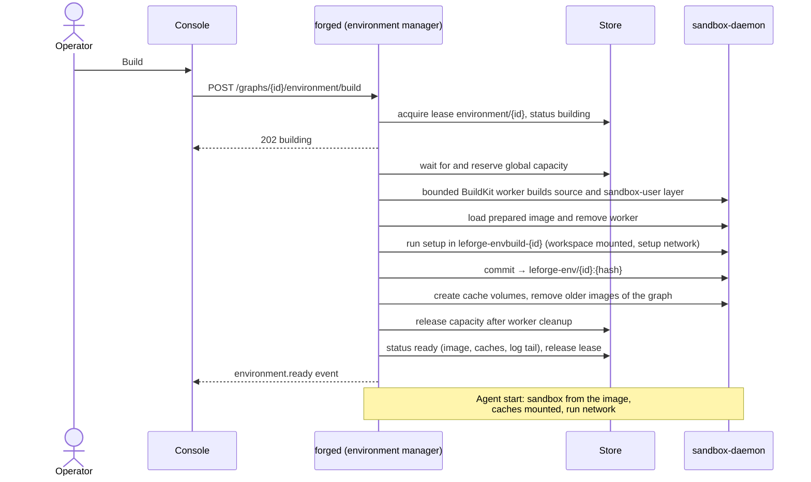

# Project environments

A project environment is the container image an agent's commands run in:
the toolchain your repository needs (Go, Node, pnpm, Python, ...), installed
once and reused by every agent of the graph. You define it on the graph,
LeForge builds it on its own [sandbox daemon](sandbox-runtime.md), and agents
with docker isolation run their commands in containers made from it. Nothing
is installed on your machine, and agents never get access to Docker.

| You want to | Go to |
|---|---|
| Set one up from the browser | [Usage](#usage-from-the-browser) |
| Pick a definition for your stack | [Recipes](#recipes) |
| Understand what happens on Build | [How a build works](#how-a-build-works) |
| Fix a failed build | [Troubleshooting](#troubleshooting) |

**Repository discovery and acceptance are available** in **Graph settings →
Environment → Discover from repository**, for an existing checkout without an
explicit environment. Discovery follows `.leforge/environment.yaml` →
`.devcontainer/devcontainer.json` → Dockerfiles → standard Compose filenames.
Select a file (and a development service for Compose), choose **Review
environment**, inspect the normalized settings, then **Accept into draft**.
An admin must **Save graph** before an operator can **Build**. Review and
acceptance never start a build automatically. Save pending repository/workspace
changes before discovery. If the checkout does not exist yet, discovery reports
that error; it does not clone the repository.

Accepted definitions record source paths and hashes in `spec.environment.origin`.
Saving and building re-read the files and verify the normalized settings. If a
source, referenced Dockerfile, or included context file changes, remove the old
environment, save, then
discover and review again. An explicit manual environment still takes precedence;
remove and save it before discovering another. To customize accepted settings,
remove the accepted definition and configure a manual image or Dockerfile.

Supported inputs in this first version:

- LeForge YAML: the environment fields documented below, with an inline
  Dockerfile or a repository-relative Dockerfile path. Repository files cannot
  set `origin`, CPU/memory overrides, or execution networking beyond `none`.
- Devcontainer: strict JSON with `name`, `image` and a string `postCreateCommand`.
  JSON comments, trailing commas and other fields produce an explicit error.
- Dockerfiles: local `COPY` and `ADD` (including local archives), with the repository
  root as the default context. `ONBUILD`, remote ADD, custom parser directives,
  instruction flags other than `COPY --from=<stage-or-image>` and heredocs are not supported.
  Use JSON array operands for filenames containing spaces.
- Compose: explicitly select a development service with `image` or `build`, plus
  optional list-form `depends_on`. Build supports local context, Dockerfile and
  target. Review the complete dependency closure before accepting; see
  [Compose runtime services](#compose-runtime-services) for supported fields and limits.
  Standard filenames and `compose.*.yml/yaml` / `docker-compose.*.yml/yaml`
  variants are independent candidates. Files are never merged implicitly.

Discovery returns paths, hashes, service names and errors, not file contents.
Review returns the normalized definition for inspection. Invalid higher-priority
files block fallback. Scans exclude `.git`, `node_modules`, `vendor` and `.venv`,
reject symlinks in definition paths, and are limited to 10,000 entries and
256 KiB per file. All reads remain inside the authorized workspace.

When no definition exists, **Analyze repository** uses the configured default
model to propose an environment. It does not install dependencies or execute
repository commands. See the approval workflow below.

Additional Compose/devcontainer features remain outside this release. Agent-callable
`environment.status` and `environment.propose` are implemented for an initially
unconfigured environment.
Global CPU accounting is enforced across execution, build and setup. Explicit shared-resource cleanup is available
through the admin API described below.
Shared build/execution concurrency and memory budgets are available in
[sandbox capacity](sandbox-runtime.md#global-execution-sandbox-capacity).
Prepared-image and cache-snapshot reuse is available as described below. See the
[contracts](product-contracts.md#planned-discovery-and-acceptance) and
[implementation checklist](../wip/TASKS.md#3-provide-containerized-project-environments).

### Agent proposal and developer approval

1. Save workspace changes, stop the graph, and discover its environment.
2. If no definition exists, choose **Analyze repository**. The console uses the
   installation's default provider/model; the API can select a model explicitly.
   Optionally select **Start graph when the approved environment is ready**.
3. Review the full definition, toolchain list and rationale in **Approvals**.
   Environment approval requires an admin, because it saves the graph definition.
   Approval never executes edits supplied in the approval answer field.
4. Approval revalidates the graph version and analyzed inputs. A background
   reconciler saves the exact approved definition and starts its build. Tasks
   remain blocked until the build succeeds. If requested, the graph starts then.
   An explicit stop, pause or kill clears that automatic-start intent.
5. Rejection, cancellation and expiration keep tasks blocked and do not build.
   Analysis errors are visible; request another proposal to retry. For an approved
   build failure, use **Retry approved build** or the existing Build action.

The analysis is one model call, without tools, capped at 90 seconds and 4,096
output tokens. It reads an allowlist of manifests/toolchain files and lockfiles
(such as `mise.toml`, `package.json`, `go.mod`, `pyproject.toml`, `Cargo.toml`),
with at most 32 files, 128 KiB total and 10,000 scanned entries. It excludes
steering files, `.env`, credential config and dependency/output directories;
symlinks and oversized inputs fail explicitly. Repository text is untrusted data
in the prompt. The proposal is a suggestion, not a tested environment.

Proposals cannot set host mounts, privileges, execution networking beyond `none`,
resource overrides or their own origin. Cache paths must stay under
`/home/sandbox`. Dockerfile proposals receive the same validated build-context
snapshot as repository definitions. Both analyzed-input hashes and build-context
hashes are rechecked on acceptance and build; stale proposals require another
analysis. The fingerprint covers analyzed inputs, not a Git commit identity.

Approval expires after 24 hours without execution. Proposal state and approvals
survive restart; approved work is reconciled again. An interrupted analysis can
be retried after two minutes. States are `analyzing`, `awaiting_approval`,
`building`, `ready`, `failed`, `rejected`, `expired` and `cancelled`.
`environment.proposal` events contain identifiers and state, not file contents;
analysis uses an `environment.propose` span and the existing model, approval and
build telemetry. After approval saves the definition, reload graph settings to
view the saved version and build logs.

For a repository using mise, an example **proposal** might use a Dockerfile that
installs mise, setup commands `mise install` and the project's lockfile-aware
dependency download, and caches under `/home/sandbox`. The model must explain
its base image, tool versions and setup network needs; the developer reviews
all installation commands before approval. No mise commands run during analysis.

### Repository build contexts

Accepted Dockerfiles use a validated tar snapshot sent to the dedicated sandbox
Docker daemon. LeForge YAML can set `context` relative to the repository root;
Compose uses its `build.context`. A standalone discovered Dockerfile defaults to
`.` (repository root), including when the Dockerfile is in a subdirectory.
Manual inline Dockerfiles still have no repository context.

The snapshot applies Docker ignore patterns, including `!` exceptions and `**`.
A Dockerfile-specific `<Dockerfile>.dockerignore` takes precedence over the
context's `.dockerignore`. The internal `.leforge` directory is excluded from
COPY inputs so runtime scratch files do not invalidate approved builds; the
source definition `.leforge/environment.yaml` is still independently fingerprinted
and revalidated. `.git`, `.leforge`, `.env`, and `.env.*` are always excluded,
even if an ignore negation would include them. Included symlinks and special
files are rejected; ignored files are not read. Context paths cannot escape the
authorized workspace. Limits are 10,000 scanned entries and 64 MiB of included
file content. Use ignore rules to keep dependency/build output out of the context.

Review records `origin.contextSHA256` and the referenced `origin.dockerfilePath`.
The digest includes paths, modes, content, and effective ignore rules, but not
modification timestamps. Save and build revalidate it, including before cached
builds. Changes require discovery, review and acceptance again. The exact
snapshot checked immediately before Docker is the snapshot sent to the builder.
The context digest also contributes to the resulting image tag.

To run the opt-in integration test against an **already running** dedicated
sandbox daemon: `make test-environment-context` (local Go and Docker required).
It builds temporary fixtures, checks COPY, archive ADD, ignore rules, stale
acceptance and build errors, and executes the image as UID 10001 without network.
It removes only its own temporary test images and containers.

### Multi-stage builds

`COPY --from=<stage-or-image>` accepts a local stage name, a zero-based stage
index, or a container image reference. Local stages take precedence over image
names; forward stage references are supported when they do not form a cycle.
Paths are resolved inside the stage or image, never rewritten as repository
context paths. Invalid image references, invalid indices, self-references, cycles,
and additional COPY flags fail validation before build. Named external build
contexts are not configured by LeForge.
Use JSON operands for paths with spaces. `ADD --from` is not supported.

External images support familiar names (`alpine`), tags (`alpine:3.22`), registry
hosts/ports, and digests (`alpine@sha256:…`). A name that does not match a local
stage is interpreted as an image, so review the reference shown in the Dockerfile.
URLs, embedded credentials, variable substitution and malformed digests are
rejected. For example:

```dockerfile
FROM alpine:3.22
COPY --from=alpine:3.22 /etc/alpine-release /copied-release
```

Discovery, review and save validate syntax locally; they do not access a registry.
Docker resolves the external image on the dedicated daemon during build. Registry,
authorization and missing-file failures are reported as failed builds. This feature
does not install credentials or change registry authentication.

Acceptance and cache identity track the written image reference, not the current
registry content behind a mutable tag. Use a digest for immutable inputs. A ready
cached environment does not check whether tags moved; force a rebuild to resolve
them again. Changing the written reference requires review and acceptance again.

For a standalone Dockerfile, discovery lists its named stages. Choose **Build
stage** before reviewing and accepting; the default builds the final stage.
LeForge YAML uses `target: development`; Compose uses `build.target: development`.
These file-defined targets are reviewed as written. Manual inline definitions
can also set `spec.environment.target` through graph YAML/API.

For example:

```dockerfile
FROM alpine:3.22 AS builder
COPY app.txt /artifact
FROM alpine:3.22 AS development
COPY --from=builder /artifact /app.txt
FROM alpine:3.22 AS runtime
COPY --from=development /app.txt /app.txt
```

The selected target must exist, is persisted with acceptance, and contributes to
the image hash. Changing it requires another review. LeForge extends the
generated Dockerfile with a sandbox-user stage inheriting the selected target,
so both are built in the bounded worker. The selected stage must still provide
`/bin/sh` for that layer.
The real sandbox test also covers named/indexed stage copies, explicit/default
targets, isolated target builds and dependency failures. It also checks external
image copies by tag and digest, and an unavailable registry.

## Usage from the browser

### 1. Define the environment

1. Open the graph, then **Graph settings** in the canvas toolbar.
2. In **Environment → Source**, pick:
   - **base image** — an image from a registry that already has the tools,
     e.g. `golang:1.26`;
   - **Dockerfile** — written in the panel, when you need system packages or
     several toolchains in one image.
3. **Setup commands** (one per line) run once per build inside the image, with
   the graph's workspace (your cloned repository) at `/workspace`. Use them for
   user-level installs and dependency downloads (`go mod download`,
   `mise install`, `pnpm install`). They run **without root**: install system
   packages in the Dockerfile instead.
4. **Network during build and setup**: `bridge` (default) lets setup download packages;
   `none` for commands without networking, or `egress` with **Build and setup hosts**.
5. **Network for agents**: `none` (default), unrestricted `bridge` when permitted,
   or `egress` with exact **Allowed hosts**. Installation policy bounds both
   environment and agent overrides; an egress environment cannot override to
   unrestricted bridge. See the runtime proxy section below.
6. **Cache directories** (optional): absolute paths kept in volumes across
   agent restarts and rebuilds, e.g. `/home/sandbox/go/pkg/mod`.
7. **Build timeout**: default `30m`, at most `2h`.
8. **Save graph**. The definition is part of the graph document, versioned with
   it and visible in the **Definition** tab.

### 2. Build it

In the **Build** box under the definition:

- **Build** (operators and admins) builds the saved definition in the
  background. The badge shows *Building…*, and **Build log** follows the
  output every few seconds.
- *Ready* means agents can use it. The image is named
  `leforge-env/<graph>:<hash>`; the hash changes when the definition changes.
- *Outdated* means the saved definition changed after the last build: build
  again before starting agents.
- *Build failed* opens the log at the failing step. Fix the definition, save,
  and **Build again**.
- **Rebuild** forces a fresh build of an up-to-date definition (for example to
  pick up a new version of a base image tag).

Builds use the **saved** graph. With unsaved environment changes the panel asks
you to save first.

### 3. Point agents at it

Select an agent → **Agent configuration → Command sandbox** → **Isolation:
docker** and leave **Image** empty. The Build box lists the agents that use the
environment ("Used by: ..."). Agents with their own **Image** keep using it;
agents with process isolation do not use containers at all.

Starting the graph (or one of those agents) is refused while the environment
is not ready. **Run all** then shows the reason with two buttons: **Build and
start when ready** (builds, waits, and starts the graph) and **Build
environment** (operators and admins). The message names the cause — for example
`environment not ready: it has not been built yet; build it in Graph settings →
Environment (needed by maintainer)`. Saving the graph shows the same message as
a warning. Agents that do not use the environment are not affected.

A rebuild applies to agents when they restart (their sandbox container is
created when they start).

### 4. Reset it

**Reset** (admins) deletes the graph-owned images and writable cache volumes.
For repository environments, shared prepared images and immutable cache seeds
are retained; the next build may reuse them. Other environments rebuild from scratch. The graph must be stopped: running agents use that
image and those caches. Deleting a graph resets its environment too.

## Reuse across tasks

Graphs with the same exact `spec.workspace.repo` URL and the default graph
workspace path automatically reuse compatible prepared images. Each graph has
its own workspace and active containers. Custom `workspace.path` is rejected
for this flow to avoid accidental aliasing. Graphs without a repository URL
retain the existing per-graph build lifecycle; a local path alone does not
establish a shared repository identity. A graph is the task boundary here;
nodes within a graph retain their existing shared/worktree configuration.

Compatibility includes the installation's store, exact repository URL, daemon
address, daemon OS/architecture, full effective image-definition digest,
accepted context digest, bounded manifest/lockfile fingerprint and versioned
reuse policy. The manifest scan uses the same allowlist and bounds as analysis
(32 files, 128 KiB total, 10,000 scanned entries). Unknown inputs are not assumed
to be setup outputs: setup always runs separately in each graph workspace.
Changing a lockfile invalidates readiness. **Rebuild** creates a new shared
generation; mutable image tags are resolved again only on a new build.

The shared image contains the Dockerfile/base-image and sandbox-user layers.
Setup may create `node_modules` in the workspace or write other mutable state,
so its resulting container image remains private to that graph. Setup is never
skipped merely because another task has completed it. Declared caches must
contain disposable dependency downloads, not credentials or task outputs.
Known download/build cache paths (`/home/sandbox/.npm/_cacache`,
`/home/sandbox/.cache/pip`, `/home/sandbox/go/pkg/mod`,
`/home/sandbox/.cache/go-build`, `/home/sandbox/.local/share/pnpm/store` and
`/home/sandbox/.pnpm-store`) become immutable seeds after successful setup.
Unknown or broad directories such as HOME and `.cache` remain entirely private. Subsequent tasks mount those seeds read-only while copying them into
private writable volumes before running setup. Runtime writes are never
published back. This supports package managers without a concurrent-writer
contract; it saves downloads but still uses disk for each task's cache copy.

A renewable storage lease deduplicates compatible image preparation and
serializes cache publication. Waiting is bounded by the build timeout and can
be cancelled by Reset. A missing shared image/cache reports an error with a
force-rebuild instruction. Failed setup does not publish a reusable seed.
The API exposes `reused`, `reuseKey`, `scope` and `inputs`; the console summarizes
reuse and Reset retention. Build logs
explain reuse, preparation and lease waiting. Ready events include the reuse
identity and outcome without repository URLs or file contents.

**Reset** and graph deletion remove graph-owned images and writable cache
volumes, but retain shared images and immutable seeds, including old generations.
Existing graph status records retain their image/cache references. This
conservative retention protects other tasks and supports reuse after all graphs
have stopped. The admin cleanup API reclaims unreferenced registered generations;
Reset itself is not a shared-storage garbage collector. Reuse reduces build
work and downloads; execution sandboxes and environment pipelines now share
the CPU/memory/concurrency budget in `isolation.docker.capacity`. Execution sandboxes
[idle and resume](sandbox-runtime.md#idle-suspension-and-task-resume) without
deleting workspaces; this budget does not cap the whole Docker VM.

### Cleanup of unused shared generations

The console exposes this flow in **Integrations → Shared images and caches**
for administrators. **Refresh preview** lists registered generations, their exact
image and cache volumes, eligibility, inspection failures and reference reasons
(`graph`, `definition`, `build`, `container`). Select up to 100 unused generations,
then **Review cleanup** to inspect the exact resources before **Confirm cleanup**.
Cancel sends no deletion request. Used or failed-to-inspect generations cannot be
selected. Stopped/suspended tasks may still retain resources; reset or replace an
environment only when it is no longer needed.

Confirmation does not reserve resources: the server revalidates usage. The console
reports each removed, retained, already absent or failed generation separately and
refreshes the preview after every attempt. If the request fails, the outcome may
be partial; selection is cleared and a fresh preview is required before retrying.
This interface does not remove workspaces/private caches, discover unregistered
historical resources, report disk sizes, or schedule automatic cleanup.


Cleanup is an explicit admin operation, separate from Reset. It deletes only
registered LeForge prepared images and immutable dependency-cache seeds. It
does not delete workspaces, task-private caches, containers, arbitrary Docker
images/volumes or BuildKit state, and never invokes daemon-wide prune or forced
resource removal.

Preview with `POST /api/v1/environments/cleanup` and `{}` (or
`{"dryRun":true}`). The response contains `generations` with `id`, `image`,
`caches`, `eligible`, `usedBy`, `removed` and optional `error`.
Deletion requires explicit generation IDs, up to 100 per request:

```json
{"dryRun": false, "generations": ["shared_ID_FROM_PREVIEW"]}
```

Each selected generation is checked again under the same renewable storage
lease used by environment builders. A previous preview is not authorization
to bypass new references. Cleanup preserves:

- Generations referenced by environment status, including ready stopped tasks.
- Explicit shared-image references in graph definitions.
- Generations while an environment build lease is active (conservatively,
  even if that build belongs to another repository).
- Images or seed volumes referenced by **any existing container**, including
  stopped/suspended containers and containers using the same image under an alias.

A reference is not removed just because a graph is stopped. Reset or replace
its environment when it no longer needs that prepared generation. Container
references remain protected until their normal lifecycle removes them.

New builds register generation ownership before creating shared resources,
including potential leftovers from failed/interrupted builds. Force rebuilds
retain the old generation record; status identifies the precise generation
used by each task. Existing generations become registered when reused or
replaced by a build. Legacy status without an exact generation conservatively
protects all generations with its reuse key. Older Docker resources without
registered ownership remain untouched; this is not an automatic import/prune
of historical resources.

Before removal, cleanup invalidates the matching reuse pointer. Partial failure
retains the generation record for retry, so a missing seed cannot be advertised
as reusable. Other generations and their reuse pointers remain intact. Missing
resources are tolerated on retry; IDs already removed report `missing:true`.
A storage, Docker or inventory error prevents removal of the affected generation.
Responses may contain partial results: inspect each `removed`, `usedBy` and
`error`, not only the HTTP status. Requests are bounded to two minutes; retry
selected unresolved IDs after restoring dependencies.

Ownership is scoped to the installation store and configured Docker daemon.
Controllers must use the same daemon configuration. The collector has no
background schedule or age-based eviction policy.

Applied attempts emit `environment.cleanup` events with the actor and generation,
and structured outcome logs. Metrics:
`leforge_environment_cleanup_total{outcome}` (`ok|partial|error`) and
`leforge_environment_cleanup_duration_seconds`; trace span:
`environment.cleanup`.

Unit, storage/CLI and admin API tests cover references, ownership, force rebuilds,
concurrent leases, invalid requests, dependency failure and retry. The real
`make test-environment-context` suite verifies preservation of another task and
a stopped container, actual image/seed removal, and rebuilding with the workspace
intact.

### Build and setup capacity

An environment pipeline reserves one slot and `spec.environment.memory` (or
`defaultMemory`, `totalCPU`, `defaultCPU`) before building, copying caches or running setup. Both the
active count and reserved-memory total must fit alongside execution sandboxes.
Waiting appears in the build log and `sandbox.capacity` events; it counts toward
the environment timeout and can be cancelled through Reset.

Dockerfile instructions and the sandbox-user layer run in a temporary Buildx
`docker-container` worker with a finite memory cap and no additional swap.
The accepted build target is preserved, and a repository context is revalidated
before its generated Dockerfile is extended. The resulting image is loaded
into the dedicated daemon. The worker is removed before cache copies and setup,
which receive the same memory/swap cap and run sequentially under the reservation.
The control-plane image includes `docker-cli-buildx`; local control-plane
installations also need the Docker Buildx plugin. The first build may download
the BuildKit worker image.

Reservations survive controller restarts. Build again or Reset the same graph
to reconcile interrupted workers. A cleanup failure is reported and retains
capacity until removal is confirmed. Prepared-image and dependency-seed reuse
remain available; temporary BuildKit workers and their layer-cache state are
removed after preparation.

The budget covers worker containers, not daemon image pull/load/commit overhead,
external runtimes or the entire Colima/Docker VM. Leave VM headroom. Global CPU
accounting is implemented across execution and preparation. Settings and the
agent panel show capacity waits; exact queue positions and ETAs remain outside
the supported scope.
Run `make test-environment-context` for real bounded builds, setup, context
validation, stage selection, failures, reuse and isolation checks.

## Recipes

The bookaneer-style stack (Go + Node + pnpm, versions in `mise.toml`) as a
Dockerfile, with setup downloading dependencies into caches:

```yaml
environment:
  dockerfile: |
    FROM golang:1.26-bookworm
    RUN apt-get update \
     && apt-get install -y --no-install-recommends ca-certificates curl git make \
     && curl -fsSL https://deb.nodesource.com/setup_24.x | bash - \
     && apt-get install -y --no-install-recommends nodejs \
     && npm install -g pnpm@10.33 \
     && rm -rf /var/lib/apt/lists/*
  setup:
    - go mod download
    # Keep pnpm's store in its cache, not inside the repository.
    - pnpm config set store-dir /home/sandbox/.local/share/pnpm/store
    - pnpm -C web install --frozen-lockfile
  caches:
    - /home/sandbox/go/pkg/mod
    - /home/sandbox/.cache/go-build
    - /home/sandbox/.local/share/pnpm
  network: {setup: bridge, run: bridge}
```

A single-toolchain project with a public image:

```yaml
environment:
  image: python:3.13-slim
  setup: ["pip install --user -r requirements.txt"]
  caches: [/home/sandbox/.cache/pip]
```

`pnpm install` and `npm install` write `node_modules` into the workspace (it is
mounted during setup), so agents see them; Go and pip downloads land in the
home directory and are kept in the image and the caches. Without the
`store-dir` line pnpm puts its store in a `.pnpm-store/` folder at the root of
the workspace (the repository), where an agent could commit it.

## How a build works



- **Where:** every step runs on the sandbox daemon dedicated to LeForge
  (`isolation.docker.host`), driven by `forged`. Agents never call Docker.
- **The sandbox user:** LeForge adds a layer that creates user 10001 (the owner
  of workspace files), sets `HOME=/home/sandbox`, and creates the cache
  directories owned by it. The base image needs `/bin/sh`; distroless images are
  not supported.
- **Setup:** runs as user 10001 with all capabilities dropped, `CI=true` (there
  is no terminal, so package managers proceed instead of asking for
  confirmation), the setup
  network, the CPU/memory limits of the definition, and the workspace at
  `/workspace` (cloned first if the graph has a repository). Changes outside
  `/workspace` are committed into the final image; the workspace itself stays
  in the workspaces volume.
- **Hash:** `leforge-env/<graph>:<hash>` is derived from the base image or
  Dockerfile, setup commands, setup network and cache paths. Changing the agent
  network, timeout or limits does not require a rebuild.
- **State:** stored per graph (`absent`, `building`, `ready`, `failed`) with
  the last 64 KiB of the build log. A build holds the store lease
  `environment/<graph>`, so two LeForge instances never build the same
  environment at once; if its instance stops, the build is reported as
  interrupted.
- **Caches:** named volumes `leforge-env-<graph>-<hash of path>`, labelled with
  the graph. Docker fills a new volume from the image the first time a sandbox
  mounts it, so what setup downloaded is there from the start.

### Observability

| Signal | Name |
|---|---|
| Events | `environment.build_started`, `environment.ready`, `environment.failed`, `environment.reset` ([events](events.md)) |
| Metrics | `leforge_environment_builds_total{outcome}`, `leforge_environment_build_duration_seconds{outcome}` |
| Traces | span `environment.build` with `leforge.graph` and `leforge.environment.hash` |
| Logs | `environment ready` (info), `environment build failed` (warn), `environment capacity` (info) |

Admission also emits `sandbox.capacity` with `phase=environment`, uses the
`sandbox.admit` span, and updates the shared capacity transition/latency metrics
documented in [sandbox capacity](sandbox-runtime.md#global-execution-sandbox-capacity).

### API

| Method and path | Role | Purpose |
|---|---|---|
| `GET /api/v1/graphs/{id}/environment/discovery` | viewer | Read-only candidate discovery in an existing checkout. |
| `POST /api/v1/graphs/{id}/environment/resolve` | viewer | Review `{source, path, sha256, service?}`; returns a validated definition with origin. No save/build. |
| `GET /api/v1/graphs/{id}/environment` | viewer | State compared with the saved definition (`defined`, `currentHash`, `upToDate`, `image`, `log`, ...). |
| `POST /api/v1/environments/cleanup` | admin | Preview registered shared generations by default; explicit `dryRun:false` plus generation IDs removes only those still unused. Per-generation results report retained resources and partial failures. |
| `POST /api/v1/graphs/{id}/environment/build` | operator | Start a build (`202`); `{"force": true}` rebuilds an up-to-date environment, otherwise that is a no-op (`200`). `409` while a build runs, `400` without `spec.environment`. |
| `POST /api/v1/graphs/{id}/environment/reset` | admin | Delete images and caches. `409` while the graph runs. |

## Troubleshooting

| Symptom | Cause | Fix |
|---|---|---|
| Start refused: `environment not ready: it has not been built yet` | No build of the saved definition | **Build** in Graph settings → Environment |
| Start refused: `the definition changed since the last build` | The environment was edited and saved | **Build** again |
| `add sandbox user (the base image needs /bin/sh)` | Distroless or scratch base image | Use an image with a shell, or a Dockerfile `FROM` one |
| Setup fails with `permission denied` installing packages | Setup runs as user 10001 | Move `apt-get`/`apk add` into the Dockerfile |
| Setup fails downloading | Setup network is `none`, or the daemon is offline | Review the permitted hosts with `egress`, or choose `bridge` if installation policy permits it; check **Integrations → Sandbox runtime** |
| `build timed out after 30m0s` | Long downloads or compilation | Raise **Build timeout** (up to `2h`) |
| `build interrupted: the LeForge instance running it stopped` | `forged` restarted mid-build | **Build again** |
| Reset: `stop it before resetting its environment` | The graph is running | Stop the graph, then reset |
| Agents still use the old image after a rebuild | Their sandbox was created before | Stop and start the agents |
| `If you are running pnpm in CI, set the CI environment variable to "true"` | An older LeForge ran setup without `CI=true` and pnpm asked to confirm recreating `node_modules` | Build again (setup now runs with `CI=true`) |
| `COPY failed` in a Dockerfile | Source missing, ignored, or outside the selected context | Check the accepted context and ignore rules; manual inline Dockerfiles have no context |

### Following builds and agent readiness

Graph settings → Environment and the agent panel show structured progress:
preparing, waiting for capacity, waiting for a compatible build, building the
image, and private cache/setup preparation. The server persists progress with
the build log approximately every two seconds; short phases may not appear.
Terminal or interrupted builds clear the active phase. Progress never comes from
parsing repository-controlled log output.

The environment response adds optional `phase`, `reuseDecision`, `buildReasons`
and `changeReasons` fields. Build reasons distinguish first build, failed retry,
explicit rebuild, changed definition/accepted context, changed bounded
manifest/lockfile fingerprint, and changed repository/workspace/daemon scope.
These are categories, not a file-by-file diff: when the definition differs,
repository inputs are not additionally inspected by the status check. Decisions
report compatible generation selection, no compatible registered generation,
forced rebuild, or private non-repository builds. Selection alone is not a
successful build; setup still has to finish. Existing build events include these
reasons/decisions without adding unbounded metric labels.

The agent panel respects inherited isolation and explicit image overrides. Only
agents using the graph environment show its readiness/start blocker. The server
remains authoritative for start validation. Status fetch errors show readiness
as unknown. Active environment panels refresh every two seconds.

Docker agents also show the latest recorded admission transition per replica
from the latest 200 graph capacity events, refreshed through SSE and five-second
polling. This is explicitly recent history, not a durable queue position or a
claim about current execution. It distinguishes waiting, granted, released,
failed and cancelled admission; no queue position or ETA is inferred. Browser
environment journeys are covered by `make test-e2e` (see
[the web testing guide](../web/README.md#browser-environment-journeys)). These use
the real controller with deterministic Docker/model fixtures. Component/client
integration and dedicated-daemon tests cover additional presentation contracts
and real container behavior. Browser recovery tests cover CPU-only/memory-only
execution waits, cancellation and retry, and idle suspension/resume with workspace
contents preserved. The fixture models Docker lifecycle; `make test-sandbox-capacity`
verifies the corresponding real daemon resource limits and preservation.
`make test-e2e-real` additionally runs Chromium through proposal, administrator
approval, build and native `shell.exec` on the dedicated daemon, then repeats the
journey with compatible image reuse and distinct workspace files. Only model
inference is scripted. The suite also covers all four discovery sources, lockfile
invalidation/rebuild, Reset preservation and the
[mise example](../examples/projects/mise-node/README.md), including real dependency
installation and offline build/tests. See the [real-browser setup](../web/README.md#browser-journey-with-the-real-sandbox).

CPU admission shares the same durable reservation as memory/count throughout
sequential build, setup and cache copies. The default per-pipeline CPU request is
`isolation.docker.capacity.defaultCPU`; an explicit manual environment `cpu`
overrides it within `totalCPU`. Dedicated BuildKit workers and all setup/cache
helpers have kernel CPU caps. See [global CPU admission and upgrade](sandbox-runtime.md#global-cpu-admission-and-upgrade)
for values, defaults, and migration of memory-only reservations.

### Compose runtime services

Discovery follows the existing priority; Compose is considered after Dockerfiles.
Choose the file and development service, then **Review environment**. The selected
service may use only `image` or `build` and list-form `depends_on`. Dependencies
are resolved transitively in deterministic order; cycles, missing services and
more than three helpers are rejected. Unrelated services never start. Variants
are standalone documents; override merging, includes and profiles are unsupported.

Each helper supports only a literal `image`, optional nonempty `command` argument
array and list-form `depends_on`. No helper builds, environment/env_file/secrets,
interpolation, mounts/volumes, ports, privileges, custom networks, resource
overrides or health/optional dependency conditions are accepted. Unsupported
settings produce validation errors rather than being silently ignored. Images
must work as uid/gid 10001, with all capabilities dropped and no-new-privileges.
Helper names use lowercase letters, digits and hyphens (up to 40 characters).
The runtime checks that containers stay running; it does not guarantee application
readiness. Clients must retry connections when their dependency is still starting.

The review lists helper images/commands and requires a checkbox acknowledging
services, networking, resources and lifecycle before **Accept into draft**.
Admin **Save graph** persists the normalized companions and reviewed source hash;
source edits and tampering are rejected before saving/building. Builds and setup
never start helpers. Helpers start only with an agent using the graph environment;
an agent with an explicit image does not use the Compose group.

Each replica gets its own internal Docker network, helper containers and writable
layers. Services resolve by their Compose names. No host ports, host mounts or
external network are attached to helpers. Agent network overrides must be empty
or `none` for a group; the reviewed internal network enables local service
communication. The development service's Compose command is unsupported: the
agent sandbox remains the command executor. A helper consumes installation-default
CPU/memory and one slot. The whole group reserves CPU, memory and container slots
atomically before starting anything, avoiding partial-admission deadlocks. Oversize
groups fail immediately; temporarily unavailable capacity waits cancellably.

Idle suspension stops the entire group, confirms every stop, and releases its
reservation while preserving service data. Resume reacquires the complete budget.
Explicit task teardown removes group containers, helper-owned anonymous volumes
and the internal network; workspace/private cache volumes remain governed by the
existing task lifecycle. Failed cleanup retains capacity. Definition ownership
labels prevent adoption/removal of another group's resources; stop the old task
before replacing its definition. Images follow the existing daemon lifecycle;
helper images are not published as shared environment cache generations. Explicit
helper references to an existing shared generation protect it from cleanup.

`make test-compose` validates reviewed Compose against the real dedicated daemon
using already cached `alpine:3.22`: DNS communication, no default route/published
ports, per-replica data isolation, CPU/memory limits, atomic admission, suspension,
resume and independent teardown. It does not fetch credentials or pull fixtures.

## Installation environment policy (implemented)

Configure `isolation.docker.environmentPolicy` in the server YAML. These settings
are controlled by the installation administrator, independently of repository
files and developer approval. For example, to allow only disconnected preparation
and execution:

```yaml
isolation:
  docker:
    network: none
    environmentPolicy:
      setupNetworks: [none]
      runNetworks: [none]
      disableAgentProposals: false
      disableDockerfiles: false
      disableSetup: false
      disableCompanions: false
```

Omitted network lists permit `none` and `bridge`, preserving existing
installations; an explicit empty list or another network mode is invalid.
Environment preparation still defaults to `bridge`, and execution defaults to
`none`. With the restrictive example above, definitions must explicitly request
`network.setup: none`; denied requests are rejected, never silently rewritten.
Repository and agent definitions can request `none` or explicitly reviewed
`egress` with hosts approved by the installation; they cannot request unrestricted
`bridge` execution.
Node-level overrides, including nodes with their own image, must also satisfy
`runNetworks`; host, container and custom Docker networks are not accepted.
Compose helpers retain the reviewed private internal network, unless
`disableCompanions` blocks them entirely.

The analysis agent receives these restrictions in its system prompt; the server
still independently validates its output. Policy checks run during API
preview/save, before opening or accepting an agent approval,
when applying an approval, before builds (including cache hits), and before
handing an environment to a sandbox. Existing provenance, supported-field and
approval checks still apply. Manual Dockerfiles now use the same validated
instruction subset as repository Dockerfiles, preventing per-instruction network
flags, remote ADD and custom frontends from overriding the build restrictions.
Network changes saved in Integrations apply to subsequent admissions without
a restart; YAML feature restrictions still require a restart. Neither path
terminates already running containers or removes images/workspaces.
Controllers share persisted network policy through the settings store. A previously ready
image becomes blocked when its definition violates the current policy.

`network.setup` also controls Dockerfile `RUN` networking: `none`, ordinary
BuildKit networking for `bridge`, or an isolated worker and managed proxy for
`egress`. Earlier images built without preparation-network enforcement are
invalidated by the versioned image format. This is a **command network policy**,
not a daemon firewall. BuildKit image resolution/layer requests traverse the proxy
in egress mode, while daemon provisioning and client-side authentication remain
outside it. Base images remain trusted installation inputs. See the runtime and
preparation proxy sections below for scope and configuration. Daemon-wide registry
restrictions remain planned.

`make test-environment-policy` validates Docker `RUN`, production reuse setup,
and command execution with no route/egress in the dedicated sandbox daemon,
using cached `alpine:3.22`. It also verifies rejection of a cached image after a
network override. Unit and storage/API integration tests cover definition
rejection, cached build checks, approval revalidation and node overrides. The
real build fixture uses a cached base without forced pulls; production build
argument wiring and failure handling are covered by the integration suite.

## Runtime egress proxy and per-environment hosts (implemented)

Use `network.run: egress` to give agent commands HTTP/HTTPS access to explicitly
approved public DNS hosts. It is opt-in: the default installation policy does
not permit `egress`. Build the trusted proxy image **on the dedicated daemon**:

```sh
make egress-image
```

This target sends only the proxy's source packages and module files to the
Compose sandbox daemon, builds `Dockerfile.egress`, and tags
`leforge/egress:latest` there. It needs access to the Go builder image/modules.
For a different dedicated daemon, build the same Dockerfile using that daemon's
Docker context. Do not mount the host Docker socket into an agent. Configure the
server as initial defaults (restart for YAML changes; saved network policy takes precedence):

```yaml
isolation:
  docker:
    egressImage: leforge/egress:latest
    environmentPolicy:
      setupNetworks: [none, bridge]
      runNetworks: [none, egress]
      egressHosts: [registry.npmjs.org, pypi.org, files.pythonhosted.org]
```

Then configure each environment in the editor, graph YAML or supported LeForge
repository definition, or review an agent proposal containing:

```yaml
network:
  setup: bridge
  run: egress
  allowedHosts: [pypi.org, files.pythonhosted.org]
```

Every requested host must occur in the installation's `egressHosts`. A developer
approval cannot expand that list. Names must be exact lowercase ASCII DNS names
(up to 64), without URLs, ports, wildcards, trailing dots or IP literals. Include
redirect/CDN/download hosts separately. Discovered definitions retain provenance
validation: editing a repository-derived definition still requires updating and
reviewing its source, rather than silently replacing accepted source fields.

Each replica has an internal network and one managed proxy container. The proxy
alone has a bridge uplink; agents and Compose helpers have no direct internet
route. The internal network uses Docker's `isolated` gateway mode, without a host
bridge address, and the agent's external DNS forwarding is disabled. This needs
Docker gateway-mode support (validated with the project's Docker 28.5.2 daemon).
It builds on [Docker's isolated gateway semantics](https://docs.docker.com/engine/network/port-publishing/#gateway-modes).
No proxy port is published. Tools receive `HTTP_PROXY`, `HTTPS_PROXY` and lowercase
equivalents; reviewed helper names are in `NO_PROXY`. Tools that ignore explicit
proxies cannot reach external destinations. The proxy uses HTTP port 80 and HTTPS
CONNECT port 443 only; SSH, other TCP ports, UDP and private services are unsupported.

The proxy resolves approved names itself, rejects mixed/public-private answers,
and connects to the validated IP literal, preventing a second DNS lookup from
changing the destination. Loopback, private, link-local, metadata, CGNAT and
reserved/transition address ranges are denied. Redirect targets undergo the same
checks. HTTPS is tunneled without TLS interception: the allowlist constrains the
CONNECT destination, not encrypted paths, SNI or content served by a shared IP.
Only approve destinations you trust to receive task traffic; a permitted server
can itself provide relay functionality.

The proxy has no workspace mounts or Docker socket. It runs as uid 10001 with
capabilities dropped, a read-only root, finite CPU/memory, a PID limit and bounded
logs. Its slot, memory and CPU count in the same atomic admission as the agent and
reviewed helpers. Suspension stops the whole group; resumption uses the same
reviewed list. If the list/image changes, stop the previous task before replacing
its group. Prepared images remain reusable because runtime hosts do not affect
build output. Proxy failures are surfaced and do not fall back to unrestricted
networking. Switching an egress environment to a node-level `bridge` override is
rejected; `none` can narrow it for a fresh task.

Denied requests produce JSON container logs containing the destination hostname,
result and duration, without URL paths, query strings, bodies or credentials.
Container names and `leforge.capacity-group` labels correlate them with the
replica. At most 64 requests run concurrently; HTTP requests are bounded to two
minutes and CONNECT tunnels to five minutes. The Docker daemon remains a trusted
installation component and must retain its network/firewall isolation.

Runtime and preparation use separate host lists. See the preparation proxy below.
Private destinations and per-path policy remain unsupported.

Validation: `make test-egress` cross-compiles the real proxy, builds unique fixture
images on the dedicated daemon (cached Alpine required), and checks HTTP/HTTPS to
`example.com`, forbidden hosts, loopback DNS answers from `127.0.0.1.nip.io`,
direct-egress blocking,
suspension/resume and fail-closed proxy failure. It requires public internet access
for the permitted endpoint and removes only its test-owned resources. Unit and
API/storage/component integration tests also cover DNS pinning, redirects,
malformed definitions, installation ceilings, approval gates and stale groups.


## Build and setup egress proxy (implemented)

The environment editor offers **Network during build and setup → egress** and
**Build and setup hosts**. This list is independent of the runtime list:

```yaml
image: alpine:3.22
network:
  setup: egress
  setupAllowedHosts: [registry-1.docker.io, auth.docker.io, production.cloudfront.docker.com, registry.npmjs.org]
  run: none
```

Enable `egress` in installation `environmentPolicy.setupNetworks`, and include
every requested host in `environmentPolicy.egressHosts`. Provision `egressImage`
as described above. Repository and agent definitions use the same validation;
approval cannot override the installation ceiling. Exact-host validation and
private-address rejection are the same as for runtime. Changing the preparation
host set changes the image/reuse key; reordering it does not. Runtime hosts still
do not affect image reuse.

A preparation pipeline reserves the worker plus one proxy atomically. The proxy
adds one container slot, 64 MiB of memory and 0.25 CPU to the worker's reservation.
Preparation egress requires capacity management. A dedicated internal bridge with
isolated gateway mode connects the BuildKit worker, proxy and sequential setup
container. Only the proxy receives an external uplink. BuildKit RUN and setup DNS
are disabled; proxy URLs use the inspected internal IP. Ignoring proxy variables
cannot enable direct internet access. The worker uses BuildKit's bridge network;
no host-network or insecure build entitlement is requested.

The [Docker container Buildx driver](https://docs.docker.com/build/builders/drivers/docker-container/)
receives HTTP/HTTPS proxy settings, as do Dockerfile RUN instructions
and setup commands. Programs must support explicit proxies. Setup proxy variables
are cleared when committing the final image; execution gets its own policy.
The proxy is removed after build/setup, including failures and cancellation. A
failed cleanup retains capacity until retry/reset confirms workers are gone.
Progress and failure messages use existing environment build logs/events; proxy
logs record host, outcome and duration without request paths or credentials.
The last 50 proxy outcomes are copied to the environment build log before cleanup.

BuildKit image manifests and layer downloads also traverse this proxy, so the
list must include the registry and any CDN/redirect destinations it uses. Missing
hosts produce a failed build; LeForge never expands the list automatically.
The example Docker Hub destinations can vary by registry/CDN configuration.
**Daemon-side provisioning of the proxy and BuildKit images and Buildx client-side
registry authentication remain outside this policy.** This is not a daemon-wide
registry firewall and does not configure registry credentials. Private registries
with private IPs remain unsupported by the proxy.

`make test-egress` also runs the production preparation pipeline on the dedicated
daemon: real BuildKit RUN, setup, approved access, forbidden/private hosts,
direct-IP and DNS bypass attempts, committed-image proxy cleanup and network
cleanup. It requires public Docker Hub/Alpine package repository/example.com access and DNS for
`127.0.0.1.nip.io`. Unit and storage/API/UI integration tests cover host validation,
independent lists, reuse invalidation, capacity and dependency/cleanup failures.


## Manage installation network policy in the console

Open **Integrations → Network policies**. Viewers and operators can inspect the
current modes, host ceiling, source/revision and saved environments using each
host. Administrators can edit the build/setup modes, agent modes and exact host
list, then **Review network policy** to see which graphs would be blocked for
new admissions. **Confirm network policy** persists the reviewed revision.
Adding `bridge` permits unrestricted internet; adding hosts expands what
individual environments may request. Environment host lists do not expand
implicitly when the installation ceiling grows.

Before the first save, values come from server `environmentPolicy` configuration.
After saving, the three network fields come from the shared settings store and
survive restarts. Other feature restrictions, proxy image, capacity and credentials
remain server configuration. Controllers must share the same store and compatible
server feature restrictions. No credentials or authentication settings are edited
by this screen.

The API uses compare-and-set revisions (including revision 0 for first save).
Stale previews/saves return 409; the screen requires another review after a failed
save. Invalid definitions return 400. Store failures or corrupt saved policies
fail closed rather than silently reverting to YAML. Writes record the actor,
revision and timestamp; `installation.network_policy.updated` events and structured
logs identify successful changes.

Each new admission reads shared settings, including approvals, cached environment
validation, builds after capacity waits, standalone/Compose sandbox starts and
idle-sandbox resumes. **Existing running tasks and builds are not automatically
stopped or disconnected.** Stop them explicitly when access must be revoked.
Paused tasks whose containers remain running also retain their existing network.
Removing a host blocks resumption of an environment still requesting it; update
and review that environment or restore the installation host before resuming.
The preview is a snapshot of saved graph definitions, not a live container audit.

`make test-egress` validates persisted host revocation and restoration against a
real suspended sandbox, preserving its workspace. Unit, storage/API and UI tests
cover validation, role enforcement, impact preview, conflict handling, storage
failures and policy checks before/after capacity admission. Per-environment proxy status and sampled denial diagnostics are available below.


## Proxy state and blocked access in the console

In **Graph settings → Environment** or the agent's **Command environment** panel,
select **Show proxy diagnostics**. Viewers, operators and administrators can inspect
this read-only view. While open, it refreshes about every ten seconds after the
previous query completes; it also offers manual refresh. Closing it stops polling.

Each current runtime or build/setup proxy shows its container name, phase, Docker
process state, capture time and recent blocked/failed requests. Reasons distinguish
unapproved hosts, private/reserved DNS answers, invalid destinations, unsupported
protocols/ports, exhausted proxy request capacity and upstream failures. Legacy
request records without a reason display “Reason not recorded”. A running process
is **not** a network connectivity/health check. Suspended proxy containers appear
as `exited`; this is not by itself evidence of a fault. Read errors are presented
as unavailable/unknown, never as a healthy proxy or zero blocked requests.

The API reads at most 32 managed proxy containers per graph, verifies ownership
labels before reading logs, and projects only timestamp, valid hostname, outcome,
reason code and duration. It never returns raw Docker logs, container configuration,
request paths, headers or payloads. Each proxy sample uses the last 100 log lines
from the previous 24 hours, with a 256 KiB read bound and a ten-second query timeout.
Displayed counts describe the sample, not lifetime totals. Long-lived HTTPS CONNECT
requests are logged when the tunnel closes. Attempts blocked directly by network
isolation never reach the proxy and therefore do not appear here.

Before removing the preparation proxy, the controller stores one bounded snapshot
in shared storage. The last captured preparation remains visible after cleanup,
including its capture time and state at capture, until replaced by another snapshot
or removed by environment reset. Snapshot failures produce a build-log warning and
do not make a successful build fail. Current runtime samples follow Docker log retention. Collected denials also persist
in the bounded history described below. This is not a complete audit trail or a
streaming monitoring system.

On upgrade, rebuild the trusted proxy image with `make egress-image` to emit the
new reason codes, and stop/start older tasks to create proxy containers with the
monitoring labels. An empty result means no **monitored** containers were found;
it does not prove that no older proxy exists. Provisioning/restarting existing
installation resources remains an explicit operator action.

`make test-egress` now verifies live runtime state, sampled denial reasons,
suspended state and preparation snapshots after cleanup on the dedicated daemon.
Unit, storage/API and UI integration tests cover data projection, malformed logs,
ownership, bounded samples, failures, roles, refresh and stale-data handling.

### Persistent blocked-access history (implemented)

The environment and agent diagnostics include an independently refreshed history
of collected `denied` requests, newest first. By default each graph retains at most **1,000
blocks for seven days**, shared across its runtime and preparation proxies.
Administrators can change the installation-wide limits in **Integrations →
Blocked access history retention**: 1–90 days and 1–10,000 blocks per environment.
Viewers and operators can read the limits. Successful
and failed upstream requests are not retained here. Safe fields include event ID,
time, hostname, reason, duration, proxy name and phase; no raw logs or request URLs.

A controller collects every ten seconds (a slow collection can delay the next
cycle), even with the UI closed, and captures before managed proxy removal.
Storage compare-and-set prevents concurrent collectors from overwriting each
other. Updated proxy images emit event IDs; older identical records use their
projected fields for deduplication and may collapse indistinguishable events.
History survives controller restarts, container removal and environment resets.
Age and count bounds apply on collection and reads; background sweeps expire data
for deleted graphs too. While controllers are offline, physical expiration waits
until restart. Empty expired histories are removed.

The history API works without Docker. The panel shows the last successful
collection time; collection/storage failures are logged, and failed refreshes do
not display stale history as current. Runtime removal returns an error if its
final capture fails, preserving containers for retry; preparation capture failures
remain explicit build warnings. Samples are still limited to 100 log lines per
proxy, 24 hours and 32 proxies per graph: bursts, log rotation, daemon outages,
external container deletion and open CONNECT tunnels can cause gaps. This is a
bounded diagnostic history, not a guaranteed security audit. Rebuild the trusted
proxy image to emit stable event IDs.

`make test-egress` verifies retained runtime and preparation denials after real
container cleanup, controller recreation, and rejection of expired records.

Retention edits require review and explicit confirmation. Revision checks reject
concurrent administrator edits with 409 rather than overwriting them. Values are
persisted in shared installation storage with revision, actor and update time;
all controllers read them on subsequent history reads/collections without a
restart. Reductions discard expired or excess records, keeping the newest first,
including retained histories of deleted graphs. An in-flight collection may
finish with its previous limits; subsequent reads/sweeps enforce the new policy.
Increasing limits does not restore discarded history (recent Docker samples can
still be collected again). Offline controllers defer physical expiration until
restart. Invalid or unavailable stored policies produce errors rather than silently
falling back to defaults. The 24-hour/100-line Docker collection window is unchanged.
The default remains seven days/1,000 blocks until the first configuration is saved.

The `installation.history_retention.updated` event records the administrator,
revision, days and event cap; as with other installation settings, event publication
is best effort and is not a guaranteed audit trail. Real sandbox tests verify that
saved retention changes apply to both runtime and preparation history.

### Agent-requested environments (implemented)

Agents granted `environment.status` and `environment.propose` can inspect their
own graph and submit a complete environment definition when no accepted or
repository definition exists. Docker nodes using the graph environment may
request this while running. The existing Approvals screen presents the complete
definition/rationale and requires an administrator decision. Approval revalidates
repository inputs and installation policy, builds the environment and releases
the waiting tool only when ready; the executor replaces the sandbox while keeping
its workspace before further commands run. See [tool contracts](tool-permissions.md#environment-tools)
for grants, cancellation, timeout/restart behavior and supported scope.

Unit and integration tests cover scope/grants, invalid definitions, policy,
discovery precedence, rejection/expiration, stale inputs, cancellation, build
failure and sandbox replacement failures. `make test-environment-context` includes
a real agent-tool gateway → persisted approval → build → continuation test, with
an unprivileged command in the approved sandbox on the dedicated daemon.

## Supported release acceptance

The supported sandbox scope and executed validation are recorded in
[sandbox acceptance](sandbox-acceptance.md). For a repository with only
`mise.toml` and pnpm manifests, use the [tested example](../examples/projects/mise-node/README.md).
Keep generated dependencies and outputs out of an approved Docker context with
`.dockerignore`; otherwise setup can change that context and correctly block
continuation until a new review. Full Compose/devcontainer compatibility,
replacement proposals, daemon-wide registry filtering and exact queue ETAs are
separate increments, not implied by this release.

Pausing a graph keeps its idle sandbox suspended when operator messages arrive.
Queued messages wait for resume. Before another turn starts, the controller checks
the persisted graph state; if that check fails, execution waits rather than
assuming the graph is running.
