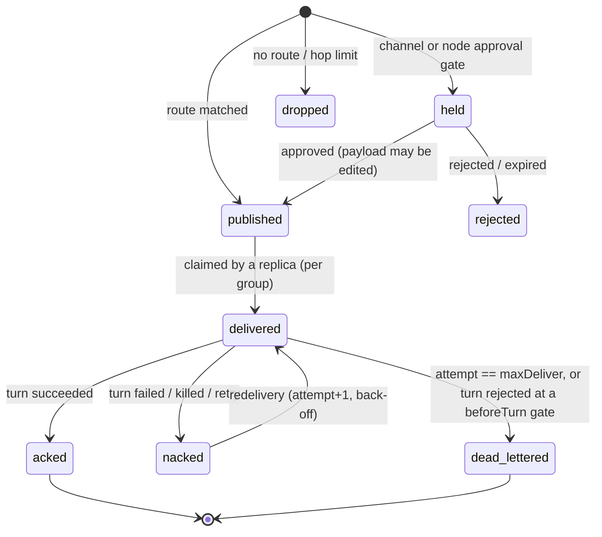

# Events, message lifecycle and traceability

Every fact the platform observes is appended to the **event log** (storage) before it is fanned out
to live subscribers. The log is the audit trail, the source of the console's live view and the
`/api/v1/events/stream` SSE feed, and the thing to read when asking "what happened?" after a restart.
Schema: [`schemas/event.schema.json`](../schemas/event.schema.json); Go: `server/internal/domain/event.go`.

## Envelope

| Field | Notes |
|---|---|
| `seq` | Store-assigned, strictly increasing. Resume cursor (`?after=`, `Last-Event-ID`). |
| `id` | `evt_…`, unique. |
| `type` | See catalogue below. |
| `time` | UTC, RFC 3339. |
| `graphId`, `nodeId` | Scope. |
| `replica` | Always present. `-1` = the node as a whole (node actions, scaling); `0` for graph-level events. |
| `executionId`, `messageId` | Correlation to a turn / message when relevant. |
| `actor` | Authenticated user or token name, `agent:<node>#<n>` / `<graph>/<node>#<n>` for tool calls, `bootstrap…`, or `system`. |
| `traceId` | OpenTelemetry trace id (32 hex) when known — jump to Tempo. |
| `level` | Reserved for log-level events. |
| `data` | Type-specific (below). |

Persisting an event never fails the operation it describes: write errors are logged and dropped.

## Catalogue

| Type | Emitted by / when | `data` |
|---|---|---|
| `graph.created` | engine, first save of a graph | `{version}` |
| `graph.updated` | engine, every later save (also bootstrap reloads that changed the document) | `{version}` |
| `graph.deleted` | engine, `DELETE /graphs/{id}` | — |
| `graph.started` | engine, `start` action | `{action, runId}` |
| `graph.paused` / `graph.resumed` | engine, `pause` / `resume` action | `{action, runId}` |
| `graph.stopping` | engine, `stop` (graceful) or `kill` action | `{action, runId}` |
| `graph.stopped` | engine reconciler, once no replica of a stopped graph is live | `{runId}` |
| `graph.failed` | engine reconciler, when a graph that should run cannot be deployed (version unloadable, condition no longer compiles, broker refuses topology); retried every reconcile, state returns to `running` on success | `{error}` |
| `node.scaled` | engine, `PUT …/scale` on a fixed cluster (`replica: -1`) | `{replicas}` |
| `replica.state_changed` | replica loop, on every state transition | `ReplicaStatus` |
| `execution.started` | turn start | `{iteration, inputs: [messageId]}` |
| `execution.completed` | turn succeeded | `Execution` |
| `execution.failed` | turn failed, cancelled (kill) or interrupted (crash recovery) | `Execution`; for interruptions `{status: "interrupted", error}` |
| `message.published` | engine, after the broker accepted a message on a channel | the full `Message` (`id, type, source, target, payload, metadata`) plus `channel` and `consumers` |
| `message.held` | engine, message parked at an approval gate | `{channel, type, approval}` |
| `message.dropped` | engine, emit matched no channel or exceeded `maxHops` | `{type, reason}` |
| `message.injected` | API, `POST …/channels/{c}/messages` | `{channel, type}` (actor = caller) |
| `message.delivered` / `.acked` / `.nacked` / `.dead_lettered` | *reserved* — these transitions are recorded in **message history** (below), not as events, to keep the log small | — |
| `tool.invoked` | tool gateway, before execution | `{tool, args (≤ 2 KiB), outcome: "started", durationMs: 0}` |
| `tool.completed` | tool gateway, after execution | `{tool, args, outcome: "ok"\|"error", durationMs, error?}` |
| `tool.denied` | tool gateway: unknown tool, no grant, constraint violation, rate limit, human rejection | `{tool, args, outcome: "unknown"\|"denied"\|"rate_limited"\|"rejected", durationMs, error}` |
| `approval.requested` | HITL service | `Approval` |
| `approval.decided` | HITL service (human decision or timeout) | `Approval` (actor = decider or `system`) |
| `operator.message` | API, `POST …/nodes/{n}/chat` | `OperatorMessage` |
| `agent.output` | runtime narration (native model text, tool call summaries, `POST /output`) | `{text}` (≤ 8000 chars) |
| `agent.broadcast` | ring clusters, end of each turn | `{text, iteration}` |
| `log` | engine: replica completed (stop policy met / ran once), node actions | `{message, node?}` |
| `provider.changed` | provider settings: create, update, delete, default (no graph id) | `{action, provider, revision}` (actor = caller) — never credentials |
| `provider.tested` | provider connection test (no graph id) | `{provider, ok, draft, model, durationMs, error?, toolCalling?}`; `level` is `warn` on failure; errors are redacted |
| `environment.build_started` | `POST …/environment/build` | `{hash, force}` (actor = caller) |
| `environment.ready` | environment build finished | `{hash, image, durationMs}` |
| `environment.failed` | environment build failed, timed out or was cancelled | `{hash, durationMs, error}` |
| `environment.reset` | `POST …/environment/reset`, graph deletion | `{errors}` (number of cleanup steps that failed) |

`stop` and `kill` emit `graph.stopping` immediately; `graph.stopped` follows when the last replica
has drained.

## Message lifecycle (message history)

Message history is a separate table (`messages`): **one row per (message id, channel, consumer
group)**, updated in place. Publish-side rows have an empty group; consumer rows carry the group and
the attempt counter. Dropped messages are recorded under the pseudo-channel `_unrouted`.



| Status | Row | Meaning |
|---|---|---|
| `published` | group `""` | Accepted by the broker for every group of the channel |
| `held` | group `""` | Waiting for a human at a gate (`metadata.held_for` = approval id) |
| `rejected` | group `""` | Gate rejected or expired |
| `dropped` | channel `_unrouted` | No channel matched, or hop limit; `error` says why |
| `delivered` | per group | Claimed by a turn (`consumer` = execution id, `attempt`) |
| `acked` | per group | Processed; duplicates of it are acked and skipped |
| `nacked` | per group | Failed; will be redelivered |
| `dead_lettered` | per group | Given up; inspect `error` |

## Correlation, causation and tracing

| Mechanism | Where | Semantics |
|---|---|---|
| `metadata.correlation_id` | every message | Id of the first message of the workflow (an injected request); inherited by every descendant. Query: `GET /graphs/{id}/messages?correlationId=…`. |
| `metadata.causation_id` | derived messages | Id of the input message whose turn emitted this one (the turn's *first* input when batching). Rebuild the causal tree from it. |
| `metadata.hops` | every message | Parent hops + 1. Over `spec.maxHops` (default 64) → `dropped` (cycle guard). |
| `metadata.execution_id` | derived messages | The turn that emitted it → `GET /executions/{id}` and `execution.*` events. |
| `metadata.traceparent` | every message | W3C trace context. The `agent.turn` span continues the trace of its first input and **links** the others (fan-in). Tool (`tool.<name>`), LLM (`llm.chat`, `gen_ai.*` attributes) and API spans nest inside; external runtimes receive `traceparent` on `/v1/turn`. |
| `Event.traceId`, `Execution.traceId` | log / executions | Jump from the console or Loki to the trace in Tempo. |

One injected request therefore yields one trace spanning every agent, broker hop, tool call and
model call it caused — across processes and brokers — and one correlation id that selects all of
its messages in history.

## Instruction events

`instruction.skill.updated` carries `skill_id`, `revision`, `deleted` and the authenticated actor. The atomic skill revision retains the durable audit. `execution.instructions.loaded` carries `entries` and `remaining_budget` with graph/node/execution correlation; bodies are excluded. See [instruction audit](instructions.md).

The loaded event also includes `omitted`. The turn span records
`leforge.instructions.entries` and `leforge.instructions.omitted`. Metrics
`leforge_instruction_loads_total{outcome="loaded|failed"}` and
`leforge_instruction_load_duration_seconds` cover resolution plus persistence;
labels contain no skill IDs, paths or content.

## Application review events

`review.requested`, `review.session`, `review.session_failed`,
`review.session_stopped`, `review.restarted`, `review.expired`, `review.cancelled`,
`review.decided`, `review.access_revoked`, and `review.continuation_queued` carry
`{id, state, session, generation}`, with graph/node/replica/execution correlation.
The durable record carries the decision actor, timestamp, method and feedback.
Event payloads do not contain preview credentials or HTTP request bodies.

Metrics: `leforge_review_transitions_total{action}`,
`leforge_preview_access_total{outcome}`, and
`leforge_preview_request_duration_seconds`; labels use bounded outcomes/actions,
not review IDs. Reconciliation creates a `review.reconcile` trace span. Cleanup
failures are logged with the review ID and retried while accounting is retained.

### Workspace observations

`workspace.observed` is emitted by the tool gateway after filesystem mutations,
Git writes and shell calls, including failures/cancellation. Its envelope carries
`graphId`, `nodeId`, `replica`, `executionId`, actor and trace identity. Data:

```json
{
  "tool": "shell.exec",
  "status": "complete",
  "attribution": "observed_during_tool",
  "scope": "workspace_except_git_metadata",
  "changes": [{"path": "src/result.txt", "operation": "modified"}]
}
```

Operations are `created`, `modified` or `deleted`; capture status is `complete`
or `partial`. Empty observations are retained. Paths are relative and no file
contents or hashes are stored. Query using the existing graph events API with
`types=workspace.observed`; pagination uses the existing sequence cursor.
See [workspace write access and observations](tool-permissions.md#workspace-write-access-and-observations)
for capture limits, concurrent writers and the distinction from proven authorship.

The continuous monitor uses the same `workspace.observed` type with
`source: "monitor"`, `attribution: "unknown"`, `observedAt`, and `since` when a
previous scan exists. It never supplies an execution ID. Node/replica, when
present, identifies a worktree scope, not the writer. `status: "baseline"` marks
initialization; `gap: true` marks baseline/restart or incomplete coverage.
Discovery failure emits `status: "partial"`, `gap: true` and
`reason: "discovery_failed"` for known scopes. Existing events survive restart,
but snapshot baselines are in memory and offline changes are not reconstructed.
Tool and monitor observations may overlap; neither proves exclusive authorship.
