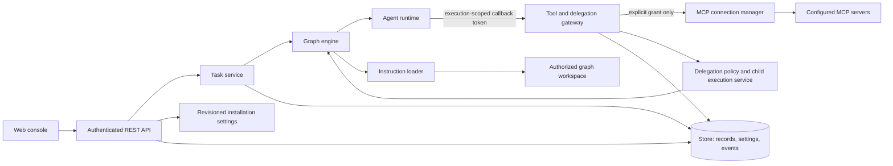

# Product Contracts and Current-State Inventory

This document records the current cross-component baseline and proposed
design contracts for the next LeForge capabilities. It is a design reference,
not a claim that planned endpoints or behavior have already been implemented.
The implemented wire contracts remain in [OpenAPI](../api/openapi.yaml),
[Runtime Protocol](runtime-protocol.md), [graph schema](../schemas/graph.schema.json),
[event catalogue](events.md), and [storage reference](database-schema.md).
When implementation begins, update those normative specifications and their
schemas alongside the code.

## 1. Current-State Inventory

| Surface | Current contract and implementation | Known boundary |
|---|---|---|
| Public API | `/api/v1` REST API, role-checked per route; graph CRUD/versioning, lifecycle, messages, chat, executions, events, approvals, model providers, tools, workspace file listing/reading. See [API reference](api.md) and [OpenAPI](../api/openapi.yaml). | No first-class user task, MCP connection, skill/steering, or delegation resource yet. |
| Web console | React/TypeScript SPA served by `forged`; graph canvas, provider/integration settings, files, approvals, events, and operational views. Main surfaces: `web/src/App.tsx`, `GraphCanvas.tsx`, `IntegrationsView.tsx`, `FilesView.tsx`, `ApprovalsView.tsx`, and `EventsView.tsx`. | The canvas edits a local graph draft (agents, channels, properties, positions) shared with the YAML view and saves it through the whole-document `PUT` with `If-Match`; validation errors are mapped to the agent/channel field that caused them. File interaction is partial; user file operations are read-only. |
| Runtime | External runtimes use Runtime Protocol v1. `TurnInput` carries graph/node/replica context, prompt, inputs, model reference, granted tools, and a per-execution callback token. Model calls and tools are mediated by the control plane. | No delegation request contract or effective-instruction snapshot is sent yet. Platform-managed provider credentials are not sent to runtimes; graph-authored `runtime.env` and `config` are passed as runtime inputs and are not a secure secret store. |
| Tools and permissions | Default-deny tool gateway. Graph node `tools` grants are enforced for native and external agents; constraints and approval/rate limits are defined in [tool permissions](tool-permissions.md). | `mcp.*` is an extension point only; there is no managed MCP registry or per-connection authorization implementation. |
| Workspace | `GET /api/v1/graphs/{id}/files` and `/files/content` are viewer-readable. Paths are resolved inside the graph/worktree root; `.git` is hidden, directory results are capped, file content is limited to 4 MiB and served as plain text with a deny-all CSP. | No Git status/diff/history API or task-to-change attribution yet. No user-facing workspace write/delete/upload API. |
| Persistence | `storage.Store` persists graph versions/control records, events, messages, executions, approvals, operator messages, replica status, KV, leases, and revisioned installation settings. Settings use compare-and-set revisions. Provider credentials are encrypted before storage. See [database schema](database-schema.md). | Future install-wide records should use settings or an explicitly designed store entity; graph/workspace data must remain scoped. |
| Authorization | Current installation uses hierarchical `viewer < operator < admin` roles from static tokens or optional OIDC. Route middleware authenticates and authorizes before handlers. Per-execution callback tokens are scoped to one running turn. | There is no multi-tenant/user ownership model. A deployment is one installation security boundary; do not imply per-user data isolation that does not exist. |
| Events and audit | Durable event envelope carries sequence, actor, graph/node/replica, execution/message IDs, trace ID and type-specific data. Provider changes/tests are installation-level events; tool and approval events are already defined. See [events](events.md). | Event append is currently best-effort for some operations. Planned security-sensitive mutations must not silently succeed without their required audit record. |
| Docker deployment | Compose runs `forged`, the agent runtime, broker, PostgreSQL, observability services, and `sandbox-daemon` (a Docker daemon dedicated to agent command sandboxes, reached over mutual TLS on a separate `sandbox` network; see [sandbox-runtime.md](sandbox-runtime.md)), with named data volumes. The web console is accessed through the published `forged` port. | Future MCP transports must be reachable from the platform container under explicit network policy; arbitrary local process launches in `forged` are not permitted. |

The current model-provider management API is the established pattern for
installation-managed configuration: metadata-only reads, write-only
credentials, `If-Match` revision checks, role-specific operations, and
redacted test results. New installation-managed resources should follow that
pattern where applicable.

## 2. Contract Conventions

- JSON field names are `camelCase`; event metadata keys retain their existing
  `snake_case` convention.
- IDs are opaque, stable identifiers. Clients must not infer authorization
  from an ID or a tool name.
- Installation-managed mutations use revision/ETag compare-and-set and return
  `409 conflict` for a stale revision or an incompatible state transition.
- Invalid request fields return `422 invalid` with field paths in
  `details.errors[]`. Malformed JSON returns `400 invalid`.
- `401 unauthorized`, `403 forbidden`, `404 not_found`, and `429 rate_limited`
  retain their existing meanings. Upstream MCP/provider failures use a
  non-success HTTP status when the operation itself fails; a successful test
  request may return `200` with `ok: false` to report the test result.
- Error text, events, logs, and response bodies must not include secret
  values. Do not echo request bodies that can contain credentials.
- Platform-managed provider, MCP, and control-plane credentials are never sent
  to an agent runtime. Graph-authored `runtime.env` and `config` are separate,
  user-controlled runtime inputs; they must not be used for managed secrets.
  A future secret-reference feature must resolve credentials only at the
  control-plane boundary and must not serialize their values into `TurnInput`.
- Every persisted mutation that starts work or changes permissions/configuration
  records the authenticated actor and its relevant scope. Audit payloads must
  omit credentials and redact sensitive tool arguments/results.
- Authorization is enforced in the control plane for every request/call. Data
  is scoped to the installation and, where applicable, graph, node, workspace,
  task, and execution. Agent-provided IDs, prompts, skills, or steering never
  grant authority.

## 3. Installation-Managed Connections and Skills

### MCP connections

MCP connections are installation-scoped resources and may have multiple
connections for the same service. The proposed public API is:

| Method and path | Minimum role | Contract |
|---|---|---|
| `GET /api/v1/mcp/connections` | viewer | List connection metadata and current status; never return credentials or ciphertext. |
| `POST /api/v1/mcp/connections` | admin | Create a connection; credential fields are write-only. Return `201` and the safe connection view. |
| `GET /api/v1/mcp/connections/{connectionId}` | viewer | Read the safe connection view. |
| `PUT /api/v1/mcp/connections/{connectionId}` | admin | Update settings/credential with `If-Match`; omitted credential keeps the stored value, explicit clear removes it. |
| `DELETE /api/v1/mcp/connections/{connectionId}` | admin | Revoke and remove the connection; refuse with `409` while it is in active use unless the caller first removes grants. |
| `POST /api/v1/mcp/connections/{connectionId}/test` | operator | Test reachability/authentication and report a redacted result. |
| `POST /api/v1/mcp/connections/{connectionId}/tools/refresh` | operator | Discover and persist the current tool catalogue; return the new catalogue revision. |

Connection metadata includes `id`, `service`, display name, endpoint/transport
metadata, `status`, `credential.configured`, `lastTest`, `toolsRevision`,
`createdAt`, `updatedAt`, and `updatedBy`. Credential values, authorization
headers, refresh tokens, and ciphertext are never part of a read model.
Secrets are encrypted with the installation secret key before being placed in
revisioned settings, one setting per connection (for example,
`mcp/connections/{connectionId}`), so updates to distinct connections do not
overwrite each other.

The platform owns MCP transport sessions. Agent runtimes never receive MCP
credentials or connect directly to MCP servers. Discovered tools are exposed
only through the tool gateway under a stable connection-qualified name
`mcp.{connectionId}.{toolName}`. A node must have an explicit matching grant
in `spec.nodes[].tools`; existing constraints, rate limits, approvals, and
gateway checks apply to every invocation. Removing a connection invalidates
its grants and makes further calls fail closed.

Transport support is selected from transports reachable by `forged` inside
Docker and implemented without executing arbitrary user commands in the
control-plane process. Connection-level network restrictions, TLS validation,
timeouts, response-size limits, cancellation, and redirect/endpoint
validation are mandatory. No endpoint or tool name supplied by an agent may
cause the gateway to select a different connection.

### Skills and project steering

- Application-managed skills are installation resources with stable IDs,
  immutable revision history, a title/description, an enabled flag, and a
  versioned Markdown body. Proposed API: `GET/POST /api/v1/skills`,
  `GET/PUT/DELETE /api/v1/skills/{skillId}`. Reads require `viewer`; writes
  require `admin` and use `If-Match`. `DELETE` disables a skill rather than
  erasing revisions; it returns `409` while an active graph version selects
  that skill. Existing execution manifests remain resolvable.
- Graphs opt into skills by ID through a graph-level instruction reference;
  nodes may narrow the selected set but may not add unapproved privileges.
- The proposed graph field is `spec.instructions: {skillIds: string[],
  projectSteering: boolean}`; omission means no application skill or project
  steering is loaded. Nodes may optionally name a subset of the graph's
  selected skill IDs. A node cannot reference a skill that its graph did not
  select.
- Project steering is read only from the authorized graph workspace under
  `.leforge/steering/`, from Markdown files whose resolved paths remain inside
  that workspace. The graph must explicitly enable project steering. Symlinks
  escaping the workspace are rejected.
- The effective instruction precedence is platform security policy (not
  overrideable) → installation defaults → graph-selected skills → authorized
  project steering → node prompt/instructions → current task. This is
  precedence for context composition only: no instruction source can alter
  authorization, limits, credentials, or approval policy.
- Each execution records an immutable instruction manifest: source type,
  stable ID/path, revision or content hash, and whether content was included
  or omitted due to a size/token limit. The runtime receives the composed
  instruction content and non-secret manifest only. Repository content is
  untrusted input and must be bounded and isolated by workspace.

### Project environments

**Delivered** (see [environments.md](environments.md)):

- `spec.environment` in the graph document is the single effective
  definition: `image` or `dockerfile`, `setup[]`, `network.setup`/`network.run`
  (`none`/`bridge`/`egress`, with separate `network.setupAllowedHosts` and `network.allowedHosts`),
  `caches[]`, `timeout`, `cpu`, `memory`, and optional
  `origin` for accepted repository definitions. It is versioned
  with the graph and saved through the graph `PUT`.
- Build state per graph: `absent`, `building`, `ready`, `failed`, with the hash
  of the built definition, image reference, cache volumes, timestamps, actor and
  a 64 KiB log tail. `upToDate` compares it with the saved definition.
- `GET /graphs/{id}/environment` (viewer), `POST …/environment/build`
  (operator, `{force}`), `POST …/environment/reset` (admin, refused while the
  graph runs). Starting nodes that need an environment that is not up to date
  returns `422` at `spec.environment`.
- Events `environment.build_started|ready|failed|reset`; metrics
  `leforge_environment_builds_total{outcome}` and
  `leforge_environment_build_duration_seconds{outcome}`; span
  `environment.build`.

**Delivered discovery API:** `GET /graphs/{id}/environment/discovery` (viewer)
reads an existing checkout without mutation. Explicit `spec.environment` returns
`source: interface`, `status: configured`; otherwise discovery follows LeForge,
devcontainer, Dockerfile, Compose precedence. Results contain `source`, `status`
(`review_required`, `invalid`, or `proposal_required`) and `candidates` with
`path`, `sha256`, optional `services` and `error`. No source contents are returned.
Discovery performs bounded structural inspection. `POST …/environment/resolve`
(viewer) accepts `{source, path, sha256, service?, target?}`, verifies the selected candidate,
normalizes supported fields and returns an environment with
`origin: {source, path, sha256, service?, files: {path: sha256}, dockerfilePath?, contextSHA256?, target?}` for review.
The console requires explicit selection, review and acceptance into the draft.
Persistence uses the existing **admin-only** graph PUT and optimistic concurrency;
acceptance never starts a build. Source and referenced-file hashes and normalized
settings are checked again on graph save and before build (including cache hits).
Stale files/settings and unsupported fields return `400` without starting Docker;
graph version conflicts retain the existing `409` behavior.

Supported input subsets and limits are documented in [environments.md](environments.md).
Repository definitions cannot set origin, CPU/memory overrides or execution
networking beyond `none`; unhandled Compose settings and unsupported Dockerfile
features fail explicitly. Local COPY/ADD contexts are confined to the workspace,
filtered by ignore rules, bounded, hashed on acceptance, and revalidated before
save and build. The validated tar snapshot is sent to the dedicated daemon.
Named build targets are selectable for standalone Dockerfiles and supported via
LeForge `target` and Compose `build.target`. The accepted target contributes to
the image hash. COPY --from supports local stage names/indices with cycle
validation and syntactically validated external image names, tags and digests.
Local stages take precedence; unmatched names resolve as images during build.
Acceptance tracks literal references, not mutable registry tag contents. External
named build contexts and other COPY flags remain unsupported. These are conservative input restrictions, not a
new installation-wide policy configuration. Missing/unreadable checkouts or scan
limits return an error, never a fallback. Discovery does not clone a repository.

When discovery returns `proposal_required`, an admin can request a bounded,
tool-free model analysis of allowlisted manifests/lockfiles. A durable
`environment` approval includes the full suggested definition, rationale and
input fingerprint. Admin acceptance revalidates the graph version and input
hashes, saves the exact approved definition and triggers the build. The engine
blocks starts until ready; a graph starts automatically only when the requester
explicitly selected that option. Rejection, expiration and cancellation do not
build. Approved work survives restart, and failed builds can be retried. This
workflow is available through the console and environment proposal API; invoking
it through `environment.propose`/`environment.status` agent tools remains planned.
See [proposal limits and behavior](environments.md#agent-proposal-and-developer-approval).

**Planned — not implemented yet** (tracked in
[TASKS.md, section 3](../wip/TASKS.md#3-provide-containerized-project-environments)):
Additional format support, agent-callable environment tools,
broader reuse lifecycle and global resource scheduling extend the delivered subset. The sections below retain the full target contracts;
only the capabilities explicitly described as delivered above are available.

#### Planned discovery and acceptance

Repositories do not need LeForge-specific files. Preserve an explicit
operator-configured environment; otherwise discover definitions in the order
below. Acceptance saves the effective definition into `spec.environment`,
creating a graph version attributed to the accepting operator. Keep the source,
repository revision and definition hash as provenance so changes can be detected
before acceptance and build.

| Priority | Source | Planned contract |
|---|---|---|
| 1 | `.leforge/environment.yaml` | Highest repository priority; same environment fields, with validated repository-relative Dockerfile paths and build contexts confined to the authorized workspace. |
| 2 | `.devcontainer/devcontainer.json` | Support the image/post-create command subset initially; report unsupported fields explicitly. |
| 3 | Dockerfiles | Discover candidates and build targets within bounded repository paths; ask the operator to choose when ambiguous. Validate build context containment and respect ignore rules. |
| 4 | Docker Compose | Discover `compose.yaml`, `compose.yml`, `docker-compose.yaml`, `docker-compose.yml` and explicitly selected variants. Select a development service and review required companion services; do not start the entire stack automatically. Supported fields and override handling must be specified before implementation. |
| 5 | Agent analysis | Only when no definition file is found: analyze manifests, lockfiles and toolchain declarations such as `mise.toml`, `go.mod` and `package.json`, then propose an environment for developer approval. |

Show discovered definitions for operator acceptance before building. An invalid
or unsupported higher-priority definition produces an actionable error, not a
silent fallback to another source or agent analysis. Repository content cannot
request host mounts, privileges, credentials, limits or network access beyond
installation policy; acceptance does not bypass those controls. Compose
interpolation and build contexts require the same validation and trust boundary.

The analysis agent must work before a project environment exists, using bounded,
read-only access to the authorized repository without installing dependencies
or executing repository commands. The planned tools are:

- `environment.propose {image or dockerfile, setup, network, caches, rationale}`:
  propose the tools/image, preparation steps and resource needs; open an approval
  showing the complete definition, rationale and diff against the current one.
- `environment.status`: report environment/build state and why work is waiting.

The developer approval gate blocks both building and task execution. Rejection
or cancellation must not start either. Approval saves the accepted definition
as a new graph version with the approver as actor; revalidate its revision and
installation policy before building. Execution resumes only after the environment
is ready. Stale approvals, analysis failures, timeouts and build failures remain
visible with an explicit recovery path. Exact new endpoints and state schemas
remain to be specified; the delivered build states above are unchanged today.

#### Delivered installation policy

`isolation.docker.environmentPolicy` now restricts preparation and execution
networks and can disable agent proposals, Dockerfiles, setup or Compose helpers.
It is checked on preview/save, before agent approval, on approval application,
before builds/cache hits and before runtime admission. Developer approval cannot
override it. Node network overrides obey the execution restriction. Manual
Dockerfiles use the same supported subset as untrusted repository definitions.
Network fields are managed in Integrations with persisted revisions; server YAML
provides initial defaults and the remaining feature restrictions. Existing running
containers are not revoked automatically.
Omitted lists preserve `none`/`bridge` compatibility; runtime defaults to `none`.
Dockerfile RUN follows preparation networking. Daemon-wide registry access needs separate controls; runtime and preparation HTTP/HTTPS egress
allowlists are implemented. See
`docs/environments.md` for configuration, migration and verification boundaries.

#### Delivered installation network administration

Integrations exposes build/setup modes, runtime modes and the installation host
ceiling. Viewers/operators can inspect settings and graph host usage; only admins
can preview and save edits. Confirmation shows affected saved environments and
warns about unrestricted bridge and existing running work. Persisted revisions
prevent concurrent edits from overwriting each other. Saved network settings
supersede YAML defaults across controllers sharing the store; feature flags,
proxy provisioning and credentials remain server-owned. Storage errors fail
closed. Start/resume and post-capacity admission recheck the current policy.
Running tasks/builds are not killed automatically. Per-environment proxy status and sampled blocked-request diagnostics are delivered
in graph settings and agent panels.

#### Delivered runtime egress subset

`network.run: egress` plus `network.allowedHosts` selects a managed per-replica
HTTP/HTTPS proxy. The installation must permit egress and every exact host in
`environmentPolicy.egressHosts`. Manual, repository and agent definitions follow
the same ceiling and approval/provenance checks. The agent's internal network has
no direct internet route or host gateway address; the proxy alone has an uplink.
Public-IP validation and pinned dials block private DNS answers/rebinding. Requests
outside the list are denied and logged without paths or credentials. Proxy
lifecycle participates in global capacity, idle suspension and group ownership.
Changed lists require replacing the old task group; they do not rebuild images.

This delivers runtime HTTP/80 and CONNECT/443 destination restrictions, not TLS
content inspection, private-service access or arbitrary protocols. Preparation
proxying is delivered separately below. Daemon-wide registry controls remain planned. See
`docs/environments.md` for configuration, image provisioning and tested limits.

#### Delivered preparation egress subset

`network.setup: egress` with `network.setupAllowedHosts` covers Dockerfile RUN and
setup. The installation must enable that mode and approve every exact host.
The editor exposes the preparation list separately from runtime hosts. The
BuildKit worker and setup use an isolated internal network with external DNS
disabled; only their managed proxy has an uplink. Preparation requires global
capacity admission for worker plus proxy (one extra slot, 64 MiB, 0.25 CPU).
Host-set changes invalidate compatible-image reuse. Failure/cancellation cleans
the group, retaining capacity if cleanup cannot be confirmed; committed setup
images clear transient proxy variables.

BuildKit registry/layer requests use the preparation proxy and require approved
registry/CDN hosts. Daemon provisioning pulls and client-side registry
authentication are outside this subset; daemon-wide registry restrictions remain
planned. There is no private-IP exception or automatic allowlist expansion.
See [environment preparation](environments.md#build-and-setup-egress-proxy-implemented).

#### Delivered proxy diagnostics subset

The environment and agent panels expose read-only runtime/build proxy container
state and bounded recent request outcomes, with explicit unavailable/error states.
Queries verify graph ownership and return structured fields only. The preparation
proxy's last snapshot persists across container cleanup until replaced/reset.
Runtime samples remain tied to Docker container/log retention. Sampling covers
at most 32 proxies and 100 recent log lines per proxy, not lifetime counters.
Running means process state, not connectivity health; direct network-layer blocks
and still-open CONNECT tunnels are outside the completed-request sample.
Older containers require recreation for monitoring labels; reason codes require
an updated trusted proxy image. Collected denials persist independently of Docker
for seven days, up to 1,000 per graph, and survive resets/controller restarts.
Background collection and final lifecycle capture use concurrent-safe shared
storage. The separate history endpoint and panel disclose retention and last
successful collection. Sampling gaps remain possible; guaranteed audit delivery,
configurable retention and streaming monitoring remain planned/outside this subset.

#### Delivered reuse subset

Repository graphs with default isolated workspace paths reuse prepared images
and immutable dependency-cache seeds within the installation and exact repository
identity. Compatibility includes the effective definition/context, bounded
manifest and lockfile inputs, daemon platform/address and versioned policy.
Renewable leases deduplicate preparation. Each graph reruns setup and gets
private writable cache copies; setup container state is never shared as an image.
Reset and graph deletion retain shared generations and remove only graph-owned
resources. Status, logs and ready events expose reuse. Unit, API integration,
concurrency and dedicated-daemon tests cover invalidation, failure, cancellation,
isolation and reset. See [environment reuse](environments.md#reuse-across-tasks)
for limits and semantics.

Execution sandboxes and environment pipelines now share installation-wide count
and reserved-memory budgets,
with finite Docker memory/swap limits, persistent reservations, cancellation,
daemon inventory checks and confirmed-stop/removal release. Defaults are four active
slots, 4 GiB total and 1 GiB per sandbox/pipeline. BuildKit workers, setup and
cache-copy helpers run sequentially with the reserved memory cap and no extra
swap; the complete pipeline holds one slot. Build timeout includes admission
waiting. Logs/events and bounded-label metrics
report admission. See [capacity](sandbox-runtime.md#global-execution-sandbox-capacity).
The budget excludes daemon overhead and external runtimes.
Idle execution sandboxes stop between turns after `isolation.docker.idleTimeout`
(default `5m`, `0s` disables), preserving container files, workspaces and caches.
New work resumes the same container after capacity admission. Active turns and
approval waits inside a turn are excluded. Suspension stops processes; it does
not checkpoint process memory. Failed stop retains capacity; failed resume
preserves inputs for retry. Explicit task teardown still removes its container
while keeping mounted workspace data.
See [idle lifecycle](sandbox-runtime.md#idle-suspension-and-task-resume).
The admin console in Integrations now previews shared resources, explains retention,
and requires selection plus confirmation of the exact images/cache volumes before
cleanup. It reports partial failures and refreshes after each attempt.
Explicit admin cleanup now reclaims unused registered shared generations after
revalidating environment/build/container references under the reuse lease.
Stopped containers and ready stopped tasks retain their references. Partial
failure invalidates reuse and keeps ownership records for retry; cleanup never
forces Docker removal or deletes workspaces/private caches. Historical resources
without registered ownership remain untouched. See
[shared cleanup](environments.md#cleanup-of-unused-shared-generations).
Global CPU accounting is implemented for execution, builds, setup and cache copies, with finite defaults, atomic durable reservations, kernel caps, cancellation and readmission on resume. Legacy memory-only reservations block new admission until normal stop/reset releases them.
The target lifecycle below includes those extensions.

#### Planned reuse and resource lifecycle

Reuse prepared images and compatible dependency caches across tasks for the
same authorized repository and effective environment. The reuse identity must
include the definition, relevant preparation inputs (including lockfiles),
platform and policy. Reuse unchanged environments; rebuild on relevant input
changes or explicit request. Coordinate concurrent builds with leases so the
same compatible environment is not built repeatedly.

Task workspaces/worktrees and active execution containers remain isolated.
Continuing the same task may reuse its container, but simultaneous tasks must
not share mutable task state. Share dependency caches only where concurrent
access is supported; otherwise lock or isolate them. Shared image layers must
exclude task-specific workspace contents and secrets, and reuse must not expose
private artifacts across unauthorized scopes.

Image/cache reuse saves build time and disk; memory consumption is controlled
by per-sandbox CPU/memory limits and a global budget for active builds and
executions. Queue tasks when capacity is exhausted and release capacity on
completion, failure or cancellation. Stop idle containers while preserving
resumable task state and workspace data.

Track references and ownership for shared images/caches. Reset, graph deletion
and cleanup must not remove resources another task still needs; reclaim unused
resources through an explicit lifecycle. The existing per-graph reset contract
must be extended and tested before enabling shared resources.

The console should explain source selection, approval waits, reuse versus
rebuild (and why), capacity waits and reset effects. Extend existing audit and
telemetry mechanisms for these outcomes without sensitive payloads or unbounded
metric labels. Unit, integration and browser tests must cover discovery order,
approval gating, reuse/invalidation, concurrent access, workspace isolation,
resource admission and safe reset; the implementation checklist records these
as pending work.

## 4. User Tasks and Child Executions

### User-initiated tasks

The interface needs a first-class task record so a request can be followed
through messages, executions, approvals, and file changes. Proposed API:

| Method and path | Minimum role | Contract |
|---|---|---|
| `POST /api/v1/graphs/{graphId}/tasks` | operator | Create a task and return `202` with its stable ID and initial state. |
| `GET /api/v1/graphs/{graphId}/tasks` | viewer | List tasks in the graph, with bounded pagination and status filters. |
| `GET /api/v1/graphs/{graphId}/tasks/{taskId}` | viewer | Read the task, linked message/execution IDs, and terminal result when available. |
| `POST /api/v1/graphs/{graphId}/tasks/{taskId}/cancel` | operator | Request cancellation; return the current task state. |

Create body contains exactly one target: either `{nodeId, instruction,
replica?}` for operator-directed agent work, or `{channelId, type, payload}`
for graph-routed work. Optional `title` and a client idempotency key are
metadata, not instructions to bypass graph routing. The backend validates the
graph, node/channel, state, payload limits, and caller role before accepting.
The resulting task is associated with the operator message or injected
message, and descendants inherit `taskId` through platform-controlled
correlation metadata.

Persist a task record with `id`, `graphId`, `createdBy`, target, status,
created/updated timestamps, linked message IDs, linked execution IDs, and
terminal result/error summary. The task state is `queued`, `running`,
`awaiting_approval`, `succeeded`, `failed`, `cancel_requested`, or `cancelled`.
Task and execution history follow existing retention/audit policy and cannot
be used to read another graph's workspace.

### Dynamic child execution

The installation administrator manages approved profiles and the global
delegation policy through the public API:

| Method and path | Minimum role | Contract |
|---|---|---|
| `GET /api/v1/delegation-policy` | viewer | Read the effective policy; no secrets are included. |
| `PUT /api/v1/delegation-policy` | admin | Update policy with `If-Match`; validate every configured limit against finite server-side bounds. |
| `GET /api/v1/delegation-profiles` | viewer | List safe profile metadata and revisions. |
| `POST /api/v1/delegation-profiles` | admin | Create an approved profile; return its stable ID and revision. |
| `GET /api/v1/delegation-profiles/{profileId}` | viewer | Read the safe profile definition and allowed grants. |
| `PUT /api/v1/delegation-profiles/{profileId}` | admin | Create a new profile revision with `If-Match`; active delegations retain their pinned revision. |
| `DELETE /api/v1/delegation-profiles/{profileId}` | admin | Disable/remove a profile; refuse with `409` while referenced by active delegations. |

Profiles are installation-scoped templates containing a configured runtime
and model reference, bounded objective/input instructions, and an allowlist of
tool grants. They cannot contain provider/MCP credentials, arbitrary runtime
commands, endpoints, or secrets. The revisioned installation policy contains
`enabled`, `approvalMode` (`required` or `automatic`), `maxDepth`,
`maxChildrenPerExecution`, `maxConcurrentChildren`, `maxDurationSeconds`,
`maxInputTokens`, `maxOutputTokens`, and `maxCumulativeTokens`. These limits
are enforced across all service instances. Settings and profiles use
compare-and-set revisions; each delegation records the effective policy and
profile revision used to authorize it.

Delegation is a runtime capability, not an API that lets an agent mutate the
permanent graph. When enabled by installation policy, the runtime sees a
platform-provided `agent.delegate` tool. It is advertised only when the
delegation service can accept requests; agents cannot enable the capability
or select arbitrary grants themselves.

The callback operation is scoped to the current execution token:

```http
POST /internal/v1/executions/{executionId}/delegations
Authorization: Bearer <current execution callback token>
Content-Type: application/json
```

```json
{
  "profile": "approved-profile-id",
  "objective": "Review the proposed implementation",
  "input": {},
  "idempotencyKey": "caller-generated-key"
}
```

The profile must be an installation-approved agent template. The service
derives effective permissions as the intersection of the parent's grants and
the profile's allowed grants; arbitrary runtime, model, endpoint, credential,
or grant overrides are rejected. The response identifies the delegation and
its state. In approval-required mode, creation returns `awaiting_approval` and
the callback waits for approval/terminal result within the turn deadline. In
automatic mode, the child starts immediately if all limits allow it.

Persist `delegationId`, `parentExecutionId`, root execution/task ID, profile
revision, objective, state, approval ID, child execution ID, effective-grant
hash, timestamps, usage, and terminal result. Child executions carry
`parentExecutionId` and `delegationId`; they never modify the saved graph.
Enforce global maximum depth, children per parent, concurrent children,
duration, and cumulative usage/budget at the service, across all instances.
If token usage cannot be measured reliably for the chosen provider, reject
policies that require token-budget enforcement and do not claim a token or
cost ceiling was enforced. Cost may be reported as unavailable when usage is
reliable but provider pricing is not.

## 5. Authorization, Audit, and Error States

### Authorization matrix for planned operations

| Operation | viewer | operator | admin | Agent/runtime |
|---|---:|---:|---:|---:|
| Read safe MCP/skill/task metadata and task history | yes | yes | yes | no |
| Test an MCP connection or refresh its tool catalogue | no | yes | yes | no |
| Create/update/revoke MCP connections or global skills | no | no | yes | no |
| Start/cancel user tasks or decide approvals | no | yes | yes | no |
| Invoke an MCP tool | no | no | no | only via current execution token and explicit effective grant |
| Request a child execution | no | no | no | only via current execution token, enabled policy, approved profile, and enforced limits |
| Read/write project steering | read-only through its authorized execution context | read-only through its authorized execution context | configure graph access | only content passed for this workspace; no direct host filesystem access |

Role checks are necessary but not sufficient: graph/workspace association,
resource state, node grants, execution-token scope, and policy limits are
checked independently at the operation boundary. The installation remains
the tenant boundary until a separate multi-tenant identity/ownership model is
designed.

### Audit event families

Extend the event catalogue with installation-level events (no `graphId`
unless the operation also names a graph) that never include credential
material:

- `mcp.connection.changed` and `mcp.connection.tested`;
- `mcp.tools.refreshed`;
- `mcp.tool.invoked`, `mcp.tool.completed`, and `mcp.tool.denied`;
- `skill.changed`;
- `task.created`, `task.state_changed`, and `task.completed`;
- `delegation.profile.changed`, `delegation.policy.changed`,
  `delegation.requested`, `delegation.approval_decided`, and
  `delegation.state_changed`.

Events include actor, scope IDs, resource IDs, revision, outcome, duration,
and safe error code as applicable. Do not log raw credentials, auth headers,
full prompts, or unredacted MCP arguments/results. For security-sensitive
mutations (credential change/revocation, grants, approval decisions, and
delegation policy changes), persist the required audit event before reporting
success; surface an explicit error if it cannot be persisted. High-volume
tool-call telemetry may follow the existing event policy but must never be
presented as a guaranteed audit record unless durable append is confirmed.

### User-visible state and error mapping

| Condition | HTTP/API behavior | Interface state |
|---|---|---|
| Invalid field, unsupported transport, malformed instruction, or invalid target | `422 invalid`, with field path(s) in `details.errors[]` | Show the error beside the field/graph element; retain user input. |
| Missing/invalid authentication | `401 unauthorized` | Prompt to sign in; do not clear unrelated unsaved graph edits. |
| Authenticated caller lacks role, graph access, or tool grant | `403 forbidden` | Explain the denied action without exposing secret or protected resource details. |
| Resource or graph does not exist | `404 not_found` | Show unavailable state and preserve the rest of the view. |
| Stale revision, duplicate idempotency key with different payload, invalid lifecycle transition, or resource still in use | `409 conflict` | Preserve local edits and offer refresh/recovery. |
| Rate/cost/concurrency/depth limit reached | `429 rate_limited` or a typed `409 conflict` for a persisted policy cap | Explain which limit blocked work and whether retry is possible. |
| Connection/runtime/provider unavailable or timed out | Typed non-2xx error for the operation; test endpoints may return `200` with `ok: false` | Show `unavailable`/`timed_out`, safe diagnostic, retry action, and last successful check separately. |
| Human decision required | Accepted work remains `awaiting_approval`; no child side effect before approval | Show pending approval and the task/delegation context; decisions are first-writer-wins. |
| Cancellation requested | Accepted work enters `cancel_requested` until termination is confirmed | Show that cancellation is in progress; only report `cancelled` after termination. |
| Unexpected internal failure | `500 internal` with generic public message and correlation/trace ID | Show an error state and trace/reference ID; never a success-shaped fallback. |

All operations must have finite deadlines and payload limits. An error or
timeout must not silently fall back to broader permissions, a different
connection/provider, omitted security policy, or a successful state.

## 6. Planned Component Boundaries

The following view describes the target boundary for Release 1 additions; it
does not depict currently shipped components:



The public REST API does not proxy arbitrary MCP endpoints or expose callback
tokens. The runtime callback remains per-execution and short-lived. The
connection manager owns external sessions and credentials; the delegation
service owns policy, profile selection, approvals, resource budgets, and child
execution lifecycle. The instruction loader can read only the graph's
authorized workspace and returns content plus a provenance manifest.

## 7. Acceptance Criteria for Contract Readiness

- Backend, UI, runtime, and operations can use this document to agree on
  resource boundaries and failure behavior before implementing each feature.
- Implementations update OpenAPI, JSON Schemas, domain types, migrations when
  required, event catalogues, and user/operator documentation together.
- Contract tests cover authorization failures, stale revisions, secret
  redaction, workspace isolation, approval gates, idempotency, limits, and
  cancellation.
- No planned behavior is described in product UI or setup documentation as
  available until the corresponding implementation and tests pass.

### Environment progress in the console

Implemented: graph environment settings and the agent panel explain reuse,
build-reason categories, active build phases and capacity waits. The agent panel
respects inherited isolation and image overrides, shows environment readiness
and errors, and presents recent per-replica admission history. Structured status
is persisted independently of build logs. Exact changed-file diffs, durable
execution queue positions/ETAs and browser E2E remain planned.

### Reviewed Compose dependency groups

Implemented: standard Compose filenames and explicit standalone variants,
development service selection, transitive list-form dependencies and mandatory
helper review in the console. Up to three prebuilt helpers run only during agent
execution, each replica in its own internal network. CPU/memory/count admission
is atomic for the entire group; suspension preserves helper data, and explicit
teardown removes only owned containers/network/helper anonymous volumes. Source
fingerprints and role-based graph saving remain authoritative.

Unsupported: implicit override merging, helper builds, environment/secret injection,
mounts, ports, privileges, network overrides, application-health conditions and
helper availability during build/setup. Rejection is explicit; unrelated services
never start. See [Compose services](environments.md#compose-runtime-services).
