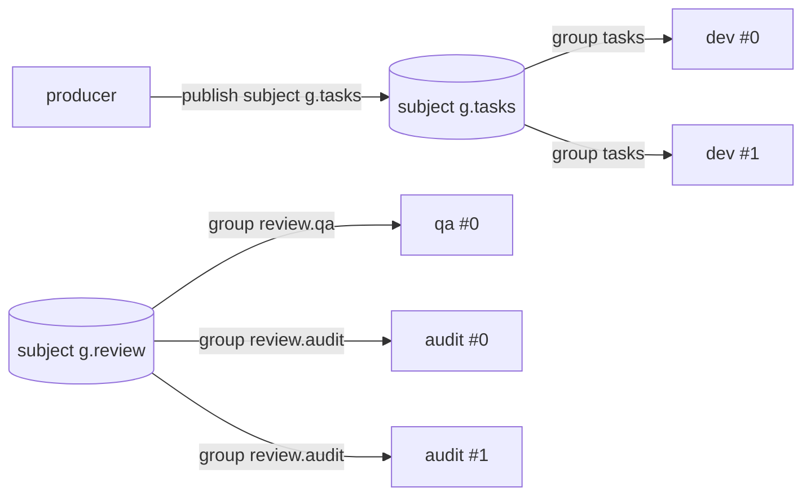

# Queue architecture

Agents never talk to each other directly. They exchange **messages over durable channels**, and the
transport behind a channel is a pluggable broker: filesystem, in-memory, **NATS JetStream (default)**,
Redis Streams, RabbitMQ or Kafka. The interface is `queue.Broker` (`server/internal/queue/queue.go`);
every adapter passes the same conformance suite (`server/internal/queue/conformance`), which was run
live against NATS 2.11, Redis 7, RabbitMQ 4 and Kafka 3.9 (KRaft).

## One primitive: subjects and groups

| Concept | Definition |
|---|---|
| **Subject** | Durable append-only stream of messages, one per channel: `<graph>.<channel>` |
| **Group** | Named cursor over a subject. Every published message goes to **every** group; inside a group each message goes to **exactly one** consumer |
| **Consumer** | One replica's subscription: `<node>#<replica>@<instance>` |
| **Delivery** | A leased message: invisible to the rest of the group until Ack, Nack, Term or lease expiry |

All channel semantics are expressed by choosing the group a replica joins
(`server/internal/graph/graph.go: ConsumerGroups / SubjectGroups`):

| Channel type | Group per | Group name | Effect |
|---|---|---|---|
| `queue` | channel | `<channel>` | Point-to-point. All target nodes **and** all their replicas compete; each message processed once |
| `topic` | (channel, node) | `<channel>.<node>` | Pub-sub; subscribers listed in `to` or opting in with `node.subscribe` patterns. Each node gets a copy; replicas of a node compete |
| `fanout` | (channel, node) | `<channel>.<node>` | Same delivery as topic with a static target list |
| `broadcast` | (channel, node, replica) | `<channel>.<node>.<n>` | Every replica of every target gets a copy (autoscaled targets: groups for `maxReplicas` are declared) |

**Competing consumers** are the default inside any group; **horizontal scaling** is adding
replicas (`cluster.replicas`, or `autoscale` which targets one replica per pending+in-flight
message, clamped to `[minReplicas, maxReplicas]`, shedding replicas idle for `scaleDownAfter`).

Groups must exist before publishing — RabbitMQ and the filesystem only deliver to groups that exist
at publish time — so the engine **declares the whole topology** whenever a graph is saved, started,
or scaled, and `Publish` to an undeclared subject returns `ErrNoGroups` (the engine re-declares and
retries once). A channel with no consumer gets a parking group `<channel>.unconsumed` so work is
retained until someone subscribes. Declaration is additive; groups are deleted only when the graph
is deleted, never by a redeploy (they may hold work).

## Delivery contract

| Operation | Contract |
|---|---|
| `Publish` | Durable when it returns nil; every declared group receives the message |
| `Fetch(max, wait)` | **Pull**: up to `max` deliveries, waiting ≤ `wait` for the first; empty on timeout |
| `Ack` | Done for this group |
| `Nack(delay)` | Redeliver after `delay` with `Attempt+1` |
| `Term(reason)` | Dead-letter: never redelivered; counted in `Stats.Dead` |
| `Extend` | Renew the lease; the engine calls it every `ackWait/3` (≥ 1 s) during long turns |
| lease expiry | After `ackWait` (default 10 m) an un-settled delivery is redelivered with `Attempt+1` |
| `maxDeliver` | After the last allowed attempt fails, the engine (or adapter) dead-letters (default 5) |

**Guarantee: at-least-once delivery, effectively-once processing.** The engine publishes a turn's
outputs *before* acking its inputs, so a crash between the two redelivers inputs rather than losing
outputs. On fetch, a delivery whose (message, channel, group) is already recorded as `acked` in
message history is acked and skipped; after a successful turn the engine also records
`MarkProcessed(group, id)`. What is *not* deduplicated: side effects performed inside a turn that
later failed — agents must be idempotent (see [runtime-protocol.md](runtime-protocol.md)).

**Back-pressure** comes from pulling: a replica fetches only when it is ready to take a turn, so a
busy replica never hoards messages that an idle one could take, and a slow consumer just accumulates
backlog (visible as `pending` in status and `leforge_queue_pending`) instead of being overrun.
Event-mode replicas block in `Fetch` (2 s slices) and wake as soon as a message arrives.

**Retries and dead letters.** Failed turns nack inputs with exponential back-off
(`retryBackoff × 2^(attempt-1)`, capped at 5 m). At `maxDeliver` the engine calls `Term`; adapters
also dead-letter messages that exhaust attempts through lease expiry where the broker can tell
(NATS advisory). Dead letters are kept per group (or per graph on NATS) for inspection.

**Ordering.** Not guaranteed across competing consumers (by design). Kafka keys records by
correlation id, so one workflow's messages stay on one partition.

## Adapters

### NATS JetStream (`nats`, default)

| | |
|---|---|
| Mapping | stream `LEFORGE_<subject>` (subject `leforge.<graph>.<channel>`) per channel; durable pull consumer per group (explicit ack, AckWait = lease, MaxDeliver, DeliverPolicy=new); DLQ stream `LEFORGE_DLQ_<graph>` |
| Durability | File storage on the NATS server(s); replicas configurable (`Options: replicas`) |
| Retention | Limits policy, `MaxAge = channel.retention` (default 7 d): acked messages stay available for audit/replay |
| Producer idempotency | `Nats-Msg-Id = message id` (2-minute duplicate window) |
| Nack / Extend | `NakWithDelay` / `InProgress`. Consumer `BackOff` deliberately unused (it would shorten long-turn leases) |
| Dead letters | `Term` and last-attempt nacks republish to the DLQ; max-delivery advisories catch consumers that crashed every time (deduplicated across instances) |
| Limits | Stream count grows with channels (fine into the hundreds); a declared subject whose groups were all deleted still accepts publishes |
| Choose when | Default for everything: single binary, tiny footprint, clusters with RAFT, true queue semantics |

### Redis Streams (`redis`, Redis ≥ 7)

| | |
|---|---|
| Mapping | stream `leforge:{<subject>}`; `XGROUP` per group created at `$`; config hash and group set per subject; dead stream per group. Hash tag `{subject}` keeps all keys of a subject on one Cluster shard |
| Leases | Pending entries list: `XAUTOCLAIM` (min-idle = AckWait) reclaims expired leases before `XREADGROUP >`; `Extend` = `XCLAIM JUSTID` |
| Nack(delay) | `XCLAIM … IDLE (AckWait - delay)` — retry stays inside Redis; **delay capped at AckWait** |
| Retention | `XADD MINID ~` trimming: can drop entries a slow group has not processed — retention must exceed worst processing lag |
| Choose when | Redis is already operated and throughput needs are moderate; Redis Cluster supported |

### RabbitMQ (`rabbitmq`, ≥ 3.8 quorum queues)

| | |
|---|---|
| Mapping | topic exchange `leforge`, routing key = subject; durable **quorum** queue per group; classic retry queue per group (per-message TTL dead-lettering back); dead queue per group |
| Publish | Persistent, mandatory, confirmed; unroutable → `ErrNoGroups` |
| Fetch | `basic.get` pull (a prefetching push consumer would hold work hostage in a busy replica) |
| Leases | Enforced locally by the holding process (AMQP has no per-message lease); `x-delivery-count` added to attempts |
| Limits | Retry delays suffer head-of-line blocking; in-flight counts are per process; `ackWait`/`maxDeliver` known to the declaring process; crash between retry republish and ack → duplicate (deduplicated by id) |
| Choose when | Organisation standard is RabbitMQ; strong per-message routing and existing ops tooling |

### Kafka (`kafka`, also Redpanda)

| | |
|---|---|
| Mapping | topic `leforge.<subject>` (default 12 partitions); consumer group `leforge.<subject>.<group>`; retry topic and DLQ topic per group; records keyed by correlation id |
| Acks | Commit the contiguous settled frontier per partition: a slow message delays later commits; crash/rebalance redelivers them |
| Nack | Re-produce to the retry topic with attempt/not-before headers, settle the original |
| Limits | **Competing consumers ≤ partitions** (set `partitions ≥` largest replica count); local leases; attempt counter misses crash/rebalance redeliveries; in-flight per process |
| Choose when | Kafka is the enterprise backbone and you want the log for replay/analytics; not the best fit for per-message queue semantics |

### Filesystem (`fs`)

| | |
|---|---|
| Mapping | `<root>/<subject>/<group>/{tmp,ready,inflight,dead}`; declared groups in `groups.json` |
| Mechanics | Every state change is one atomic `rename(2)`; the **file name** carries visibility time, lease expiry and attempt count, so no file is rewritten and the hot path takes no lock. Two consumers racing for one item: exactly one rename wins |
| Limits | Polling (50 → 500 ms back-off), directory scans, no history after ack; needs atomic rename (local disk / POSIX shared FS); clock skew shifts lease expiry |
| Choose when | Zero-dependency single node, air-gapped laptops, debugging (`ls` is a queue browser) |

### Memory (`memory`)

Full semantics in-process; **not durable**. Reference implementation, unit tests, single-binary demos.

## Comparison

| | fs | memory | NATS (default) | Redis | RabbitMQ | Kafka |
|---|---|---|---|---|---|---|
| Extra service | none | none | nats-server | redis | rabbitmq | kafka |
| Survives restart | yes | **no** | yes | yes (AOF/RDB) | yes | yes |
| Multi-instance control plane | same host / shared FS | no | yes | yes | yes | yes |
| Per-message lease | file name | yes | broker | broker (PEL) | local | local |
| Delayed nack | yes | yes | yes | ≤ AckWait | yes (HOL blocking) | yes (held locally) |
| Competing consumers limit | none | none | none | none | none | partitions |
| Acked-message history | no | no | until MaxAge | until trim | no | until retention |
| Exact `Stats.InFlight` | yes | yes | yes | yes | per process | per process |
| Throughput | low | high | high | medium-high | medium-high | very high |

## Trade-offs and design decisions

| Decision | Why | Cost |
|---|---|---|
| Pull, not push | Agents take work only when ready; natural back-pressure; maps to "wait for work" | Polling on brokers without blocking pull (fs, RabbitMQ) — negligible next to an LLM turn |
| Groups as the only primitive | Four channel types and clusters without adapter-specific code paths | Broadcast needs a group per replica |
| Engine acks, not agents | Delivery guarantees don't depend on agent code; agents need no broker access or `shell` to claim work | The engine is in the data path (scaled by running more instances) |
| Publish-then-ack | Never lose outputs | Duplicates possible → dedupe by message id + idempotent agents |
| Declare on save | Messages injected before the first start are kept | Topology work on every save (idempotent) |
| NATS default | Smallest operational footprint with real queue semantics, clustering and persistence | Another component compared with `fs` (which remains available) |
