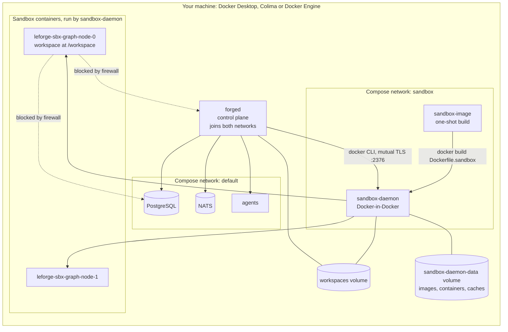

# Sandbox runtime: running agent commands in containers

Agents that hold `shell.exec` or the git tools run real commands: `go test`,
`pnpm install`, `git commit`. With **docker isolation** those commands run in a
container dedicated to the agent replica, on a Docker daemon that belongs to
LeForge alone. Nothing is installed on, built on or started on your machine's
Docker, and resetting LeForge's volumes removes every image, container and
cache those commands produced.

This page explains how it works (architecture), how to use it from the console
(usage), how to reset it, and how to fix common problems.

- Decision record: [ADR 0009](adr/0009-dedicated-sandbox-daemon.md)
- The image agents run in, per graph: [project environments](environments.md)

## Architecture



### Components

| Component | What it does | Where |
|---|---|---|
| `sandbox-daemon` service | A LeForge image based on `docker:28.5.2-dind`, with a supervised workspace journal collector, used only by LeForge. Stores its images, containers and build cache in the `sandbox-daemon-data` volume. Generates its TLS certificates on start. | `docker-compose.yml`, `deploy/sandbox-daemon/` |
| Firewall rules | Installed by `deploy/sandbox-daemon/entrypoint.sh` right after the daemon starts. Sandbox containers cannot reach private address ranges (the Compose networks with PostgreSQL, NATS and `forged`; your LAN; cloud metadata) nor the daemon itself. Sandboxes on the same bridge, and the internet, stay reachable for containers that have a network. If the rules cannot be installed the daemon stops, and the healthcheck only passes while they are present. | `deploy/sandbox-daemon/entrypoint.sh`, `healthcheck.sh` |
| `sandbox-image` service | Runs on every `docker compose up`: builds `Dockerfile.sandbox` as `leforge/sandbox:latest` **inside** `sandbox-daemon`. Layers are cached, so later runs finish in seconds. | `docker-compose.yml`, `Dockerfile.sandbox` |
| `forged` | Talks to the daemon with the Docker CLI: `LEFORGE_SANDBOX_DOCKER_HOST=tcp://sandbox-daemon:2376` plus `DOCKER_TLS_VERIFY`/`DOCKER_CERT_PATH` (client certificate, read-only volume). Creates one long-lived container per replica that needs docker isolation and runs each command with `docker exec`. | `internal/tools/sandbox_docker.go`, `internal/app/app.go` |
| Workspaces | The `workspaces` volume is mounted at `/var/lib/leforge/workspaces` in both `forged` and `sandbox-daemon`, so a sandbox bind-mounts the same path `forged` uses. Both run as UID 10001, so files written by tools and by the platform have the same owner. | `docker-compose.yml` |
| Readiness | `GET /readyz` reports `"sandbox": "ok"`, `"not configured"` or the daemon error. It does not make the platform unready: only docker-isolated agents depend on it. The console shows it in **Integrations → LeForge services → Sandbox runtime**. | `internal/api/server.go` |

### What a sandbox container gets

Each sandbox is started with `--cap-drop ALL`, `--security-opt no-new-privileges`,
CPU and memory limits when the agent sets them, the label `leforge.sandbox=true`,
only the replica's workspace mounted at `/workspace`, and **no network**
(`--network none`) unless an approved network mode is selected. Environments
using `egress` receive an internal network and a managed HTTP/HTTPS proxy;
`bridge` remains unrestricted within the daemon firewall. Agents never receive
Docker access: they only call `shell.exec` and the git tools, and LeForge runs
the command for them.

| Agent network setting | Internet | Other sandboxes | PostgreSQL, NATS, forged, your LAN | sandbox-daemon API |
|---|---|---|---|---|
| `none` (default) | no | no | no | no |
| `bridge` | yes | same bridge only | no | no |

### Security model and trade-offs

- **Not on your machine's Docker.** The host's `/var/run/docker.sock` is not
  mounted anywhere. Compared with mounting it, LeForge cannot see or touch your
  other containers and images, and everything it creates lives in one volume.
- **`privileged: true` on `sandbox-daemon`.** Docker-in-Docker needs it. The
  privilege belongs to the daemon container, which agents cannot reach; the
  containers it starts for agents are unprivileged, capability-less and
  firewalled as described above. On Docker Desktop and Colima the daemon runs
  inside their Linux VM, not directly on macOS or Windows. On a shared Linux
  server, treat `sandbox-daemon` like any privileged service: run LeForge on a
  host or VM dedicated to it. A rootless variant is planned (`wip/TASKS.md`,
  section 3).
- **Mutual TLS.** The daemon only accepts clients holding the certificate in
  the `sandbox-certs-client` volume (mounted read-only into `forged`). The CA
  and server keys stay in volumes only `sandbox-daemon` mounts.
- **Fail closed.** No firewall rules, no daemon: the entrypoint stops the
  daemon if it cannot install them, and the healthcheck re-verifies them.

## Usage (from the browser)

### 1. Check that the runtime is up

Open **Integrations**. Under **LeForge services**, the **Sandbox runtime** card
should read *Connected*. Click **Check services** to test again.

| Card says | Meaning | What to do |
|---|---|---|
| Connected | `forged` reached the dedicated daemon over TLS | Nothing |
| Check needed — "No sandbox daemon is configured" | `LEFORGE_SANDBOX_DOCKER_HOST` is not set (for example, `forged` running outside Compose) | Agents with docker isolation cannot start; see [Running outside Compose](#running-outside-compose) |
| Unavailable — with an error | The daemon is down, still starting, or the certificates do not match | See [Troubleshooting](#troubleshooting) |

### 2. Run an agent's commands in a container

1. Open the graph and select the agent on the **Graph** tab.
2. In **Agent configuration → Command sandbox**, set **Isolation** to
   `docker — dedicated sandbox container`.
3. Choose **Network**:
   - `none` for agents that only build and test code already in the workspace;
   - `bridge` when the agent must download dependencies (`go get`,
     `pnpm install`). It reaches the internet only — never LeForge's services
     or your network.
4. Optionally set **Image** (leave empty for `leforge/sandbox:latest`), **CPU
   limit** (for example `2`) and **Memory limit** (for example `2g`).
5. Grant the tools the agent needs in **Tools** — for example `shell.exec`,
   restricted to the commands it should run.
6. **Save graph**, then start the agent. Its commands appear in **Live output**
   and run in a container named `leforge-sbx-<graph>-<agent>-<replica>`.

While an agent with `shell.exec` uses process isolation, the panel warns that
its commands would run inside the LeForge server container.

The same settings in YAML (**Definition** tab):

```yaml
nodes:
  - id: tester
    tools: [filesystem.read, {name: shell.exec, commands: ["go", "make"]}]
    isolation:
      mode: docker
      network: bridge   # omit for no network
      memory: 2g
      cpu: "2"
```

### 3. Use a different toolchain

The default image is Python 3.12 with git and make. For a project's toolchain,
define a [project environment](environments.md) in **Graph settings →
Environment**: LeForge builds it on this daemon and every docker-isolated agent
of the graph without an image of its own runs in it. An agent's **Image**
setting overrides it with any image the daemon can pull; such images must run
as uid 10001 (or create that user) to write in the workspace.

## Resetting

Everything the sandboxes produced lives in LeForge's volumes, so resetting
never touches your machine's Docker:

| Goal | Command | Effect |
|---|---|---|
| Rebuild the default image | `docker compose up sandbox-image` | Rebuilds `leforge/sandbox:latest` inside the daemon |
| Remove sandbox containers, images and caches only | `docker compose rm -sf sandbox-daemon` then `docker volume rm leforge_sandbox-daemon-data`, then `docker compose up -d` | The daemon starts empty; `sandbox-image` rebuilds the default image; workspaces and platform data are kept |
| Start LeForge from zero | `docker compose down -v` | Deletes **all** LeForge volumes: graphs, history, workspaces, credentials and every sandbox artifact |

Sandbox containers are recreated automatically the next time an agent runs.

## Troubleshooting

| Symptom | Cause | Fix |
|---|---|---|
| Card shows `... unreachable: ... no such host` | `sandbox-daemon` is not running | `docker compose up -d sandbox-daemon`, then **Check services** |
| `... x509: certificate signed by unknown authority` or `bad certificate` | The certificate volumes are out of sync (for example `sandbox-certs-ca` was removed while the others were kept) | Remove all four `leforge_sandbox-certs-*` volumes with the daemon stopped, then `docker compose up -d`; certificates are regenerated on start |
| `sandbox-daemon` exits with "refusing to run without firewall rules" | The kernel lacks iptables support needed by Docker-in-Docker | Run on a Linux kernel/VM with iptables (Docker Desktop and Colima include it); check `docker compose logs sandbox-daemon` |
| Agent start fails with `docker run ...: Unable to find image` | The image is not in the daemon and cannot be pulled (offline, private registry) | Use `leforge/sandbox:latest` or rebuild it; for other images, run once while online |
| Commands cannot download packages | The agent uses network `none` | Set **Network** to `bridge` for that agent |
| A sandbox needs to call a private service (internal registry, proxy) | Private ranges are blocked by design | Private destinations remain unsupported, including through the runtime egress proxy; public-host allowlists are documented in `docs/environments.md` |

Run the automated checks at any time:

```bash
make test-sandbox
```

It verifies TLS access, that the default image exists only in the dedicated
daemon, that sandboxes without network reach nothing, that bridged sandboxes
reach the internet but not the daemon or `forged`, and that your machine's
Docker runs no LeForge sandbox.

## Running outside Compose

`forged` drives whatever daemon the Docker CLI reaches. Set
`LEFORGE_SANDBOX_DOCKER_HOST` (or `isolation.docker.host`) to a daemon you
dedicate to LeForge, plus `DOCKER_TLS_VERIFY`/`DOCKER_CERT_PATH` when it uses
TLS. When `forged` and the daemon see the workspace directory at different
paths, set `LEFORGE_WORKSPACES_HOST` to the daemon's path. Apply equivalent
egress rules to that daemon's bridges: they are what keeps sandboxes away from
your services.

## Limitations

- **External runtimes launched from `runtime.image`** are not started on the
  sandbox daemon: they must call `forged` back, which its firewall forbids.
  Run external agents as services and point `runtime.endpoint` at them (the
  Compose `agents` service is an example).
- **Kubernetes isolation** still runs tools in the `forged` pod.
- **Runtime egress is opt-in:** `bridge` remains unrestricted; use environment
  `network.run: egress` with approved `allowedHosts` for HTTP/HTTPS destination
  restrictions. See `docs/environments.md`; setup/build use a separate `setupAllowedHosts` list with `network.setup: egress`.
  Daemon provisioning and client-side registry authentication remain outside these proxies.
- **One daemon per installation:** caches and images are shared by all graphs.

## Global execution-sandbox capacity

`isolation.docker.capacity` applies across graphs and replicas using the same
installation store and dedicated Docker daemon. Environment builds, setup and
cache-copy helpers share this pool with execution sandboxes. Defaults are:

```yaml
isolation:
  docker:
    capacity:
      maxActive: 4
      totalMemory: 4g
      defaultMemory: 1g
      totalCPU: "4"
      defaultCPU: "1"
```

A node's `isolation.memory` or an environment's `spec.environment.memory`
overrides `defaultMemory`. Each environment pipeline reserves one slot for its
sequential build/setup/cache-copy phases. Requests must fit the
whole budget and Docker's 6 MiB minimum. Values accept integer bytes or `k`, `m`,
`g` suffixes. Zero/negative limits and a default larger than the total are
configuration errors. Configure the same policy and daemon address on every
controller sharing a store. The platform always passes `--memory` and an equal
`--memory-swap` to execution sandboxes, so swap cannot expand their reservation.
Existing containers must have a finite cap before new work can be admitted.

Admission counts reserved memory, not fluctuating RSS. A 1 GiB sandbox consumes
1 GiB of the budget while running, including idle time before suspension. Both the container count and sum of memory
limits must fit before creation/start. Excess work remains in replica startup,
with `sandbox.capacity` events and structured logs (`waiting`, `admitted`,
`cancelled`, `failed`, `released`). Waiting is cancellable by stopping the graph;
there is no FIFO guarantee. Idle execution containers are stopped automatically
after the configured timeout, releasing their reservation.

Reservations are durable and admission is serialized with a storage lease.
The controller also inspects running containers carrying `leforge.sandbox=true`
on the dedicated daemon; containers surviving a restart still count. A container
name reuses its existing reservation rather than counting twice. Reservations
are released only after Docker confirms removal or a stopped container during
suspension. Failed stop/removal/storage writes
retain the reservation and report errors instead of admitting excess work.
Sandbox teardown errors are logged. Ordinary failed starts attempt cleanup.

After a crash during startup, a reservation can remain even if no container was
created. Resume that same graph/node and then stop it to complete cleanup; do not
edit accounting or delete the store to make room. Restore daemon connectivity
before retrying failed cleanup. Stop existing sandboxes before lowering limits
or changing their reserved memory. All controllers must share the same store;
independent installations must not use the same daemon for concurrent admission.

The budget covers Docker execution sandboxes (including idle ones), temporary
BuildKit workers, environment setup and cache-copy containers. Builds use the
Buildx `docker-container` driver; the worker is removed before setup starts.
[Environment capacity](environments.md#build-and-setup-capacity) describes
waiting, timeout, cleanup and recovery. It does not cap Docker daemon overhead
(including image pulls/loads/commits), external agent runtimes,
process/Kubernetes isolation or the operating system. Leave headroom in the
Colima/Docker VM. Global CPU accounting uses the same durable admission budget.

Metrics use bounded state labels:

- `leforge_sandbox_capacity_transitions_total{state}` records admission transitions.
- `leforge_sandbox_admission_duration_seconds` records waiting/admission latency.

Run `make test-sandbox-capacity` against the already running dedicated daemon to
verify real cgroup memory/swap caps, waiting, release, controller recreation and
network/user isolation, and stop/resume preservation of workspace, caches and
container files. It creates and removes only its temporary containers and
workspace volumes. Unit and storage/CLI integration tests run under `make test`.


## Idle suspension and task resume

`isolation.docker.idleTimeout` defaults to `5m`; `0s` disables automatic
suspension. Negative values are invalid. This setting applies to execution
sandboxes, not environment builds or external runtime containers.

The replica loop checks inactivity **between turns**: waiting for queue/operator
input, waiting for a schedule, pacing between turns, retry backoff, or a paused
graph/node. Active runtime turns and approval/tool waits within a turn are never
suspended by this timeout. Queue polling may delay suspension by its polling
interval. Long scheduled and paused waits wake at the idle deadline without
advancing the schedule or unpausing the task.

Suspension uses `docker stop` and confirms the stopped state before releasing
the global memory/slot reservation. It preserves the container's writable
filesystem, mounted workspace/worktree and cache volumes. Background processes
inside the container stop; this is not a checkpoint of process memory. Projects
that need background services to remain running between turns can disable this
timeout.

A new turn restarts the same container after reacquiring global capacity. Inputs
remain leased during admission, and admission is cancelled by graph Stop/Kill or
the turn timeout. Failed resume does not invoke the runtime: queue inputs are
nacked and consumed operator messages are restored for retry. A paused task
keeps incoming work queued until explicitly resumed.

Failed stop/inspection/storage release retains capacity and reports an error.
The idle loop retries suspension after 30 seconds. A failed resume preserves
the existing container and attempts to confirm a stopped state before releasing
capacity; ambiguous failures keep the reservation. Restore daemon connectivity
and retry the task.

After a controller crash, the existing container is discovered by its stable
replica name and reused, with capacity checked again. Startup currently starts
that container and begins a fresh idle timer. Normal completion, explicit Stop,
and graceful controller shutdown retain their existing teardown behavior:
remove the container, preserve mounted workspace/cache data. In those cases,
container-only files and process state are not retained for a later task start.

Replica status detail reports suspension and capacity waiting; the logical task
remains idle/paused rather than completed. `sandbox.lifecycle` events and
structured logs carry graph/node/replica, action and outcome. Metrics use only
bounded labels:

- `leforge_sandbox_lifecycle_total{action,outcome}` (`suspend|resume`, `ok|error`).
- `leforge_sandbox_lifecycle_duration_seconds{action}`, including resume admission.
- Traces: `sandbox.suspend` and `sandbox.resume`.

Unit and engine/storage/queue integration tests cover idle eligibility, schedules,
pause, active turns, input retry, failures and resume. `make test-sandbox-capacity`
also verifies real stop/start, unchanged container identity and files, released
capacity, queued resume and controller recreation.

### Global CPU admission and upgrade

`totalCPU` caps the sum of reserved CPU cores across execution and environment
build/setup/cache-copy pipelines. `defaultCPU` supplies the per-request cap when
CPU is omitted. Defaults are 4 total cores and 1 core per request, including
configurations predating these fields. Values are decimal cores with up to three
decimal places (minimum 0.01), not percentages or millicore suffixes. Explicit
node `isolation.cpu` and manually configured environment `cpu` requests must fit
the global total; repository definitions still cannot override resource policy.
A default exceeding the total is invalid. This is configured quota accounting,
not a measurement of current utilization or an automatic VM CPU detector.

CPU, memory and count admission are atomic under the same storage lease. All
controllers must use the same policy/version and sandbox daemon. Reservations
remain after ambiguous failures, disappear only after confirmed cleanup or idle
suspension, and are reacquired on resume. Inventory includes running sandbox CPU
caps; unbounded CPU or invalid inventory blocks admission. CPU caps are applied
with `--cpus` on execution/setup/cache-copy containers. BuildKit's dedicated
worker uses a 100000µs CFS period and a quota matching the reserved cores (see
[Docker container driver options](https://docs.docker.com/build/builders/drivers/docker-container/)).

Existing memory-only reservation records remain readable for release but block
new admissions until their owners are stopped/reset normally. Do not delete
reservation records to bypass this check. Stop existing workloads before
upgrading all controllers, and restart them under the new policy; running legacy
containers without CPU caps also block admission. No automatic deletion of
workspaces or user resources is performed by the upgrade.

## Human review and application previews

The built-in preview gateway runs in `forged`, independently of the console
listener. It is local by default: `127.0.0.1:8082`, with one host per review at
`http://<review-id>.localhost:8082`. Compose publishes only
`127.0.0.1:8082:8082`. No external gateway, public DNS, cloud account or third-party
tunnel is required. Chromium is exercised by the browser acceptance test.
Clients whose resolver does not recognize `*.localhost` can use cURL's
`--resolve '<review-id>.localhost:8082:127.0.0.1'`, or a local hosts entry.

### Requesting a review

Grant `review.request` on a Docker node. Starting an application also requires
`shell.exec` and its command restrictions/approval; a review grant alone cannot
launch arbitrary commands. Example node fragment:

```yaml
isolation: {mode: docker}
tools:
  - name: review.request
  - name: shell.exec
    commands: [npm]
config:
  reviewPolicy:
    reviewers: [alice] # authenticated operator/admin identity names
    requiredMethod: managed
```

Omit `reviewPolicy` to allow any authenticated operator and all review methods.
It is saved graph configuration, never an agent-supplied permission. The agent
runs its tests/build first, then invokes:

```json
{
  "title": "Validate the dependency update",
  "instructions": "Open the page, navigate and submit the test form.",
  "command": ["npm", "run", "dev", "--", "--host", "127.0.0.1"],
  "cwd": ".",
  "port": 5173,
  "readyPath": "/",
  "lifetimeSeconds": 1800,
  "checks": ["npm test passed", "npm run build passed"]
}
```

The configured image/environment must already contain the runtime and dependencies.
Readiness accepts HTTP 2xx/3xx at the selected path, without following redirects.
The application must listen on the declared port on loopback or all interfaces
inside its container. Commands are argv, not interpolated shell strings; use
`shell.exec` for terminating preparation commands, not background servers.

LeForge copies the workspace (including dirty changes, excluding `.git`) and
binds the review to its SHA-256 identity. Capture rejects escaping symlinks,
special files and candidates over 2 GiB or 200,000 entries. Each generation runs
from a separate copy; environment caches are mounted read-only and copied into
private writable container storage. The code digest does not attest the contents
of dependency caches or external services. Use deterministic dependencies and
isolated test data. Agent-reported checks are displayed as unverified evidence.

### Human validation

Open **Approvals → Application reviews**. The card shows the candidate,
instructions, reported checks, readiness, expiry and preview URL. **Open preview**
uses a one-use exchange token (one minute) and a host-only HttpOnly cookie
(15 minutes). Credentials never appear in the URL or agent context. Allow the
console popup. A new open operation can renew browser access while the session
is still active.

For cURL/Postman, select **Generate HTTP client credential**, copy the masked
value into a private local variable and keep it separate from application auth:

```sh
# Supply LEFORGE_PREVIEW_TOKEN privately; do not put the value in saved scripts.
curl 'http://<review-id>.localhost:8082/api/items' \
  -H "X-LeForge-Preview-Token: $LEFORGE_PREVIEW_TOKEN" \
  -H 'Authorization: Bearer <application-test-token>'
curl 'http://<review-id>.localhost:8082/api/items' \
  -H "X-LeForge-Preview-Token: $LEFORGE_PREVIEW_TOKEN" \
  -H 'Content-Type: application/json' \
  --data '{"name":"review fixture"}'
```

In Postman, set the base URL to the card's URL and add header
`X-LeForge-Preview-Token: {{previewToken}}`; store its value privately, outside
shared/exported collections. Configure the application's Authorization separately.
Send a GET and a test-data mutation, inspect status/body, then revoke access and
verify the same request is denied. This is the manual Postman acceptance recipe;
automated acceptance exercises the equivalent requests using HTTP and real cURL.

Choose the actual review method and **Approve candidate**, **Request changes**
(with feedback), or **Reject**. Approval rechecks the source digest and lets the
agent continue; modifying the candidate afterward prevents completion until a
new review. Request changes returns feedback to a new turn. Rejection ends the
node's work without publishing success. Stopping the node/graph cancels its gate.
No decision merges, pushes, deploys, or authorizes any of those separate actions.

Without `command`, the same gate supports `externalUrl` (HTTPS CI/PR link,
unverified provenance), `local` branch validation, or `without_execution` explicit
acceptance. The operator can require one method using `reviewPolicy.requiredMethod`.
Branch names and external links are not immutable proof; compare the candidate
and record what was actually checked. Provider-specific PR/CI automation is not
implemented by this feature.

### Isolation, capacity and recovery

A narrowly scoped stdio relay (`forge-preview`, shipped in the image) connects
only to the registered loopback port via the dedicated Docker daemon. Application
ports are never published. Preview ingress does not grant outbound network
access or access to platform services; existing environment policy still applies.
Approved companion services and their limits use the existing sandbox factory
and shared CPU/memory/slot admission. The idle agent sandbox is suspended while
the separately accounted preview is active. Cache copies run inside its limits.

Gateway limits are 8 MiB per request body, 32 concurrent requests per review,
30 seconds for response headers and 15 minutes per connection. Browser requests
use an exact-origin policy. Gateway credentials are stripped before proxying;
application Authorization is preserved, application cookies are host-only and
WebSockets are supported. Revocation/expiry closes active streams within the
one-second revalidation interval. Application cookies and mutation behavior are
still the application's responsibility; use disposable test accounts/data.

A preview lasts 30 minutes by default (request range 60 seconds–2 hours).
**Extend preview** is bounded by the review's 24-hour deadline. Preview expiry
stops compute and revokes credentials, while the gate stays pending. **Restart
preview** creates a new generation from the frozen candidate and rechecks
capacity/readiness. A review deadline never auto-approves work. Startup/readiness
failure revokes the route and stops compute; cleanup failures retain accounting
and are retried. **Application logs** returns the last 100 lines, capped at 64 KiB;
application authors must keep secrets out of their own logs.

Review records, decisions and idempotent continuation messages survive controller
restart. Existing preview generations reconnect; their TTL remains in force.
If the controller is offline, gateway access is unavailable and container cleanup
waits for reconciliation after restart. Continuation delivery is idempotent, but
external side effects still require the application's usual idempotency controls.
Snapshots, stopped containers and work directories are retained; this feature
does not delete persistent data automatically. Plan disk retention separately.

### Remote installation and troubleshooting

For a private remote server, forward the gateway port over your existing secure
transport to local port 8082 and retain `baseUrl: http://localhost:8082`; forward
the console too and configure its exact origin. The browser reaches the gateway,
not sandbox IPs. The acceptance harness exercises this topology through a private
forwarder to a dedicated daemon.

For direct remote access, configure `preview.baseUrl: https://preview.example.com`,
DNS for `*.preview.example.com`, an appropriate wildcard TLS certificate/key,
and reachable `preview.addr`. The gateway requires TLS for nonlocal access;
HTTP on a public listener is rejected. Configure the exact console HTTPS origin
in `preview.consoleOrigins`. The administrator supplies DNS, TLS and network
access; LeForge does not publish a public endpoint automatically.

An unknown host returns 404; wrong/expired credentials return 401/403; an unready
session cannot issue access. A popup timeout usually means wrong console origins,
blocked popups, missing local hostname resolution, or an unreachable gateway.
Readiness failure usually means a wrong port/path, missing dependencies, a server
binding only IPv6, or exhausted capacity. Inspect the card and application logs.
Build the Linux relay with `make build` for native control-plane runs; Compose
images already include it. A native control plane can manage Docker previews;
managed previews of native `process` nodes are not supported.

Validation: `make test-preview` exercises a real Docker HTTP app, cURL, network-none
isolation, controller recovery, expiry/restart and shutdown. The real browser
suite (`make test-e2e-real`) exercises React, routing, cookies, application auth,
WebSockets and the human gate. Unit/integration suites cover storage, controller,
policy, stale candidates, concurrent decisions, failure and revocation paths.

Public DNS/TLS deployments require installation-specific validation using the
recipes above.


Workspace process/transient history uses a private `workspace-journal` volume,
read-only in forged and absent from agent sandboxes. The collector continues
while forged is offline, and journal imports resume from durable cursors.
See [kernel journal](tool-permissions.md#kernel-journal-in-the-dedicated-linux-daemon)
for process identity, coverage gaps, size limits, recovery and activation on an
existing installation. The collector must remain active to record offline events;
this is not reconstruction of unobserved history.
