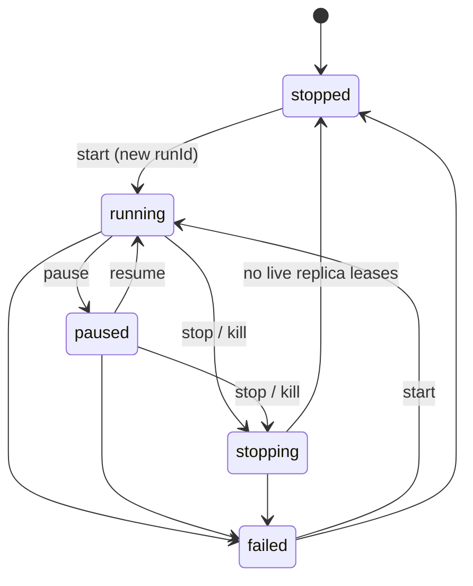
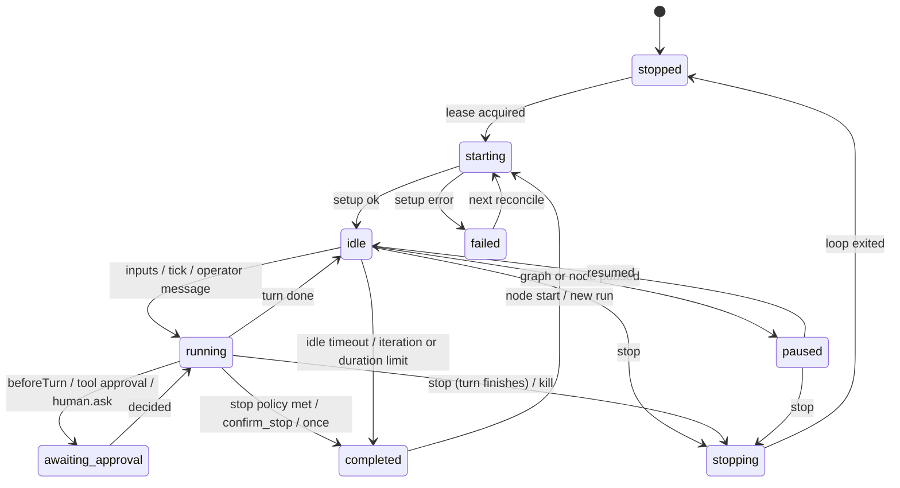
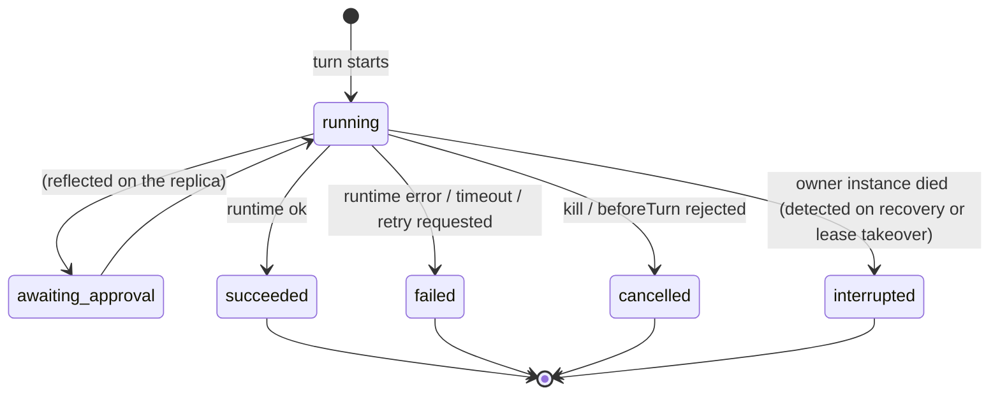
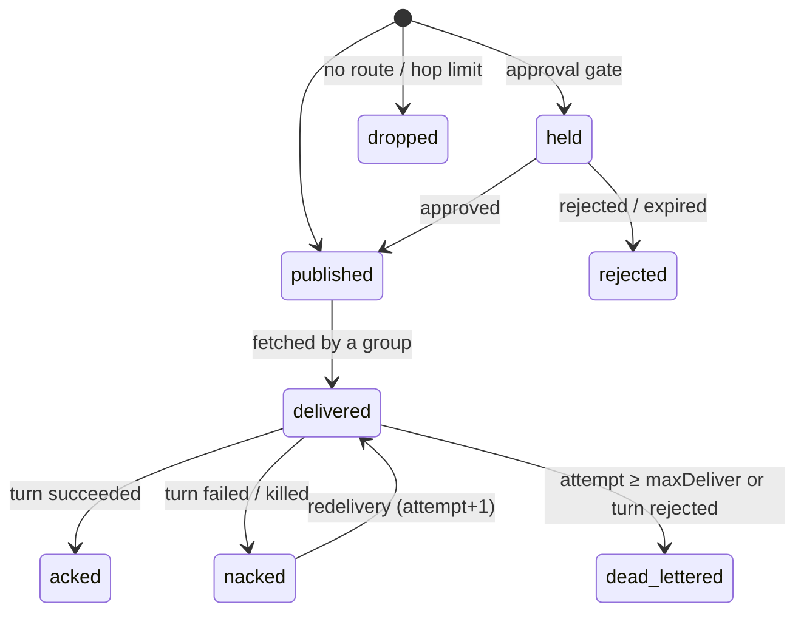
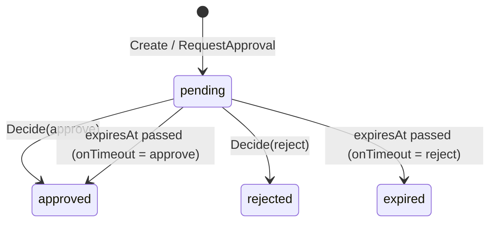

# State machines

Allowed transitions are declared in `server/internal/domain/state.go` (`CanTransition`). The engine drives them in `engine/` and `hitl/`. Every replica, execution and approval transition emits an event (`replica.state_changed`, `execution.*`, `approval.*`).

## Graph run

`GraphRecord.desiredState` is what an operator asked for; `state` is what the reconciler observed.

| Trigger | Guard | Effects |
|---|---|---|
| `start` | desired is `stopped` (no-op if already `running`) | New `runId`, `startedAt`; node stop and pause overrides cleared; `graph.started`; reconciler acquires leases and starts replicas. |
| `start` | desired is `paused` | desired → `running`. |
| `pause` | desired is `running` | desired → `paused`; replicas finish the current turn and park in `paused`. |
| `resume` | desired is `paused` | desired → `running`; replicas are poked. |
| `stop` | — | desired → `stopped`, state → `stopping`; `graph.stopping`. Replicas drain their current turn, then release their leases. |
| `kill` | — | Same as stop (`graph.stopping`), plus in-flight turns on this instance are cancelled (inputs nacked). |
| reconcile | desired `stopped`, no live replica holds an unexpired lease | state → `stopped`; `graph.stopped`. Statuses of replicas whose instance vanished are set to `stopped`. |
| reconcile | desired `running`/`paused` | state mirrors desired. |
| reconcile error | desired `running`/`paused`, and the graph cannot be deployed (version not loadable, a `when` condition no longer compiles, the broker refuses the topology) | state → `failed`; `graph.failed` with the error. Reconciliation keeps retrying and the state returns to `running`/`paused` on the next successful deploy. |

## Replica

| Trigger | Guard | Effects |
|---|---|---|
| Lease acquired | replica wanted, not `completed` in this run | Previous owner's executions marked `interrupted`; goroutine started. |
| Setup | workspace, sandbox, `Runtime.Prepare`, subscriptions | On failure: `failed`, 10s back-off, then exit (restarted by a later reconcile). |
| Claim | depends on loop mode (see [execution-model.md](execution-model.md)) | `running`; execution created. |
| Turn ends | — | `idle`. Failures add exponential back-off (`retryBackoff · 2^(n-1)`, max 5m). |
| Pause | graph desired `paused` or node override `paused` | `paused`; no new turn starts. |
| Stop policy | `iterations` / `duration` / `idle` limit reached, `once` done, or `confirm_stop` after a declaration | `completed`; marker `done/<node>#<n> = runId`; not restarted during this run. |
| Stop | graph or node stopped, surplus replica, lease lost | `stopping` → `stopped`; lease released. |
| Kill | — | Turn context cancelled, then as for stop. |

The UI reports a node's state as its "most alive" replica: running > awaiting_approval > starting > idle > paused > stopping > failed > completed > stopped.

## Execution (turn)

`pending` exists in the domain model, but the engine creates executions directly in `running`. While a turn waits for a human, the *replica* shows `awaiting_approval`; the execution record stays `running`.

| Outcome | Effect on inputs |
|---|---|
| `succeeded` | Emits routed and published, then inputs acked and `MarkProcessed`. |
| `failed` | Inputs nacked with delay `retryBackoff · 2^(attempt-1)`; `Term` (dead letter) once `attempt ≥ channel.maxDeliver`. Consumed operator messages are re-queued. |
| `cancelled` (kill) | Inputs nacked immediately. |
| `cancelled` (beforeTurn rejected) | Inputs dead-lettered with reason "turn rejected by operator". |
| `interrupted` | Nothing is acked; the broker redelivers after the lease expires. |

## Message delivery (history)

History holds one row per (message, channel, group). The publish-side row has no group. A duplicate delivery (already `acked` for the group) is acked without a turn and counted as `outcome="duplicate"`.

## Approval

| Kind | Created by | On approval | On rejection / expiry |
|---|---|---|---|
| `tool` | Tool gateway (`requiresApproval`) | Tool executes | `ErrRejected` is returned to the agent |
| `turn` | `approval.beforeTurn` | Turn proceeds | Inputs dead-lettered; execution `cancelled` |
| `message` | `channel.approval`, `approval.beforeEmit` | Published (payload replaced if `answer` is valid JSON) | Recorded as `rejected` |
| `question` | `human.ask` tool, `AskHuman` callback | `answer` returned to the agent | Error returned to the agent |

`DecideApproval` succeeds only from `pending`; a second decision returns HTTP 409. Expiry is evaluated by the waiter and by the periodic `Sweep`.
