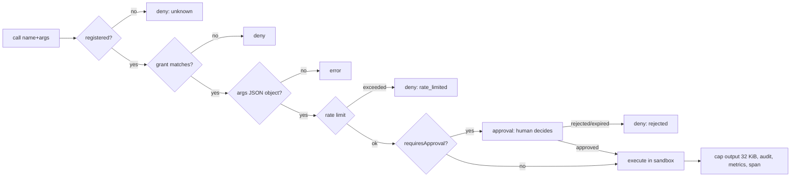

# Tool permission model

Agents act on the world only through **tools**, and every tool call — from native agents and from
external runtimes alike — passes through one **tool gateway** (`server/internal/tools/gateway.go`)
that checks the calling replica's **grants** before anything runs. The model is **default deny**:
a node with no `tools:` has no tools (native agents keep the four platform tools below).

Grants are enforced, not requested: the model only ever *sees* schemas of granted tools
(`Registry.Schemas`), and a call to anything else is refused by the gateway regardless of what the
model or agent code asks for.

## Capabilities and tools

A **tool** is what an agent invokes; a **capability** is the permission it requires. Several tools
share a capability, so granting `filesystem.read` grants all four read tools.

| Capability | Tools | Constraint axis | Notes |
|---|---|---|---|
| `filesystem.read` | `filesystem.read` `{path, offset?, limit?}`, `filesystem.list` `{path?, recursive?, glob?, maxEntries?}`, `filesystem.search` `{pattern (regexp), path?, glob?, maxResults?}`, `filesystem.stat` `{path}` | `paths` | Listing/search skip `.git`, `node_modules`, `.venv`, `__pycache__` |
| `filesystem.write` | `filesystem.write` `{path, content, append?}` (atomic), `filesystem.edit` `{path, old, new, replaceAll?}`, `filesystem.move` `{from, to}` (both checked), `filesystem.mkdir` `{path}` | `paths` | Creates parent directories |
| `filesystem.delete` | `filesystem.delete` `{path, recursive?}` | `paths` | Separate from write on purpose |
| `shell.exec` | `shell.exec` `{command? \| argv?, cwd?, timeoutSec? (≤1800), env?}` | `commands` | Runs in the replica's sandbox; default timeout 2 m, output 64 KiB |
| `git.read` | `git.status`, `git.diff` `{staged?, ref?, path?}`, `git.log` `{n?, ref?}`, `git.show` `{ref}`, `git.branches` | `paths` (pathspecs) | Executed through the sandbox (works in docker isolation); refs starting with `-` rejected, paths after `--` |
| `git.write` | `git.add` `{paths}`, `git.commit` `{message, all?, author?}`, `git.branch` `{name, from?, checkout?}`, `git.checkout` `{ref}`, `git.merge` `{branch, noFF?, message?}` | `paths` | Fallback identity `LeForge Agent <agent@leforge.local>` |
| `http.fetch` | `http.fetch` `{url, method?, headers?, body?, maxBytes? (≤5 MiB)}` | `hosts` | http/https only, ≤ 5 redirects (each re-checked), HTML → text, SSRF guard |
| `human.ask` | `human.ask` `{question}` | — | Opens a `question` approval and blocks until a human answers |
| `mcp.<server>.*` | *(extension point)* | — | Requires registering an MCP tool provider |

`GET /api/v1/tools` lists the registry with JSON Schemas.

### Platform tools (no grant needed)

Native agents always have four tools that only touch their own turn; external runtimes reach the
same functions through the callback API.

| Tool | Callback equivalent | Effect |
|---|---|---|
| `emit {type, payload, target?, channel?}` | `POST /emit` | Queue an output; published only if the turn succeeds |
| `state_get {key}` / `state_set {key, value}` | `GET/PUT /state/{key}` | Node memory (shared by replicas), ≤ 1 MiB per value |
| `finish {summary?, signal?, broadcast?}` | `TurnResult` | End the turn; stop handshake; ring broadcast |

## Grant syntax

A grant is a bare string or an object:

```yaml
tools:
  - filesystem.read                          # capability
  - git.status                               # single tool
  - "git.*"                                  # wildcard (quote in YAML)
  - {name: filesystem.write, paths: ["src/**", "tests/**"]}
  - {name: shell.exec, commands: ["python3", "go test *"], requiresApproval: false, rateLimit: 30}
  - {name: http.fetch, hosts: ["*.wikipedia.org", "docs.python.org"]}
  - {name: git.write, requiresApproval: true}
```

| Field | Applies to | Semantics |
|---|---|---|
| `name` | all | Matched with `*`/`?` globs (where `*` crosses dots) against the tool name **or** its capability. `*` alone = every tool (validation warns) |
| `paths` | filesystem.*, git (pathspecs) | Workspace-relative globs: `**` = any number of segments (incl. none), `*`/`?`/`[…]` within one segment. Empty = whole workspace |
| `commands` | shell.exec | Pattern **without** a space → matched against `basename(argv[0])` (`go`, `pytest*`). Pattern **with** a space → matched against the full command line with `argv[0]` reduced to its basename (`npm *`, `git status`). Empty = any command |
| `hosts` | http.fetch | Case-insensitive host globs; also applied to every redirect. Empty = any **public** host |
| `requiresApproval` | all | Each call waits for a human (`tool` approval) |
| `rateLimit` | all | Calls per minute per (graph, node, tool): token bucket, burst = limit |

### Matching and merge semantics (as implemented in `policy.go`)

1. **Default deny.** Collect every grant whose `name` matches the tool name or capability. None → `tool.denied` (HTTP 403 on callbacks).
2. **Union of permissions.** If several grants match, the call is allowed if *any* of them would allow it:

| Axis | Merged value |
|---|---|
| `paths` / `commands` / `hosts` | If **any** matching grant leaves the axis empty → unrestricted; otherwise the union of patterns |
| `requiresApproval` | `true` only if **every** matching grant requires it |
| `rateLimit` | `0` (unlimited) if any matching grant is unlimited; otherwise the largest limit |

   Consequence: `[filesystem.read, {name: filesystem.read, paths: [docs/**]}]` is **unrestricted** —
   narrowing only works when no broader grant also matches.
3. **Constraints are checked by the tool** after authorisation; a violation is a denial (`tool.denied`,
   outcome `denied`), not a tool error.
4. **Path jail (always on, independent of grants).** Every path is cleaned, joined to the replica's
   workdir and resolved through symlinks of its deepest existing ancestor; anything that leaves the
   workdir — `../`, absolute paths outside, planted symlinks — is refused. Absolute paths inside the
   workdir are accepted.
5. **Restricted shells.** When `commands` is set, a `command` string must be a single simple command:
   any of `` ; | & ` $ < > ( ) { } `` or a newline is refused, and the command runs as argv **without a
   shell**, so what was checked is exactly what runs. Without `commands`, `command` runs via `/bin/sh -c`
   (`cmd /C` on Windows).
6. **SSRF guard (http.fetch).** Resolved addresses are checked at dial time (defeats DNS rebinding):
   loopback, RFC 1918/ULA private, link-local (incl. `169.254.169.254` metadata), multicast, CGNAT,
   unspecified and reserved ranges are refused unless `tools.allowPrivateNetworks: true`.

### Gateway pipeline



Tool *failures* (non-zero exit, missing file, HTTP error) are returned to the agent as
`{isError: true, content}` so the model can recover; only refusals are errors.

## Audit and observability

| Signal | Content |
|---|---|
| Events | `tool.invoked`, `tool.completed`, `tool.denied` with `{tool, args (≤ 2 KiB), outcome, durationMs, error}`, actor `agent:<node>#<n>`, execution and trace ids |
| Metrics | `leforge_tool_invocations_total{tool,outcome}`, `leforge_tool_duration_seconds{tool}` |
| Traces | Span `tool.<name>` with `leforge.graph/node/replica/execution`, `leforge.tool.outcome` |
| Approvals | `approval.requested/decided` with detail `{tool, args}` |

## Recipes

| Role | Grants | Rationale |
|---|---|---|
| Read-only reviewer | `[filesystem.read, git.read]` | Can inspect code and diffs, change nothing |
| Developer | `[filesystem.read, {name: filesystem.write, paths: ["src/**","tests/**"]}, git.read, git.write]` | Writes only source and tests; no shell, no deletes |
| QA (test runner only) | `[filesystem.read, {name: shell.exec, commands: ["python3", "pytest"]}]` | Can run the suite, nothing else; no pipes or redirects |
| Researcher | `[{name: filesystem.write, paths: ["research/**"]}, {name: http.fetch, hosts: ["*.wikipedia.org"]}]` | Writes notes, browses an allowlist of public hosts |
| Release / integrator | `[git.read, {name: git.write, requiresApproval: true}]` | Every write needs a human |
| Fully trusted builder | `[filesystem.*, shell.exec, git.*, http.fetch]` | Only in docker/kubernetes isolation |

**`.git` is protected.** Mutating filesystem tools refuse any path inside a `.git` directory, and
git runs with hooks and fsmonitor disabled, so `filesystem.write` plus `git.*` does not amount to
code execution. Repository internals change only through the git tools.

## Adding a tool

1. Implement `tools.Tool` (`Name`, `Capability`, `Description`, `Schema`, `Invoke`). Use
   `ResolvePath` + `CheckPath` for paths, `CheckCommand` for commands, `CheckHost` for hosts, and run
   processes through `inv.Sandbox` (never `os/exec` directly) so isolation modes apply. Return
   `ErrDenied`-wrapped errors for constraint violations, plain errors or `IsError` results for failures.
2. Register it: `registry.Register(t)` in the composition root (`internal/app`), or add it to
   `tools.Builtin`.
3. Pick a capability name `<domain>.<verb>`; reuse an existing one only if the risk is identical.
4. Document the arguments in the JSON Schema — it is what the model reads.

## Environment tools

`environment.status {}` reads only the calling graph's readiness and proposal
ID/state/error. `environment.propose {environment, rationale, tools}` accepts a
complete definition from an agent and waits for **administrator** approval and a
successful build. Both require explicit grants (`environment.status` and
`environment.propose`); neither accepts a graph ID, revision, approval decision,
resource override or resume target. A grant with `requiresApproval: false` does
not remove the mandatory environment approval. Ordinary gateway tool approval,
when configured, is an additional gate rather than approval of the definition.

The proposing node must use Docker isolation without an explicit image override.
There must be no existing environment or repository definition: discovery still
has priority. The proposal includes an image or inline Dockerfile, setup/cache/
network choices, a bounded rationale and toolchain names. Installation policy,
manifest fingerprints and build-context validation apply before approval/build.
Origin and context metadata are derived by the server, never accepted from agents.

The calling turn waits (within its configured turn timeout), with the replica
shown as awaiting approval, until the durable proposal is ready. Approval records
include node, replica and execution identity. The environment reconciler performs
the approved build; the executor replaces the old sandbox before commands resume,
keeping the workspace. Concurrent tool calls within a turn are serialized. Other
ordinary tool calls check the graph's proposal gate and refuse pending/failed
states; `environment.status` remains available. Already executing commands are
not forcibly revoked by creating a proposal.

Rejection, expiration, cancellation, stale inputs and build failures return tool
errors, never a ready environment. A timeout while awaiting approval attempts to
cancel that proposal; after approval, a durable build can finish independently of
the original turn. Restart recovery follows existing execution/message retry
semantics, not restoration of an in-memory model call. The agent can inspect
status after a retry; approved build failures can be retried from the existing
proposal UI. Sandbox replacement/capacity failures prevent commands from using the
old environment and can be retried after resolving the failure. Neither tool
approves a proposal or weakens installation policy.

```yaml
isolation:
  mode: docker
tools:
  - environment.status
  - environment.propose
  - {name: shell.exec, commands: ["go test *"]}
```

## `review.request`: durable human gate

This explicit capability is available when the preview subsystem is enabled.
It requires a Docker node and freezes only the invocation's own workspace.
Optional application `command` additionally passes the node's `shell.exec`
command allowlist and any `requiresApproval` check. The operator-owned
`config.reviewPolicy` selects reviewers/required method; tool arguments cannot
change policy. `title` and `instructions` identify the requested validation;
`command`, `cwd`, `port`, `readyPath`, `lifetimeSeconds`, `checks` and `externalUrl`
are optional. See the [complete example and limits](sandbox-runtime.md#requesting-a-review).

A successful result has `yield: true`. The engine ends the turn, suppresses its
outputs and releases its input lease; subsequent runtime/model/tool calls cannot
bypass the gate. Approve/request-changes delivers a durable review result in a
later turn. Completion is refused for rejected, unapproved or changed candidates.
Existing per-tool approval does not itself approve the final candidate.

## Workspace write access and observations

For native agents, set `spec.nodes[].workspace.readOnly: true` to deny
`filesystem.write`/`filesystem.delete` capabilities, `git.read`/`git.write`, `shell.exec`,
`environment.propose` and `review.request`, even when broader tool grants exist.
Filesystem read tools remain subject to their normal grants. Agent Git tools
are also denied because even inspection can execute repository-configured
filters; operators can still use the separate protected Files/Git API. Docker mounts the workspace
read-only and refuses to resume an existing container whose mount is writable
or cannot be verified. Shell is denied entirely for this policy: command
allowlists cannot establish that an interpreter or test runner will not write.

The default is `false` for compatibility: write access still requires the
appropriate tool grant. A `shell.exec` grant authorizes the command's filesystem
side effects; filesystem path grants do not constrain arbitrary shell code.
Use Docker isolation for commands that must not access the host. Native process
execution retains the platform user's OS privileges. External runtimes are
trusted code outside this gateway boundary, so graph validation rejects combining
an external runtime with `workspace.readOnly`. Installation-managed environment
preparation is separate from agent write access.

The gateway emits `workspace.observed` after filesystem mutations, Git writes
and `shell.exec`, including failed or cancelled calls. It compares bounded
snapshots and records workspace-relative paths with `created`, `modified` or
`deleted`, graph/node/replica/execution identity, tool, trace and capture status.
No file contents, content hashes or symlink targets are emitted. The event log
persists these observations and the Files panel displays the latest 100 operation
and observation events. Query older observations with the events API and its
sequence cursor, filtering by graph, node and `types=workspace.observed`.

This is an observation window, not proof of exclusive authorship. Concurrent
writers, external runtimes and processes continuing after a tool returns can
change files outside it; temporary changes reverted before the final snapshot
are not recorded. Renames appear as delete/create. Git metadata (`.git`) is
excluded. Each scan is bounded to 10,000 entries, 64 MiB and a two-second
cooperative deadline; at most 200 changed paths are emitted. Unreadable files,
special files, unstable reads or limits produce `status: partial`; absence from
such a scan never proves a file was created or deleted. A complete scan describes
only the observed scope, not a universal filesystem journal. Event persistence
failures use the existing event-bus error reporting and do not roll back tool
side effects.

### Changes outside tool calls

While the controller runs, a workspace monitor scans authorized graph workspaces
and known replica worktrees independently of active turns. Stopped graphs remain
monitored; no workspace is created by discovery. Worktree paths are derived from
the graph/node/replica, never trusted from runtime-reported paths. The monitor
uses the same confined, bounded snapshot comparison as tool observations and
waits one second after each full scan before rediscovering targets.

External runtimes, background children and concurrent writers can therefore
produce persisted `workspace.observed` events even after a task finishes.
These events use `source: monitor`, `attribution: unknown`, and no execution ID.
For worktrees, node/replica identifies the directory's scope, not its author.
Shared-workspace observations have no node identity. Files displays these events
alongside tool observations, explicitly labeling unknown authorship/execution.
A tool and the monitor may both observe the same change; they describe different
observation windows and must not be counted as distinct writes.

The initial scan establishes a baseline and reports `gap: true`; a restart does
the same, while prior events remain in storage. Discovery failures are logged
and mark known scopes as partial, and recovery reports the gap. Inaccessible
roots and bounded/incomplete scans never imply that missing files were deleted.
Healthy unchanged scans emit no events. Monitoring ends with the controller and
stops tracking scopes removed from graph/replica inventory.

This is periodic net-change detection, not kernel-level process auditing. A file
created and removed between scans, writes reverted to their previous contents,
changes while the controller is offline, and exact attribution among concurrent
writers cannot be reconstructed. Scan limits still apply. Multiple controller
instances can emit overlapping observations; there is no exactly-once write
journal. These limits remain separate from workspace write authorization.
